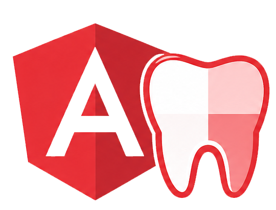

<p align="center">
  
</p>

# 🦷 Angular Advanced Odontogram

[](https://www.npmjs.com/package/angular-advanced-odontogram)
[](https://github.com/ZoliQua/Angular-Advanced-Odontogram/releases)
[](https://github.com/ZoliQua/Angular-Advanced-Odontogram/blob/main/LICENSE)

[](https://angular.dev/)
[](https://www.typescriptlang.org/)

---

> 🌐 **Languages:** 🇬🇧 [English](README-en.md) | 🇭🇺 [Magyar](README-hu.md) | 🇩🇪 [Deutsch](README-de.md) | 🇪🇸 [Español](README-es.md) | 🇫🇷 [Français](README-fr.md) | 🇮🇹 [Italiano](README-it.md) | 🇵🇱 [Polski](README-pl.md) | 🇧🇷 [Português (BR)](README-pt-br.md) | 🇸🇰 [Slovenčina](README-sk.md) | 🇷🇺 [Русский](README-ru.md) | 🇸🇦 [العربية](README-ar.md) | 🇨🇳 [简体中文](README-zh.md) | 🇯🇵 日本語（このファイル） | 🇰🇷 [한국어](README-ko.md)

---

## 📑 目次

- [📋 概要](#-概要)
- [📦 npm パッケージとして使う](#-npm-パッケージとして使う)
- [✨ 主な機能](#-主な機能)
- [📦 モジュール](#-モジュール)
- [🛠️ UI コントロール](#-ui-コントロール)
- [🦷 歯の種類と状態](#-歯の種類と状態)
- [⚙️ 設定](#-設定)
- [🖼️ SVG テンプレートシステム](#-svg-テンプレートシステム)
- [🔢 歯式表記](#-歯式表記)
- [🚀 使い方](#-使い方)
- [🔗 連携](#-連携)
- [🧪 テスト](#-テスト)
- [📖 API ドキュメント](#-api-ドキュメント)
- [📡 公開 API](#-公開-api)
- [💾 状態の永続化（localStorage）](#-状態の永続化localstorage)
- [💾 状態のエクスポート／インポート形式](#-状態のエクスポートインポート形式)
- [🖨️ エクスポート](#-エクスポート)
- [📁 フォルダ構成](#-フォルダ構成)
- [⚙️ 技術スタック](#-技術スタック)
- [📝 補足](#-補足)
- [🔒 セキュリティに関する注意](#-セキュリティに関する注意)
- [📖 引用方法](#-引用方法)

## 🇯🇵 日本語

### 📋 概要

本プロジェクトは、**Angular ＋ TypeScript** 向けの対話型で、ブラウザで動作する歯式図（オドントグラム）エディタであり、すっきりした UI で素早い歯式記録を支援します。修復物、う蝕、根管の状態、動揺度、その他の臨床的な詳細を表現するために階層化された SVG の歯テンプレートを描画し、同時に複数選択、選択フィルタ、定義済みの状態プリセットを提供します。

**これは [React Advanced Odontogram](https://github.com/ZoliQua/React-Advanced-Odontogram)（npm: [`react-advanced-odontogram`](https://www.npmjs.com/package/react-advanced-odontogram)）の公式 Angular 移植版です。** react-advanced-odontogram **v2.9.0**（エンジンのコミット `3321e63`）と機能パリティを保ち、ペイロードバージョンは **2.22** です — JSON と FHIR R4 のエクスポートは 2 つのライブラリ間で往復します。臨床エンジン（`projects/angular-advanced-odontogram/src/lib/core/`）は逐語的に共有されます — 歯式状態のロジック、歯周記録、診断コーディング、FHIR のエクスポート／インポート、i18n の文字列、ガイドツアー、SVG テンプレートは React 原版とバイト単位で同一であり、再同期のたびに固定した上流コミットから再コピーされます。Angular ネイティブなのはコンポーネントのシェル（`projects/angular-advanced-odontogram/src/lib/components/`）のみです。小さく、明示的に文書化された一連の相違（ブランド・識別文字列のみ — 本リポジトリの移植設計仕様を参照）が存在します。バージョンは React モジュールと歩調を合わせて付けられます。

---

*スクリーンショットは原版の React プロジェクトのものです — Angular 移植版は同一の UI を描画します。*

🔗 **ライブデモ:** https://angular-advanced-odontogram.vercel.app/

---

### 📦 npm パッケージとして使う

本歯式図は、自己完結した Angular コンポーネントライブラリとして npm で配布されています:
[`angular-advanced-odontogram`](https://www.npmjs.com/package/angular-advanced-odontogram)。

#### 要件
- **Angular 21.2 以上**（peer dependency として宣言 — アプリ側が提供します）。
- `exports` フィールドと ESM を理解する**バンドラ** — Angular CLI（`@angular/build`）は追加設定なしで要件を満たします。本パッケージは **ESM 専用**です。
- ツール実行のため Node **≥ 20.19.0** — ライブラリは `engines.node >= 20.19.0` を宣言しているため、より古い Node ではインストール時にエンジンの警告が出ます（`engine-strict` ではエラーになります）。これはビルドツールのみに関わる話で、コンポーネント自体はブラウザで動作します。

#### インストール

```bash
npm install angular-advanced-odontogram
```

#### 基本的な使い方

アプリのグローバルスタイルを設定している場所（例: `angular.json`）で、スタイルシートを**一度だけ**登録します:

```json
"styles": [
  "node_modules/angular-advanced-odontogram/styles.css",
  "src/styles.css"
]
```

そのうえで `OdontogramShellComponent` を描画します:

```ts
import { Component } from "@angular/core";
import { OdontogramShellComponent } from "angular-advanced-odontogram";

@Component({
  selector: "app-chart",
  imports: [OdontogramShellComponent],
  template: `
    <aao-odontogram-shell
      language="en"           
      numberingSystem="FDI"   
      [darkMode]="false"
    />
  `,
})
export class ChartComponent {}
```

`language` は `hu | en | de | es | it | sk | pl | ru | pt-br | zh | ar | fr | ja | ko` を受け付け、`numberingSystem` は `FDI | UNIVERSAL | PALMER` を受け付けます。

#### コンポーネントの入力

`OdontogramShellComponent` は制御コンポーネントです — すべての入力は Angular の `input()` シグナルで、いずれも任意であり、省略するとエンジン自身の既定値にフォールバックします。よく使うものは次のとおりです:

| 入力 | 型 | 既定値 | 説明 |
|------|------|---------|-------------|
| `language` | `Language` | `"hu"` | UI の言語（`hu`/`en`/`de`/`es`/`it`/`sk`/`pl`/`ru`/`pt-br`/`zh`/`ar`/`fr`/`ja`/`ko`）。 |
| `numberingSystem` | `"FDI" \| "UNIVERSAL" \| "PALMER"` | `"FDI"` | 歯式表記の方式。 |
| `darkMode` | `boolean` | `false` | ダークテーマの切り替え。 |
| `readOnly` | `boolean` | `false` | すべての編集を無効化（閲覧専用）。 |
| `themeConfig` | `OdontogramThemeConfig` | — | テーマの CSS 変数（`--odon-*`）、歯のアートワークのパレット（`tooth`、`tokens`）、選択のハイライト（`selection`）を上書きします — [連携](#-連携)を参照。 |
| `plugins` | `OdontogramPlugin[]` | — | 独自の状態プラグイン／追加レイヤーを登録。 |
| `toothTemplates` | `ToothTemplateOverrides` | — | 工場出荷の描画の代わりにホストが供給する歯の描画（SVG テキスト）。形態プロファイルごとに解決されます — テンプレートから `setToothTemplateOverrides()` を使う慣用的な方法です。すべてのテンプレートは検査されます。拒否されたテンプレートは工場出荷の描画を保ち、`getToothTemplateRejections()` で一覧できます。 |
| `enableNotes` | `boolean` | `false` | 歯ごとのメモを有効化。 |
| `enableIcdas` | `boolean` | `false` | ICDAS II のう蝕評価を有効化。 |
| `fillingComplexity` | `"complex" \| "simple"` | `"complex"` | 充填カードの詳細度: `"simple"`（歯ごとに 1 材料）または `"complex"`（面ごとの材料）。 |
| `fillingDefectEnabled` | `boolean` | `true` | 充填カードで充填物の欠陥所見を有効化。 |
| `fillingMaterialAvailability` | `Record<string, boolean>` | すべて利用可 | `amalgam`/`composite`/`gic`/`temporary` に対する真偽値マップとして、利用可能な充填材料を指定（未知のキーは無視）。 |
| `fissureSealingEnabled` | `boolean` | `true` | 充填カードで小窩裂溝填塞を有効化。 |
| `screenToothSpacing` | `"wide" \| "normal" \| "close"` | `"normal"` | 画面上の歯と歯の間隔。 |
| `screenToothNumberSize` | `"small" \| "normal" \| "xlarge"` | `"normal"` | 画面グリッドにおける歯番号の大きさ。 |
| `selectionColor` | `string` | `"#3b7bff"` | 選択リングの色（`#rrggbb`）。`themeConfig.selection.color` より優先されます。 |
| `selectionBorderStyle` | `"solid" \| "dashed" \| "dotted"` | `"dashed"` | 選択リングの線種。`themeConfig.selection.borderStyle` より優先されます。 |
| `toothInfo` | `boolean` | `true` | 歯の情報パネルを表示。 |
| `languageChange` / `numberingChange` / `darkModeChange`（出力） | `output<T>` | — | 利用者が UI から設定を変更したときに発火。 |
| `fillingComplexityChange` / `fillingDefectEnabledChange` / `fillingMaterialAvailabilityChange` / `fissureSealingEnabledChange`（出力） | `output<T>` | — | 利用者が設定 → 充填で該当設定を変更したときに発火。 |

より細かい詳細度の入力（`pulpDetailLevel`、`secondaryCariesMode`、`rootCariesMode`、`radiographicDepthMode`、`cariesDepthEnabled`、`wearDetailLevel`、`discolorationDetailLevel`、`surfaceNotation`、`showStatusCard`、`showOrthoCard`）も受け付けます — 完全で型付きの一覧は `odontogram-shell.component.ts` を参照してください。

上記 4 つの充填関連の入力は**復元専用**です: 省略した入力はエンジンに書き込みません（マウント前の命令的な `setFillingComplexity()` 呼び出しは保持されます）。一方、与えた入力はエンジンと設定モーダルの状態を同時に書き換えるため、モーダルが古い値を表示することはありません。`fillingMaterialAvailability` は正規化したシリアライズ済みキーに対して差分適用されるため、内容が同一の新しいオブジェクトリテラルで再レンダリングしてもエンジンへの再書き込みは起きません。対応する `*Change` 出力は設定 → 充填から発火します — 設定を永続化するホストのための書き戻し経路です。

#### 公開 API（名前付きエクスポート）

`OdontogramShellComponent` は名前付きエクスポートです。命令的な状態 API、単独利用できる `PerioChartComponent`、ガイドツアー、そしてすべての公開型は、同じエントリポイントからの名前付きエクスポートです:

```ts
import {
  OdontogramShellComponent,
  PerioChartComponent,          // standalone periodontal chart
  // read state
  getOdontogramSummary,
  getToothStateSummary,
  onStateChange,                // subscribe to state changes
  // export / import
  exportFhir,                   // HL7 FHIR R4 bundle
  exportSvg, exportImage,       // vector / raster chart export
  setImportFormat,
  // control
  setReadOnly, getReadOnly,
  clearSelection, getSelectedTeeth,
  registerPlugins, setPluginState, getPluginState,
  startIntroTour,               // launch the onboarding tour
  // …and many more setX/getX settings functions
} from "angular-advanced-odontogram";
```

全体（100 を大きく超える関数と型 — `OdontogramSummary`、`OdontogramThemeConfig`、`OdontogramPlugin`、`FhirExportOptions`、`PdfSettings`、`PerioViewMode` など多数）は同梱の `.d.ts` 型定義で完全に型付けされています。精選した参照表は後述の [公開 API](#-公開-api) にあります。

#### 組み合わせ可能なサーフェス（上級）

`OdontogramShellComponent` はサポート対象のオールインワンコンポーネントであり、追加の設定を必要としません。歯式図の各領域を独自レイアウトの別の場所に配置したい場合は、シェルの 4 つの UI サーフェスもエクスポートされており、1 つの `OdontogramUiService` の下で組み合わせられます。いずれもそのインスタンスが所有する単一のセッションを共有します:

```ts
import { AfterViewInit, Component, OnDestroy, inject } from "@angular/core";
import {
  OdontogramUiService,
  OdontogramTopbarComponent,
  OdontogramChartSurfaceComponent,
  ToothInfoSurfaceComponent,
  ToothControlsSurfaceComponent,
} from "angular-advanced-odontogram";

@Component({
  selector: "app-workspace",
  imports: [
    OdontogramTopbarComponent,
    OdontogramChartSurfaceComponent,
    ToothInfoSurfaceComponent,
    ToothControlsSurfaceComponent,
  ],
  providers: [OdontogramUiService],   // one instance = one session, scoped to this host
  template: `
    <my-header-area><aao-odontogram-topbar /></my-header-area>
    <my-main-area>
      <aao-odontogram-chart-surface />
      <aao-tooth-info-surface />
    </my-main-area>
    <my-side-panel><aao-tooth-controls-surface /></my-side-panel>
  `,
})
export class WorkspaceComponent implements AfterViewInit, OnDestroy {
  protected readonly ui = inject(OdontogramUiService);

  constructor() {
    // Every `OdontogramUiConfig` field is optional — a zero-config
    // `configure()` call gives a standalone session with the same defaults
    // `OdontogramShellComponent` itself falls back to (language "en"/"hu"
    // depending on host document, "FDI" numbering, light mode, ...). Pass
    // only the Signals/callbacks you want to override, e.g.
    // `{ darkMode: this.darkMode, onDarkModeChange: (v) => ... }`.
    this.ui.configure();
  }

  ngAfterViewInit(): void { this.ui.init(); }
  ngOnDestroy(): void { this.ui.destroy(); }
}
```

`OdontogramUiService` は `OdontogramShellComponent` の入力と同じ設定の形を取ります（その `configure()` メソッドは `Signal`／コールバックからなる `OdontogramUiConfig` オブジェクトを受け取り、各フィールドは任意で、上流と同じ既定値を持ちます）。現在の制約: 1 ページに `OdontogramUiService` のインスタンスは 1 つだけです（エンジンはモジュールレベルのシングルトンです）。サーフェスは必要に応じてマウント／アンマウントできます。`OdontogramShellComponent` 自体は変わっていません — まさにこの組み合わせを既定の配置で構成したものであり、依然として自身の入力からすべてのフィールドを明示的に配線しています。

さらに細かく組み合わせたい場合、個々のコントロールカードもエクスポートされています:

| コンポーネント | セレクタ | 対象 |
|---|---|---|
| `StatusesCardComponent` | `aao-statuses-card` | 全顎の状態・プリセットのコントロール（リセット、乳歯列／混合歯列、無歯顎、状態の追加プリセット） |
| `ToothDetailsCardComponent` | `aao-tooth-details-card` | 基本の行（歯の選択／歯質）、破損歯冠のチェックボックス、歯冠が必要／再製が必要のトグル |
| `CariesCardComponent` | `aao-caries-card` | う蝕深さのモード、歯冠下う蝕、根面う蝕の重症度、面ごとのう蝕ピッカー |
| `FillingsCardComponent` | `aao-fillings-card` | 充填材料、面ごとの充填ピッカー ＋ 欠陥、二次う蝕・欠陥のヒント注記 |
| `RootPeriodontiumCardComponent` | `aao-root-periodontium-card` | 歯髄／根管の状態、根尖診断、吸収、動揺度、インプラント周囲の状態 |
| `OrthodonticsCardComponent` | `aao-orthodontics-card` | 装置、移動、垂直的移動、捻転 |
| `SurfaceCrossComponent` | `aao-surface-cross` | う蝕・充填カードが内部で用いる共通の B／M／O／D／L 十字選択ウィジェット |
| `DiagnosesCardComponent` | `aao-diagnoses-card` | 歯ごとの ICD-10／BNO-10／ICD-10-CM／SNOMED の診断コーディング — その歯から導かれた診断を確認し、調整できます（導かれたものを抑制する、チャートが表現していないものを追加する） |

各カードは自己完結した宣言的コンポーネントで、`inject(OdontogramUiService)` とエクスポートされた `engineState()` ヘルパー（任意のエンジンの getter の読み取りをシグナルとして返し、コア自身の変更通知バスで最新に保ちます）を通じて共有セッションを読み書きします。あるレイアウトで必要なカードだけを、任意の配置で、1 つの `OdontogramUiService` の下にマウントしてください。`CreditsModalComponent`（`aao-credits-modal`、トップバーの「概要とクレジット」ポップアップ）と `CaseDiagnosesModalComponent`（`aao-case-diagnoses-modal`、全顎の症例／領域の診断ポップアップ）もエクスポートされており、どちらも自前の開閉状態から駆動したいホストで利用できます。

```ts
import { engineState, OdontogramUiService, getOdontogramSummary } from "angular-advanced-odontogram";

// Anywhere inside an injection context under an `OdontogramUiService`:
readonly summary = engineState(getOdontogramSummary); // Signal<OdontogramSummary>, kept fresh automatically
```

#### ホストテスト用の DI 継ぎ目

2 つの `InjectionToken` により、ホストアプリは副作用のあるエンジン呼び出しを自身のテストで上書きできます（どちらも本番では実際のエンジン呼び出しが既定で、いずれも `providedIn: "root"` です）:

| トークン | 上書き対象 | 構造 |
|---|---|---|
| `ODONTOGRAM_ENGINE_LIFECYCLE` | `initOdontogram()` / `destroyOdontogram()`。`OdontogramShellComponent` の `ngAfterViewInit()`/`ngOnDestroy()` から呼ばれます | `{ init: () => Promise<void>; destroy: () => void }` |
| `EXPORT_PDF_FN` | `exportPdf(opts)`。「エクスポート」で `ExportOptionsModalComponent` から呼ばれます | `(opts: PdfExportOptions) => Promise<void>` |

どちらも存在する理由は、実際の関数がヘッドレスなテスト環境では完全に提供できない DOM／canvas／`jsPDF` の内部に触れるからです — ホストアプリ自身のコンポーネントテストでは、Angular の `TestBed` の provider 配列を通じて上書きしてください。

#### 重要な注意と現時点の制約
- **ESM 専用** — 本パッケージは単一の ES モジュール（`ng-packagr` でビルド）と型定義のエントリを公開します。バンドラのモジュール解決を対象としており、CommonJS ビルドはありません。
- **スタイルシートは別** — `angular-advanced-odontogram/styles.css` を一度**必ず**登録してください。自動では注入されません。スタイルは `.odontogram-root` 配下にスコープされたグローバル CSS で、`--odon-*` CSS 変数で制御します。
- **SSR / クライアント専用** — 本コンポーネントはマウント時に DOM を読むため、ブラウザで動作する必要があります。ブラウザ側でのみ描画してください。
- **アセットは自己完結** — 歯とアイコンの SVG はビルド時にバンドルへインライン化されます（生成された TypeScript モジュール、`npm run gen:assets`）。**実行時のアセット取得はなく**、設定も、アプリの public フォルダへの追加コピーも不要です。
- **オンデマンド読み込み** — 初期バンドルに含まれるのは英語と `classic` の歯形態アートワークのみです。他の 13 の UI 言語テーブルと `measured` 形態プロファイルのアートワークは別の遅延チャンクで、ホストが最初にそれらへ切り替えた時点で取得されます（それぞれ `[language]` / `I18nService.setLanguage()`／言語メニュー、および `setToothAnatomy("measured")`／設定 → 歯式図 → 歯の形態に対応します）。2.6.0 の分割はデモの主チャンクを 3.12 MB から 1.25 MB へ、初期合計を 3.21 MB から 1.33 MB へ削減しました。2.7.0 ではトークンで着色されたアートワークにより両者がわずかに 1.29 MB と 1.38 MB へ増え、遅延の measured チャンクは形態の完成に伴い 1.2 MB から 4.0 MB へ増えました — ホスト側で設定することは何もありません。2.8.0 ではそれぞれ 1.30 MB と 1.39 MB、遅延の measured チャンクは 3.9 MB です。2.9.0 では初期の数値は 1.30 MB と 1.39 MB のまま変わりません。日本語、韓国語とそれらの 2 つの PDF フォントはすべて遅延チャンクで（韓国語フォント 3.24 MB、日本語フォント 289 kB、ロケールテーブル 87 kB と 79 kB）、いずれも初期バンドルには含まれません。遅延の measured チャンクは 3.89 MB です。
- **本リリースでは 1 ページに 1 インスタンス** — エンジンの状態はモジュールレベルのシングルトンなので（React 原版と同じ）、同一ページに 2 つの `<aao-odontogram-shell>` を描画すると 1 つのチャートの状態を共有してしまいます。
- **歯テンプレートの上書きと開いている歯周チャート** — `toothTemplates` 入力はエンジンの初期化前に適用され、後から変化したときには主グリッドを再構築します。すでに描画済みのチャートに対して命令的に `setToothTemplateOverrides()` を呼んでも再描画は**されません**。チャートのマウント前に呼ぶか、入力を使ってください。**すでに開いている**歯周チャートは `toothTemplates` の変化では再構築されません: 再度開くか形態プロファイルが変わるまで、以前の歯のアートワークを保ちます（これは React 原版と一致します）。

---

### ✨ 主な機能
- 🖱️ 素早い選択と複数選択（CMD／CTRL ＋ クリック）
- 🦷 歯種: 永久歯、乳歯、インプラント、歯肉下、欠損
- 🦷 歯質（修復物とは直交する軸）: 健全、残根（radix）、破損、支台歯形成済み
- 👑 修復物は種類 × 材料で指定: クラウン／インレー／アンレー／ラミネートベニア／ブリッジを e.max、金、グラディア、ジルコニア、メタル、メタルセラミック、テレスコープ、暫間のいずれかで（アンレーは咬合面ビュー専用）— クリック数を抑えた「固定: クラウン – …」の統合ピッカーから選択します。従来の `metal` クラウンは `metal-ceramic`（メタルセラミック）へ移行します。インプラントも同じ種類 × 材料モデルを用い、インプラントコネクタ層と合成されます。ピッカーは歯種でスコープされます: インプラントはクラウン／ブリッジのみ（加えて後述の 5 つのアタッチメント）、欠損歯はブリッジのポンティックのみ（加えて部分床／全部床）、`radix`（残根）の歯質では修復物コントロールそのものを隠します（残根に修復物は記録できません）
- 🦿 可撤性・アタッチメント系の補綴は専用の `prosthesis` 軸に（統合ピッカーの「可撤性:」項目）: インプラントのヒーリングアバットメント、ロケーター、ロケーター併用オーバーデンチャー、バー、バー併用オーバーデンチャー、そして歯牙支持の部分床・全部床義歯
- 🌉 ブリッジの歯はクラウンキャップとサドルコネクタの両方を描画します。複数歯にわたるブリッジスパンのオーバーレイは、連続するブリッジ歯（ポンティック＋支台歯）とその間の歯間部をまたいで、歯列弓を考慮した 1 本の連続コネクタを描き、PNG／JPG／SVG エクスポートにも含まれます
- 🔍 6 面のう蝕記録: 近心、遠心、頬側、舌側、咬合面、歯冠下
- 🪥 面ごとの充填材料: アマルガム、コンポジットレジン、グラスアイオノマー（GIC）、仮充填
- 🏥 「歯髄／根管の状態」を 1 つに統合したセレクタ（生活歯髄と治療済み／根管でグループ分け）: 根管の状態（薬剤根管充填、根管充填、不完全根管充填、グラスファイバーポスト、メタルポスト）と AAE の歯髄診断（`pulpDx`: 正常／可逆性／不可逆性歯髄炎／壊死）は相互排他です — 根管治療済みの歯（`endo` が設定済み）は生活歯髄の診断を併せ持てません。治療を設定すると `pulpDx` は `normal` に正規化されます。3 段階の歯髄詳細度設定（`pulpDetailLevel`: 簡易／AAE／実用ラテン語）を有効にすると、`pulpLatin` を介して 9 種の実用ラテン語の歯髄サブタイプが選べます
- 🦴 根尖診断（`apicalDx`: 症状のある／ない根尖性歯周炎、急性／慢性根尖性膿瘍、硬化性骨炎）が根尖グリフを直接駆動します。肉芽腫／嚢胞という病変サブタイプの修飾子は、症状のある／ない根尖性歯周炎の下でのみ表示されます
- 🩹 「歯根と歯周組織」カードを統合（根／根尖と歯周の所見を 1 つの折りたたみ可能なセクションに）
- ⚕️ 修飾: 根尖性炎症（欠損歯と抜歯創の歯にのみ表示。現存歯では非表示で、インプラントでは `periImplant` が担うため非表示）、歯周疾患、動揺度（M1／M2／M3、インプラントでは非表示）
- 🦷🔩 インプラント周囲の状態（`periImplant`: なし／粘膜炎／インプラント周囲炎 軽度・中等度・重度）— 2018 年 World Workshop の病期分類に基づき、インプラントで専用セレクタとして表示されます
- 🏷️ 特別指標: 歯冠が必要、歯冠の再製が必要、閉鎖した欠損、抜歯予定、小窩裂溝填塞、コンタクトの喪失
- 👁️ 咬合面ビュー、第三大臼歯、骨、歯髄の表示切り替え
- 🔢 12 種の選択フィルタ（すべて、現存歯、永久歯、乳歯、インプラント、欠損、上顎／下顎、前歯／大臼歯）
- 📊 定義済みの状態プリセット（リセット、乳歯列、混合歯列、無歯顎）
- 📦 22 種の定義済み修復テンプレート（ブリッジ、可撤性義歯、インプラント併用のバーオーバーデンチャー）
- 💾 状態の JSON エクスポート／インポート（バージョン 2.22。旧来の 1.4 および 2.0〜2.21 も読み込み可能で自動移行します。プラグインのカスタム状態と歯ごとのメモを含みます）
- 💽 オプトインの localStorage 永続化（`enablePersistence`／`disablePersistence`／`clearPersistedState`／`isPersistenceEnabled`）— 既定では無効。有効にすると現状チャート（および任意で計画チャート）を自動保存し、4 MB のサイズガードを備え、ストレージや解析のエラーは例外を投げずに `onError` コールバック（または `console.warn`）へ回されます
- 🔗 HL7 FHIR R4 エクスポート（歯ごとの Observation を収めた collection Bundle、永久歯**および**乳歯（51-85、インポート時に無損失で往復）の ISO 3950 歯コード、ローカルコードシステム、さらにオプトインの SNOMED CT オーバーレイ（設定 → 一般 → SNOMED CT））。重症度が記録されたう蝕コンポーネントはスコアリング体系のコーディングも併せ持ちます — 未充填（一次）面では ICDAS、充填済み（二次）面では CARS。治療計画も一緒に出力されます: 計画チャートが現状チャートと異なる場合、`exportFhir()` は計画された各介入について、その歯の意図された臨床状態でコード化された `ServiceRequest`（`intent: "plan"`）を 1 つ出力します。FHIR のインポートは計画レイヤーを無視し、計画レイヤーは JSON ペイロードで往復します
- ✚ う蝕と充填のための十字型の面選択 UI（B／M／O／D／L）— `SurfaceCrossComponent` として、組み合わせ可能なレイアウト向けにエクスポートされています
- 🧱 面ごとの修復材料（混在する充填、例: 頬側アマルガム＋遠心コンポジット）
- 🖼️ チャートの PNG／JPG／SVG 画像エクスポート（ダウンロード可能。PNG／JPG はベクター SVG からラスタライズ）
- 🦷 う蝕／二次う蝕は面ごとの状態機械です: 充填のない有う蝕面は一次う蝕として描画され（ICDAS に応じた不透明度）、その面に充填が存在すると代わりに二次う蝕として描画されます（CARS でスコア化）— 同じ面で両方が同時に有効になることはありません
- 🎯 面ごとの統一重症度（`cariesSeverity`、0–6）: 一次面では ICDAS の深さとして、二次面では名前付きの CARS スコア（健全 … 広範な齲窩）として読まれ、その面の現在の状態に関係するスケールだけを表示する文脈依存のポップアップから入力します
- 🌱 根面う蝕（`rootCaries`: なし／活動性／停止性／齲窩を伴う活動性）。専用の根面う蝕アートワーク層を重症度に応じた不透明度で有効化します
- 📡 エックス線的う蝕深さ（`radiographicDepth`: 面ごとに なし／E1／E2／D1／D2／D3）。視覚的な ICDAS／CARS 重症度スケールとは独立で、バッジとして表示され、専用の FHIR Observation で往復します
- 🎚️ 3 つのう蝕粒度設定（`secondaryCariesMode`、`rootCariesMode`、`radiographicDepthMode`）と `cariesDepthEnabled` トグル。保存値を失うことなく、各スケールをより単純なピッカー表示に畳めます
- 🩹 充填パネルの二次う蝕サマリー行: 二次う蝕がある選択中の歯とその面を列挙します
- 🪛 面ごとの充填物の欠陥（`fillingDefect`: なし／辺縁の欠陥／破折／摩耗）を直接修復に。二次う蝕とは独立です
- 🦷💥 臨床的な原因と部位で型付けされた歯の摩耗（`wearEdge`: なし／咬耗／酸蝕、切縁・咬合面。`wearCervical`: なし／摩耗／アブフラクション／酸蝕、歯頸部）
- 🎨 原因別の歯の変色（`discoloration`: なし／テトラサイクリン／歯のフッ素症／失活／外来性／その他）を永久歯と乳歯に
- ✏️ 前歯（切歯・犬歯）は UI 全体で咬合面を「切縁」と表示します。保存される面キーは `occlusal` のままです
- 🔤 位置を考慮した歯面表記（設定 → 歯の詳細 → 「歯面の表記」、簡易／完全、既定は完全）: 完全モードではう蝕・充填の面の記号とラベルが歯の解剖に従います — 咬合面 → 前歯では I／切縁、頬側 → 前歯では L／唇側、舌側 → 上顎では P／口蓋側、下顎では L／舌側
- 🦷↕️ 歯ごとの矯正記録（`orthoAppliance`: なし／ブラケット／バンド。`orthoDrift`: なし／近心／遠心。`orthoVertical`: なし／挺出／圧下。`orthoRotation`: 真偽値）を現存する天然歯（永久歯または乳歯）に
- 🪨 歯石、および内部性／外部（歯頸部）性で型付けされた歯根吸収（`resorptionType`）
- 📏 面ごとのう蝕深さ（表層／象牙質／深在性）、または `enableIcdas` による任意の ICDAS II スコアリング（0–6）
- 🩹 歯冠辺縁の漏洩トグル。クラウンまたはブリッジの修復がある場合のみ表示されます
- 🧬 標準準拠の診断コーディング（WHO ICD-10、常時有効）: 記録された各所見から ICD-10 コード付きの診断を導きます — う蝕（K02）、根面／セメント質および停止性う蝕（K02.2／.3）、歯髄炎と歯髄壊死（K04.0／.1）、根尖性歯周炎、根尖性膿瘍と歯根嚢胞（K04.4–.9）、咬耗／摩耗／酸蝕／アブフラクション（K03.0–.8）、歯石（K03.6）、吸収（K03.3）、変色（K00.3／K00.8／K03.7）、歯の喪失（K08.1）、残根（K08.3）、歯の破折（S02.5）— FHIR Condition として出力されます
- 🩺 歯ごとの**診断カード**（`DiagnosesCardComponent`、`aao-diagnoses-card`）: その歯から導かれた ICD-10 診断を確認し、調整できます — 誤って導かれたものを抑制し、チャートが表現していないものを追加できます。実効集合（導出 − 抑制 ＋ 追加）が FHIR エクスポートを駆動します。各行は ICD-10 コードを先に表示し（`K04.0 Pulpitis`）、行はコード順に並びます。**除外**トグルはチャートに触れずに診断を FHIR エクスポートから外し、**削除**（×）は診断*と*その基礎となる所見をまとめて取り除きます
- 🗂️ **症例／領域の診断**（`CaseDiagnosesModalComponent`、`aao-case-diagnoses-modal`）: 単一の歯に紐づかない全顎診断 — 不正咬合と顎関節（K07）、口腔の嚢胞（K09）、唾液腺疾患（K11）、口内炎と口腔粘膜（K12／K13）、歯列弓レベルの発育異常（K00）— それぞれ任意で左右（左／右／両側）を指定でき、歯式図／歯周状態トグルの横の**診断**ボタンから開きます
- 🌍 各国のコードパック（設定 → 一般 → 診断コード体系）: WHO ICD-10 を基礎に各国のコード体系を重ねます — BNO-10（ハンガリー、公式の NEAK 名称。WHO コードは保持）または米国 ICD-10-CM（コードを再マッピング、例: K07 の歯顎顔面域 → M26）
- 🔬 SNOMED CT オーバーレイ（設定 → 一般 → SNOMED CT、オプトイン、既定はオフ）: WHO および各国パックのコーディングと並べて SNOMED CT のコーディングを追加し、WHO ICD-10 コードを持たないインプラント周囲の所見もコード化します。ICD-10-CM と SNOMED のコンセプト ID は参考値・最善努力です — 臨床利用の前に公式の ICD-10-CM 一覧／SNOMED CT ブラウザで検証してください
- 🔁 FHIR Condition の往復: 診断は Observation と並んで FHIR `Condition` リソースとして出力され（歯に紐づくもの、および左右を bodySite に持つ患者レベルの症例病態）、インポートでそれらを再構成します — 症例病態は直接、歯ごとの追加／抑制の上書きは、インポートした Condition と再導出したチャートを差分して復元します
- ✅ HL7 バリデータでクリーンな FHIR エクスポート: Bundle の各エントリは決定的な `id` と絶対 `fullUrl` を持ち（`urn:uuid` のプレースホルダは使いません）、Bundle はエンジン自身の **CodeSystem** を埋め込むため、検証時にローカルコードが解決します。同じ CodeSystem と生成された ValueSet は、本リポジトリの `projects/angular-advanced-odontogram/src/lib/fhir/` に公開されています（FHIR エクスポートのオプションで `includeCodeSystem: false` を渡すと Bundle から省略できます）
- 🔄 歯周データは JSON ペイロードだけでなく FHIR のインポートでも往復します: インポータは LOINC 74029-0 の歯周パネルを各歯へ読み戻します — プロービング深さ、歯肉辺縁（CAL から再構成するため偽ポケットの値も保たれます）、BOP、根分岐部、O'Leary のプラーク、PI／GI とインプラントの mPI／mBI 指数、付着歯肉幅 — さらに症例レベルの喫煙状況と HbA1c のエビデンス Observation も含みます。排膿は唯一の例外で、JSON 専用のままです
- 🧰 統一されたトップバーのアイコン列と、タブ付きの設定ダイアログ（7 タブ — 一般／歯式図／歯周チャート／歯の詳細／う蝕／充填／エクスポート設定 — 後述の [設定](#-設定) を参照）
- 🦷🩺 設定 → 「歯周チャート」タブ: 利用可否のトグルに加えて、歯周チャートの行に対する 16 個の指数ごとの表示／非表示トグル（それぞれ説明付き）と、指数名を翻訳するか標準表記にするかの表示オプション
- 📋 歯の情報パネル: チャート全体のライブなテキストサマリー（歯数、現存／欠損の一覧、二次を含むう蝕、充填、根管治療、補綴、インプラント、歯周状態）— 既定で表示され、設定で切り替えられます
- 🗂️ 統合されたエクスポートのドロップダウン（状態 JSON／FHIR／PNG／JPG／SVG／PDF レポート）。各形式は設定 → 一般から個別に非表示にできます
- 📥 FHIR インポートを備えたインポートのドロップダウン（出力した Bundle を往復できます）。取り込み元ごとに個別に非表示にできます
- ⏳ 画像エクスポート中の進捗オーバーレイ
- 🎓 対話的な導入ツアー（シェルのコントロールをガイド付きで一巡します）
- 🔢 3 つの歯式表記（FDI、ユニバーサル、パルマー）
- 🌐 多言語対応 — 14 の UI 言語（HU/EN/DE/ES/IT/SK/PL/RU/PT-BR/AR/ZH/FR/JA/KO）と言語切り替え。アラビア語は UI を右から左に描画し、歯式／歯周チャートは左から右に固定します（機械翻訳であり、AR/ZH/FR/JA/KO は母語話者によるレビュー待ちです）。主バンドルに含まれるのは有効な言語のみ — 他のすべての言語は別チャンクで、最初に選択された時点で取得されます
- 🌗 トグルボタン付きのダークモード対応（単独利用、または親アプリからの制御）
- 🎨 テーマ設定できるチャートと歯のアートワーク: `themeConfig`（`colors`、`tooth`、`tokens`、`selection`）が `--odon-*` CSS カスタムプロパティを駆動します — 歯の描画そのもの（`--odon-tooth-body`、`--odon-milktooth-body`、`--odon-tooth-dentin`、…）も含みます。ダーク用のアートワークパレットも同梱です
- 🎨 インプラントと輪郭のテーマ設定: `--odon-implant-tint` は 1 つの CSS フィルタでインプラントのフィクスチャ全体をシフトさせ、`--odon-implant-fill` はフィクスチャを 1 色でフラットに塗り、歯の輪郭の幅もテーマ設定できます（`themeConfig.tooth.outlineWidth` → `--odon-tooth-outline-width`）。咬合面のシルエットもその幅に従います
- 🖌️ ホストが供給する歯の描画: `setToothTemplateOverrides()` と `toothTemplates` 入力が、フォークなしに工場出荷の SVG を形態プロファイルごとに差し替えます — すべてのテンプレートは描画できるようになる前に検査され（静かに清掃されるのではなく拒否されます）、`getToothTemplateRejections()` が何がなぜ拒否されたかを報告します
- 🩺 歯周チャートの修正: フォーカス中のセルはグリッドの再構築を越えて保たれるため、キーボードで記録する臨床医は位置を失いません。また UI 言語が変わるとグリッドはラベルを貼り替えます
- 📐 実測形態の完成: `measured` プロファイルは 40 の歯の位置すべてについて文献に基づき実測されたテンプレートを備え、乳歯は乳歯として描画され、歯冠と歯根には導出された象牙質コアが入ります。そのアートワークは別の遅延チャンクで、切り替えたときにのみ取得されます（設定 → 歯式図 → 歯の形態）
- ⚖️ `compareExams(before, after)` — 同一口腔の 2 つのエクスポート済み検査を比較します: 軸レベルの変化、部位ごとの歯周プロービング深さとアタッチメントレベルの変動（2 mm 以上の変化は印が付きます）、各検査の 2017 年分類。純粋関数で、ライブチャートには一切触れません
- 🖥️ API としてのチャート表示設定: 歯の間隔、歯番号の大きさ、選択の色と線種、歯の情報パネル（`get…`／`set…` の対と対応するシェルの入力）、さらに `getNumberingSystem()`
- 📱 モバイルのタッチ UX: タップで拡大するポップオーバー、長押しのコンテキストメニュー、ピンチズーム、WCAG 準拠の 44px タッチターゲット、歯列弓切り替えによるナビゲーション
- 🔌 カスタム SVG プラグインシステム: 視覚的オーバーレイの注入、歯ごとのカスタム状態、JSON エクスポート／インポートへの対応 — プラグインの `renderSvg()` 出力はライブチャートへの挿入前に DOMPurify（SVG プロファイル）で無害化されます。それでもプラグインは信頼されたコードとして実行されるため、信頼できる提供元のプラグインのみを読み込んでください
- ⚠️ 両立しない歯の状態の組み合わせに対する状態検証の警告
- 🏷️ 歯のタイルに自動で出る状態ツールチップ（有効なすべての状態を表示）
- 🩺 歯ごとのツールチップと全顎サマリーパネルが臨床所見の全体を表示します（歯髄／根尖診断、歯根吸収、インプラント周囲の状態、段階づけられた根面う蝕、歯石、歯冠辺縁の漏洩、破折、コンタクトの喪失、型付けされた切縁・歯頸部の摩耗）
- ♿ キーボードアクセシビリティ（WCAG）: ARIA の listbox／option ロール、Enter／Space での選択、矢印キーでの移動、focus-visible のアウトライン
- 🔒 読み取り専用モード: 印刷・レポート・閲覧用途のためにすべての操作を無効化
- ✨ 選択のアニメーション: 選択された歯の脈動する破線枠と発光するドロップシャドウ（prefers-reduced-motion に対応）
- 📝 歯ごとのメモ: ダブルクリックでメモを追加・編集、歯番号の横にメモアイコン、ホバーでメモ本文のツールチップ、全顎サマリーパネルの「個別メモ」行、PDF レポートへの収録、JSON エクスポート／インポート
- 🔀 現状 ↔ 計画のチャート分離: `現状 | 計画` トグルが、現在の**状態**チャートと**計画**（治療後に意図する状態）チャートを切り替えます。それぞれが独自の歯の状態を持ちます。エクスポート／インポートは常に現状チャートを対象とし、計画チャートは独自の API で個別に読み書きします（[公開 API](#-公開-api) を参照）。現状と異なる場合には、JSON エクスポートに追加の `plan` セクションとして含まれます
- 📝 「何が変わるか」ボックス: 計画が現状と異なるとき、歯ごと・治療軸ごとのすべての差分を列挙します。`getPlanChanges()` でプログラムからも取得できます
- 🅿️ 提案のスタイリング: 計画モードでは、計画が現状に対して**追加**する所見が、はっきりした破線で色味を帯びた「提案」の輪郭で描画されます
- 🚦 計画モードのゲート: 計画チャートは歯科医が*行える*ことだけを示します — 現状専用の所見（う蝕、摩耗、変色、歯周ブロック全体）は非表示になり、修復物、補綴、矯正、歯冠の必要・再製、抜歯予定は計画可能なままです


*スクリーンショットは原版の React プロジェクトのものです — Angular 移植版は同一の UI を描画します。*

- 🩺 歯周記録: 歯ごとに標準の 6 部位で**プロービング深さ**、**歯肉辺縁**、**プロービング時の出血**（＋排膿）を記録し、**クリニカルアタッチメントレベル（CAL ＝ PD ＋ 歯肉辺縁）**、歯肉退縮、全顎の **%BOP** を導出します。**グラフィカルな全顎歯周チャート**では、各歯列弓を頬側と口蓋（舌）側の 2 つの独立した SVG として描画し、赤い **CEJ 線**、数値付きのミリ単位ガイドグリッド、歯肉辺縁／ポケット深さの曲線を備え、**Miller 分類**と**プラーク／PI／GI／mPI／mBI** を歯ごとの解剖学的なひし形タイルとして担う中央の歯周指数バンドで上下に分けられます。入力はキーボードで自動送りでき、チャートは利用可能な幅いっぱいに動的に拡大縮小します。`歯式図 | 歯周状態` のビュー切り替えとして提示され、依然としてエクスポートされた `PerioChartComponent` から個別に呼び出せます。部位ごとの **FHIR** エクスポートは LOINC の歯周パネル（`74029-0`。PD `32910-2`、歯肉退縮 `32911-0`、CAL `32912-8`）経由です
- 🧪 歯式表記、翻訳、プリセット、多言語対応、シェル、テーマ、タッチ、プラグイン、アクセシビリティ、そして凍結された React コーパスに対する臨床軸・診断のパリティを網羅する広範な自動テスト群（[テスト](#-テスト) を参照）
- 📖 すべての公開エクスポートに JSDoc コメントを備えた TypeDoc API ドキュメント（`npm run docs`）

### 📦 モジュール
- 🦷 歯式図のグリッドと歯タイルの UI（`OdontogramChartSurfaceComponent`）
- 🎛️ コントロールと状態パネル（`ToothControlsSurfaceComponent` ＋ 8 つの宣言的カード）
- 🎨 SVG レイヤリングエンジンとテンプレート（フレームワーク非依存のコア、`core/odontogram.ts`）
- 🔢 歯の番号付けとラベルの対応（FDI／ユニバーサル／パルマー、`core/utils/numbering.ts`）
- 🌐 ローカライズ — 14 の UI 言語（HU/EN/DE/ES/IT/SK/PL/RU/PT-BR/AR/ZH/FR/JA/KO）。アラビア語（RTL）を含みます（`core/i18n/`、`I18nService`）
- 💾 状態のエクスポート／インポート
- 📋 状態の追加プリセット: 定義済みの修復テンプレート
- 🎨 テーマ設定: `--odon-*` CSS プロパティでカスタマイズできるカラーパレット
- 📱 モバイルのタッチ操作（タップで拡大、長押し、ピンチズーム、歯列弓切り替え）
- 🔌 カスタム SVG プラグインシステム
- ⚠️ 状態の検証とツールチップの仕組み
- ♿ キーボードアクセシビリティと ARIA 対応
- 🔒 読み取り専用モード
- ✨ 選択のアニメーション
- 📝 歯ごとのメモ機能
- 🧱 **組み合わせ可能な UI** — `OdontogramUiService`、`engineState()` ヘルパー、4 つの表示用サーフェス、8 つの宣言的コントロールカードが、いずれも独立してエクスポートされています（上記の [組み合わせ可能なサーフェス](#-npm-パッケージとして使う) を参照）
- 🧪 自動テスト群（Vitest のコーパス ＋ `ng test`。[テスト](#-テスト) を参照）

### 🛠️ UI コントロール

**🔝 トップバー**（`OdontogramTopbarComponent`）:
- 言語切り替え（HU/EN/DE/ES/IT/SK/PL/RU/PT-BR/AR/ZH/FR/JA/KO のドロップダウン）
- ダークモード切り替えボタン（太陽／月のアイコン。ライトとダークのテーマを切り替えます）
- 歯式表記の切り替え（FDI／ユニバーサル／パルマーのドロップダウン）
- 状態のエクスポート／インポートのボタン
- 設定（歯車アイコン）、クレジット・概要（情報アイコン）、GitHub へのリンク

**📊 チャートのヘッダー:**
- 咬合面ビューの切り替え
- 第三大臼歯の表示切り替え
- 骨の表示切り替え
- 歯髄の表示切り替え
- 選択解除のボタン

**🔍 選択フィルタ:**
- すべて選択／現存歯すべて／永久歯／乳歯／インプラント／欠損歯すべて
- 上顎を選択／上顎前歯 6 本／上顎大臼歯
- 下顎を選択／下顎前歯 6 本／下顎大臼歯

**📋 状態プリセット:**
- すべてリセット（口腔内をリセット）
- 乳歯列
- 混合歯列
- 無歯顎の切り替え

**📦 状態の追加プリセットのドロップダウン:**
- 上顎／下顎のジルコニアブリッジ（12-22、13-23、16-26、全歯列弓）
- 上顎／下顎のメタルブリッジ（12-22、13-23、16-26、全歯列弓）
- 上顎／下顎の部分床義歯
- 上顎／下顎の全部床義歯
- 上顎／下顎のインプラント併用バーオーバーデンチャー

**🦷 歯のエディタパネル**（`ToothControlsSurfaceComponent`。選択した歯に対して、折りたたみ可能なカードにまとめられています）:
- **状態カード:** 全顎のプリセットと状態の追加プリセット（`showStatusCard` で個別に表示／非表示）
- **歯の詳細カード:** 歯の選択（破損歯冠のバリエーションを含む基本の種類）、歯質、統合された「固定: …」／「可撤性: …」の修復ドロップダウン、歯冠辺縁の漏洩チェックボックス、破損歯冠の部位チェックボックス、歯冠が必要／歯冠の再製が必要のトグル
- **矯正カード:** 装置、近心／遠心への移動、垂直的移動、捻転のトグル — 現存する天然歯で表示されます（`showOrthoCard` で個別に表示／非表示）
- **う蝕カード:** う蝕深さのモードのドロップダウン、歯冠下う蝕のチェックボックス、根面う蝕の重症度ドロップダウン、そして B／M／O／D／L の面ごとのう蝕ピッカー（`SurfaceCrossComponent`。文脈依存の ICDAS 深さ／CARS ポップアップとエックス線的深さのバッジ付き）
- **充填カード:** 充填材料のドロップダウン、面ごとの充填ピッカー、面ごとの充填物欠陥インジケータ、二次う蝕と充填物欠陥のヒント注記
- **歯根と歯周組織のカード:** 統合された「歯髄／根管の状態」セレクタ、根尖診断のセレクタ、根尖病変のサブタイプセレクタ、歯根吸収の種類セレクタ、動揺度のセレクタ、インプラント周囲の状態セレクタ（インプラントのみ）
- **特別指標:** 抜歯予定／抜歯創、閉鎖した欠損、小窩裂溝填塞、コンタクトの喪失、歯石、パラパルパルピン、歯根端切除、ブリッジ支台歯

### 🦷 歯の種類と状態

**歯の選択（基本の種類）:**
| 値 | 説明 |
|---|---|
| `none` | 欠損歯 |
| `tooth-base` | 永久歯 |
| `milktooth` | 乳歯 |
| `implant` | 歯科インプラント |
| `tooth-under-gum` | 歯肉下（未萌出）の歯 |

**破損歯のバリエーション:**
`tooth-broken-inicisal`、`tooth-broken-distal-inicisal`、`tooth-broken-distal`、`tooth-broken-mesial-distal-inicisal`、`tooth-broken-mesial-distal`、`tooth-broken-mesial-inicisal`、`tooth-broken-mesial`、`no-tooth-after-extraction`

**歯質（永久歯）:**
`natural`（既定）、`radix`（残根）、`broken`、`crownprep`（支台歯形成済み）

**修復物の種類（永久歯）:**
`none`、`crown`、`inlay`、`onlay`（咬合面ビュー専用）、`veneer`、`bridge`

**修復物の材料（永久歯）:**
`none`、`emax`、`gold`、`gradia`、`zircon`、`metal`、`metal-ceramic`（従来の `metal` クラウンはここへ移行）、`telescope`、`temporary`

**修復物の選択肢は歯種でゲートされます**（`projects/angular-advanced-odontogram/src/lib/core/registry/restorations.ts` の `restorationOptions()`）: インプラントは `crown`／`bridge` の修復種類のみ（インプラントコネクタ層と合成）に加えて後述の 5 つの `prosthesis` アタッチメント項目、欠損歯は `bridge` のポンティックのみに加えて 2 つの可撤性義歯の `prosthesis` 項目、`radix` の歯質では修復物コントロールそのものを隠します。

**補綴装置**（`prosthesis`。直交する可撤性・アタッチメント軸。統合された修復ドロップダウンの「可撤性:」項目として表示されます）:
`none`、`healing-abutment`、`locator`、`locator-denture`、`bar`、`bar-denture`（インプラントのアタッチメント。オーバーデンチャーの有無あり）、`removable-partial`、`removable-full`（欠損歯の上の歯牙支持義歯）。1 本の歯は固定修復か補綴装置のいずれかを持ち、両方は持ちません — 一方を設定すると他方は解除されます。

**歯冠辺縁の漏洩**（`crownLeakage`。真偽値）: `restorationType` が `crown` または `bridge` のときのみ表示されます。

**根管の選択肢（永久歯）:**
`none`、`endo-medical-filling`、`endo-filling`、`endo-filling-incomplete`、`endo-glass-pin`、`endo-metal-pin`

**根管の選択肢（乳歯）:**
`none`、`endo-medical-filling`

`endo` と `pulpDx` は 1 つに統合された「歯髄／根管の状態」セレクタ（生活歯髄と治療済み／根管でグループ分け）で表示され、相互排他です — 治療済み（`endo != none`）の選択肢を選ぶと `pulpDx` は `normal` に戻り、歯髄診断を選ぶと `endo` は `none` に戻ります。

**充填材料（永久歯）:**
`amalgam`、`composite`、`gic`、`temporary`

**充填材料（乳歯）:**
`composite`、`gic`、`temporary`

**充填／う蝕の面:**
`mesial`、`distal`、`buccal`、`lingual`、`occlusal`、`subcrown`（う蝕のみ）

**修飾:**
`inflammation`（根尖性）、`parodontal`（歯周）、`mobility`（M1／M2／M3）

**根尖病変の種類**（`periapicalType`。根尖グリフを修飾し、症状のある／ない根尖性歯周炎の下でのみ表示されます）:
`none`、`granuloma`、`cyst` — 従来の `abscess` 値は依然として受け付け・保存されますが、ピッカーには提示されません

**歯髄診断**（AAE の用語。`pulpDx`）:
`normal`、`reversible-pulpitis`、`irreversible-pulpitis`、`necrosis` — `endo` と相互排他です

**歯髄診断、実用ラテン語**（`pulpLatin`。`pulpDetailLevel` が `latin` のときのみ歯髄ピッカーに表示されます）:
`none`、`pulpa-sana`、`hyperaemia-pulpae`、`pulpitis-acuta-serosa`、`pulpitis-acuta-purulenta`、`pulpitis-chronica-clausa`、`pulpitis-chronica-ulcerosa`、`pulpitis-chronica-hyperplastica`、`necrosis-pulpae`、`gangraena-pulpae`

**歯髄の詳細度**（`pulpDetailLevel`、全体設定）: `simple`、`aae`（既定）、`latin`

**根尖診断**（`apicalDx`。根尖グリフを駆動します）:
`normal`、`symptomatic-apical-periodontitis`、`asymptomatic-apical-periodontitis`、`acute-apical-abscess`、`chronic-apical-abscess`、`condensing-osteitis`

**歯根吸収の種類**（`resorptionType`）:
`none`、`internal`、`external-cervical`

**インプラント周囲の状態**（`periImplant`。インプラント専用、2018 年 World Workshop の病期分類）:
`none`、`mucositis`、`peri-implantitis-mild`、`peri-implantitis-moderate`、`peri-implantitis-severe`

**う蝕の重症度**（`cariesSeverity`。面ごとの統一フィールド、`0`–`6`）: 充填のない面では ICDAS のう蝕深さスケール（`superficial`／`dentin`／`deep`、`enableIcdas` が設定されている場合は生の ICDAS II コード `0–6`）として読まれ、充填のある面では名前付きの CARS スコア（`0` 健全 … `6` 広範な齲窩）として読まれます

**根面う蝕**（`rootCaries`）: `none`、`active`、`arrested`、`active-cavitated`

**エックス線的う蝕深さ**（`radiographicDepth`。面ごと）: `none`、`E1`、`E2`、`D1`、`D2`、`D3`

**う蝕の粒度設定**（全体）: `secondaryCariesMode`（`simple`／`standard`／`full`、既定 `standard`）、`rootCariesMode`（`simple`／`severity`、既定 `simple`）、`radiographicDepthMode`（`off`／`threeLevel`／`detailed`、既定 `off`）、`cariesDepthEnabled`（真偽値、既定 `true`）

**特別指標:**
`crownNeeded`、`crownReplace`、`missingClosed`、`extractionPlan`、`extractionWound`、`bridgePillar`、`fissureSealing`、`contactMesial`、`contactDistal`、`endoResection`、`calculus`、`parapulpalPin`

**歯の摩耗**（`wearEdge`、`wearCervical`。部位ごとの臨床的な型。歯種が tooth-base ＋ 修復物なし ＋ 歯質が健全であることを条件とします）:
`wearEdge`: `none`、`attrition`、`erosion` — `wearCervical`: `none`、`abrasion`、`abfraction`、`erosion`

**変色**（`discoloration`。歯ごとの原因。天然の tooth-base または乳歯 ＋ 修復物なし ＋ 歯質が健全であることを条件とします）:
`none`、`tetracycline`、`fluorosis`、`nonvital`、`extrinsic`、`other`

**充填物の欠陥**（`fillingDefect`。面ごと、二次う蝕とは独立した直接修復の所見）:
`none`、`marginal`、`fracture`、`wear`

**矯正**（`orthoAppliance`、`orthoDrift`、`orthoVertical`、`orthoRotation`。歯ごと、現存する天然歯を条件とします）:
`orthoAppliance`: `none`、`bracket`、`band` — `orthoDrift`: `none`、`mesial`、`distal` — `orthoVertical`: `none`、`extrusion`、`intrusion` — `orthoRotation`: 真偽値

**歯の詳細／表記の設定**（全体のセッション設定、設定 → 歯の詳細）: `wearDetailLevel` と `discolorationDetailLevel`（`ToothDetailLevel`: `simple`／`complex`、既定 `complex`）、および `surfaceNotation`（`simple`／`full`、既定 `full`）

### ⚙️ 設定

トップバーの歯車アイコンから開きます（`SettingsModalComponent`）。フォーカストラップされた ARIA の `dialog` で、7 タブのレイアウトです（Esc または背景クリックで閉じ、矢印キーでタブを切り替えます）。このダイアログはホストが供給する `SettingsState` に対する純粋なビューであり、設定の状態そのものは保持しません。注記のない限り、すべての設定はセッションレベルの UI 状態にすぎません — どれも歯ごとのデータやエクスポートのペイロードを書き換えません。

- **一般:** 歯式表記（FDI／ユニバーサル／パルマー）、言語、ダーク／ライトのテーマ、形式ごとのエクスポートの利用可否（PNG／JPG／SVG／PDF — オフにすると対応するエクスポートメニュー項目が隠れ、PDF がオフのときはエクスポート設定タブが無効になります）、取り込み元ごとのインポートの利用可否（状態 JSON／FHIR）、診断コード体系（なし／BNO-10／ICD-10-CM）、そしてオプトインの SNOMED CT オーバーレイのトグル
- **歯式図:** 画面上のレイアウト — 歯の間隔、歯番号の大きさ、選択の色と線種。歯の情報パネルの表示。計画モードの利用可否。歯の形態プロファイル（既定の `classic`／`measured` — 文献に基づき実測された 40 種の歯テンプレートを、2 つの歯列弓・歯ごとの幅のレイアウトで描画し、実行時に切り替え可能です。そのアートワークは別の遅延チャンクで、切り替えたときにのみ取得されるため、クラシックの既定にコストはかかりません）。状態カードと矯正カードの表示
- **歯周チャート:** タブの残りとシェルの歯周への入口をゲートする利用可否のトグル。歯周のビューモード（`toggle`／`popup`）。5 グループにわたる 16 個の指数ごとの表示／非表示トグル（ポケット: PD／GM／CAL／BOP・口腔衛生: プラーク／PI／GI・歯肉粘膜: CEJ の視認性／歯根の陥凹／KG／GT・支持組織: 根分岐部／動揺度／Miller 分類・インプラント周囲: mPI／mBI）。指数名を翻訳するか標準表記にするかの表示モード（標準表記＝どの UI 言語でも固定の英語／ラテン語の学術名。ツールチップは常にローカライズされたままです）
- **歯の詳細:** 歯髄の詳細度（簡易／AAE／実用ラテン語、既定 AAE）、摩耗の詳細度と変色の詳細度（簡易／詳細、いずれも既定は詳細）、歯面の表記（簡易／完全、既定は完全）、歯ごとのメモのトグル
- **う蝕:** ICDAS II スコアリングのトグル、う蝕深さのトグル、根面う蝕の粒度（簡易／重症度）、二次／CARS の粒度（簡易／標準／完全）、エックス線的深さの粒度（オフ／3 段階／詳細）
- **充填:** 充填の詳細度（詳細／簡易）、充填物の欠陥所見のトグル、材料ごとの利用可否（amalgam／composite／gic／temporary）、小窩裂溝填塞のトグル
- **エクスポート設定:** PDF レポートの完全な設定（`PdfSettings` — 後述の [エクスポート](#-エクスポート) を参照）— 一般タブで PDF エクスポートがオフのときは無効になります（一般タブの内容にフォールバックします）

### 🖼️ SVG テンプレートシステム

**歯のテンプレート**（`projects/angular-advanced-odontogram/src/lib/core/assets/teeth-svgs/` 内）:
| テンプレート | 使用する歯 |
|---|---|
| `11.svg` | 11, 12, 21, 22, 31, 32, 41, 42（切歯） |
| `13.svg` | 13, 23, 33, 43（犬歯） |
| `14.svg` / `14_occl.svg` | 14, 15, 24, 25, 34, 35, 44, 45（小臼歯） |
| `16.svg` / `16_occl.svg` | 16, 17, 18, 26, 27, 28, 36, 37, 38, 46, 47, 48（大臼歯） |

テンプレートは下顎では 180 度回転し、左側では水平に反転します。並列の `measured/` サブフォルダには、`measured` 形態プロファイルが 2 つの歯列弓・歯ごとの幅のレイアウトで描画する、文献に基づき実測された 40 種の歯テンプレートが入っています（設定 → 歯式図 → 歯の形態）。

**アイコン SVG**（`projects/angular-advanced-odontogram/src/lib/core/assets/icon-svgs/` 内）:
`icon_8.svg`（第三大臼歯）、`icon_gum.svg`（骨）、`icon_no_selection.svg`（選択解除）、`icon_occl.svg`（咬合面ビュー）、`icon_pulp.svg`（歯髄）

どちらのフォルダも `npm run gen:assets` によって生成された TypeScript モジュール（`core/generated/teeth-svgs.ts`、`core/generated/icon-svgs.ts`）へコンパイルされます — 元の SVG を編集したらこれを実行して、バンドルされるインライン文字列を同期させてください。

**ホストが供給する描画。** ホストアプリは、ライブラリをフォークすることなく、`OdontogramShellComponent` の `toothTemplates` 入力（慣用的な方法）または命令的な `setToothTemplateOverrides()` を通じて、これらのテンプレートを独自の SVG に置き換えられます。上書きは**形態プロファイルごと**にキー付けされます。テンプレート番号 N は `classic` と `measured` で別の描画だからです:

```ts
import { Component } from "@angular/core";
import {
  OdontogramShellComponent,
  setToothTemplateOverrides,
  getToothTemplateRejections,
} from "angular-advanced-odontogram";
import type { ToothTemplateOverrides } from "angular-advanced-odontogram";

@Component({
  selector: "app-custom-teeth",
  imports: [OdontogramShellComponent],
  // The idiomatic way: bind the input. It is applied before the engine
  // initialises, so the first grid is already drawn with your templates.
  template: `<aao-odontogram-shell [toothTemplates]="teeth" />`,
})
export class CustomTeethComponent {
  readonly teeth: ToothTemplateOverrides = {
    classic:  { templates: { 11: myIncisorSvg }, templatesOccl: { 16: myMolarOcclusalSvg } },
    measured: { templates: { 11: myMeasuredIncisorSvg } },
  };
}

// Imperative alternative — call it before the chart mounts:
setToothTemplateOverrides({ classic: { templates: { 11: myIncisorSvg } } });
getToothTemplateRejections(); // [] — everything was accepted
setToothTemplateOverrides(null); // back to the factory artwork
```

各プロファイルは 4 つのマップを取ります — `templates`、`templatesOccl`、そして乳歯を独自のアートワークとして描画するプロファイル（`measured`）では `primaryTemplates` と `primaryTemplatesOccl`。上書きは形態プロファイルの変更を越えて保持され（各プロファイルが自分の分を解決します）、`null` は工場出荷のアートワークを復元します。何も供給しなければ、エンジンは従来どおりの描画をそのまま提供します。

テンプレートはライブ DOM に入る信頼できないマークアップなので、**描画できるようになる前に検査されます** — 後述のセキュリティに関する注意を参照してください。拒否されたテンプレートは `getToothTemplateRejections()` が `{ profile, set, key, reason }[]` として一覧し、工場出荷の描画がそのまま残ります: チャートが歯のない状態になることはありません。

### 🔢 歯式表記

**FDI（ISO 3950）:** 永久歯 11-18、21-28、31-38、41-48。乳歯 51-55、61-65、71-75、81-85。値: `"FDI"`。

**ユニバーサル（米国）:** 永久歯は 1-32 の番号。乳歯は A-T の文字。値: `"UNIVERSAL"`。

**パルマー（ジグモンディ・パルマー）:** 象限＋位置の形式（例: UR-1、LL-5）。乳歯は象限ごとに A-E の文字を使います。値: `"PALMER"`。

`NumberingSystem`（`core/utils/numbering.ts`）はちょうど `"FDI" | "UNIVERSAL" | "PALMER"` のユニオンです。エクスポートされた `toLabel(fdiTooth, system)` は FDI の歯番号を指定した体系のラベルへ変換します（例: `toLabel(14, "PALMER")` → `"UR-4"`）。

### 🚀 使い方
開発（デモアプリを実行します）:
```bash
npm install
npm start           # ng serve
```
ライブラリのビルド:
```bash
npm run build:styles && npx ng build angular-advanced-odontogram
```
デモアプリのビルド:
```bash
npm run build:demo
```

### 🔗 連携
本コンポーネントはどの Angular アプリにも埋め込めます:
```ts
import { Component } from "@angular/core";
import { OdontogramShellComponent } from "angular-advanced-odontogram";
import type { Language } from "angular-advanced-odontogram";
import type { NumberingSystem } from "angular-advanced-odontogram";

@Component({
  selector: "app-host",
  imports: [OdontogramShellComponent],
  template: `
    <aao-odontogram-shell
      [language]="language"
      (languageChange)="onLanguageChange($event)"
      [numberingSystem]="numbering"
      (numberingChange)="onNumberingChange($event)"
      [darkMode]="darkMode"
      (darkModeChange)="onDarkModeChange($event)"
    />
  `,
})
export class HostComponent {
  language: Language = "en";
  numbering: NumberingSystem = "FDI";
  darkMode = false;

  onLanguageChange(lang: Language) { this.language = lang; console.log(lang); }
  onNumberingChange(system: NumberingSystem) { this.numbering = system; console.log(system); }
  onDarkModeChange(dark: boolean) { this.darkMode = dark; console.log(dark); }
}
```

**ダークモードの連携:**
- **単独モード:** `darkMode` を省略します — コンポーネントがトップバーの切り替えボタンで自身のテーマ状態を管理し、ホストのルート要素に `.dark` クラスを付け外しします。
- **制御モード:** `[darkMode]` と `(darkModeChange)` をバインドします — 親アプリがテーマを制御します。切り替えボタンは表示されますが、内部状態を管理する代わりに `darkModeChange` を発火します。`<html>` の `.dark` クラスの付け外しは親の責任です。

**カスタムテーマ:**
```ts
import type { OdontogramThemeConfig } from "angular-advanced-odontogram";

@Component({
  template: `<aao-odontogram-shell [themeConfig]="theme" />`,
})
export class ThemedHostComponent {
  readonly theme: OdontogramThemeConfig = {
    colors: {
      accent: "#e74c3c",
      background: "#fafafa",
      text: "#222222",
    },
    // The tooth drawings are themable too. Omitted keys keep the colour the
    // artwork is drawn in, so this is additive: set nothing and nothing moves.
    tooth: {
      // `body` is the tooth's own silhouette, crown AND root. In `classic`
      // that is the whole tooth; in `measured` it is the outer shell around
      // `dentin`, which takes its colour unless you set it.
      body: "#f2f2f2",
      dentin: "#e6d7bf",
      outline: "#b9bdc2",
      // Not a colour: the width of that outline, in SVG user units.
      outlineWidth: "1.4",
      gum: "#e8a5a0",
      bone: "#f6e6c8",
    },
    // Any palette token by name, for the surfaces `tooth` does not cover
    // (per-material restoration colours, gradient stops).
    tokens: {
      "--odon-rest-gold": "#d4af37",
      // Not a colour: a CSS filter over the implant fixture as a whole.
      "--odon-implant-tint": "hue-rotate(205deg) saturate(.85)",
      // …or one flat colour over the whole fixture, instead of the tint.
      "--odon-implant-fill": "#8fa6b8",
    },
    // The selection highlight. Applied through the session setters,
    // not as a CSS custom property.
    selection: { color: "#3b7bff", borderStyle: "dashed" },
  };
}
```

描画は色を CSS カスタムプロパティとして保持し、出荷時の色をフォールバックに持つため（`--odon-tooth-body`、`--odon-milktooth-body`、`--odon-tooth-dentin`、…）、省略したキーはアートワークを描かれたとおりに残し、2 つの形態プロファイルが 1 つの設定に従います。エクスポートはファイルがページを離れる前にトークンを解決します。`tooth.body` はシルエット全体（歯冠と歯根）— `classic` では歯の全体、`measured` では象牙質コアを囲む外殻 — で、`tooth.dentin` がそのコアを着色します（`measured` 専用。設定しなければ本体の色に従うため、境界は求めたときにだけ現れます）。選択は CSS 変数ではありません: `themeConfig.selection` は `selectionColor` / `selectionBorderStyle` 入力と同じセッター（`setSelectionColor()` / `setSelectionBorderStyle()`）を通じて適用され、両方が与えられた場合は専用の入力が優先されます。ダークモードには専用のアートワークパレットが同梱されているため、チャートはインターフェースの残りと一緒に暗くなります — 象牙質は意図的にそのパレットから外され、本体の色に従い続けます。ダークモードでは咬合面のタイルも側面ビューと一緒に暗くなり、う蝕病変は暗い塗りを保ちつつ輪郭が明色に反転します。トークンの完全な表は原版プロジェクトの [`tools/toothgen/palette.py`](https://github.com/ZoliQua/React-Advanced-Odontogram/blob/main/tools/toothgen/palette.py) にあります。

**インプラントのフィクスチャは色を置き換えるのではなく、ティントをかけます。** その描画は光源を符号化した約 65 のほぼ同一の金属グレーを持つため、1 つずつテーマ設定できるようには意図的にしていません: 個別に設定すると、再テーマではなく陰影を平坦化してしまいます。`--odon-implant-tint`（`themeConfig.tokens` の下で設定します）はフィクスチャ全体にかかる CSS フィルタなので、すべてのグレーが一緒に動き、それらの関係が保たれます — `hue-rotate(205deg) saturate(.85)`、あるいは独自の `url(#…)` フィルタでも構いません。設定しない限り `none` で、インプラント周囲の骨吸収オーバーレイには触れません: その層はフィルタ対象のグループの外にあるため、装飾的な設定が臨床的なシグナルを動かすことは決してありません。

**…あるいはパレットがそうであるなら、フラットにもできます。** `--odon-implant-fill` はフィクスチャ内のすべての図形の塗りを一度に置き換えるため、フラットな臨床パレットに独自のフィルタは不要です。各図形は自分が描かれているグレーにフォールバックするので、このトークンを設定しなければフィクスチャは従来どおりの描画そのままです。2 つは合成されます: 塗りがフラットにし、続いてティントがシフトさせます。影響するのは `fill` のみなので、咬合面のスクリューホールの縁は輪郭を保ち、インプラント周囲の骨吸収オーバーレイはティントと同様にそのまま残ります。

**輪郭の幅もテーマ設定できます。** 描画は `stroke-width` を一切宣言していないため、SVG の初期値 `1` で描かれます。`themeConfig.tooth.outlineWidth`（または `--odon-tooth-outline-width`）がそれを変えます。歯自身のシルエットであるすべての層に適用されます: 天然歯冠と乳歯の歯冠、残根、支台歯形成済みの歯、歯肉下の歯、7 つの破折状態すべて、そして咬合面の投影。したがって輪郭は、歯がどのように記録されていても 1 つの太さを保ち、咬合面のタイルも隣に並ぶ側面ビューと一緒に太くなります。固定幅のままなのは咬合面の溝だけです。

**プラグインの連携:**
```ts
import type { OdontogramPlugin } from "angular-advanced-odontogram";
import { setPluginState } from "angular-advanced-odontogram";

const myPlugin: OdontogramPlugin = {
  id: "implant-brand",
  label: { en: "Implant Brand", hu: "Implantátum márka" },
  layer: "overlay",
  renderSvg: (toothNo, _quadrant, state) => {
    if (!state) return null;
    return `<text x="16" y="60" font-size="6" fill="#3b7bff">${state}</text>`;
  },
};

// <aao-odontogram-shell [plugins]="[myPlugin]" />

// Set plugin state for a tooth:
setPluginState(11, "implant-brand", "Straumann");
```

プラグインの `renderSvg()` 出力はライブチャートへの挿入前に DOMPurify（SVG プロファイル）で無害化されます — [セキュリティに関する注意](#-セキュリティに関する注意) を参照してください。

### 🧪 テスト

テスト群は**2 つのランナー**に分かれており、どちらも成功する必要があります（`npm test` が両方を順に実行します）:

```bash
npm run test:corpus   # plain Vitest — the shared clinical-engine core
npm run test:ng       # Angular's Vitest builder — the Angular shell (ng test)
npm test              # both, in order
npm run test:watch    # watch mode (corpus runner)
```

- **`test:corpus`**（`vitest run`）は `projects/angular-advanced-odontogram/src/lib/core/` — 共有される臨床エンジンのコア — を、移植されたテストコーパス（`core/__tests__/` 配下の 100 以上のスペックファイル）に対して検証します。SVG 描画、FHIR エクスポート、JSON 往復の**ゴールデンフィクスチャ**はここに置かれ、バイト単位で検査されます: `parity/svg-fingerprints.json`、`parity/fhir-golden.json`、`parity/roundtrip-golden.json`、`parity/shell-dom-golden.html`。
- **`test:ng`**（`ng test angular-advanced-odontogram --watch=false`。Angular の `@angular/build:unit-test` による Vitest 統合）は Angular シェル自身の `*.spec.ts` スペック — コンポーネント、サービス、ディレクティブ — を実行し、DOM のパリティを検証します: シェルは原版の React コンポーネントと同じ id、クラス、マークアップを描画します。

このビルダーの Vitest 統合は相対パスのモジュールモックに `vi.mock()`／`vi.spyOn()` を使えないため、DOM に触れる副作用（`initOdontogram`／`destroyOdontogram`、`exportPdf`）は代わりに `ODONTOGRAM_ENGINE_LIFECYCLE`／`EXPORT_PDF_FN` のインジェクショントークンと Angular `TestBed` の provider 配列で上書きします — 上記の [ホストテスト用の DI 継ぎ目](#-npm-パッケージとして使う) を参照してください。

### 📖 API ドキュメント
```bash
npm run docs           # Generate TypeDoc docs in docs/api/
```
共有される臨床エンジンの API は、原版プロジェクトでも文書化されています:

📚 **https://zoliqua.github.io/React-Advanced-Odontogram/**

### 📡 公開 API

**コンポーネントの入力／出力:** 完全な表は上記の [コンポーネントの入力](#-npm-パッケージとして使う) を参照してください。

**外部制御のためにエクスポートされた関数**（精選した一部 — 完全で型付きの全体は同梱の `.d.ts` にあります）:

| 関数 | 説明 |
|---|---|
| `initOdontogram()` / `destroyOdontogram()` | エンジンの初期化／片付け（`ODONTOGRAM_ENGINE_LIFECYCLE` トークンを介して `OdontogramShellComponent`／`OdontogramUiService` が内部で呼びます） |
| `setNumberingSystem(system)` | FDI、UNIVERSAL、PALMER を切り替えます |
| `clearSelection()` | すべての歯の選択を解除します |
| `getSelectedTeeth()` | 現在選択されている歯（FDI 番号）を選択順で返します |
| `registerPlugins(plugins)` | カスタム SVG プラグインを登録します |
| `setPluginState(toothNo, pluginId, value)` / `getPluginState(toothNo, pluginId)` | ある歯のプラグインのカスタム状態を設定／取得します |
| `getToothStateSummary(toothNo)` | 有効なすべての状態のローカライズされた要約を取得します |
| `getOdontogramSummary()` | チャート全体の構造化・ローカライズされたテキスト要約を取得します（件数、セクション、計画された変更） |
| `onStateChange(callback)` | 状態変化を購読します。購読解除の関数を返します |
| `setReadOnly(value)` / `getReadOnly()` | 読み取り専用モードの有効・無効／問い合わせ |
| `setNotesEnabled(value)` / `getNotesEnabled()` | 歯ごとのメモの有効・無効／問い合わせ |
| `setPulpDetailLevel(level)` / `getPulpDetailLevel()` | 歯髄ピッカーの語彙の設定／取得 — `"simple"`、`"aae"`、`"latin"` |
| `getToothAnatomy()` / `setToothAnatomy(v)` | 歯の形態プロファイルの取得／設定 — `"classic"` または `"measured"` |
| `setToothTemplateOverrides(overrides)` | 工場出荷の歯の描画を、ホストが供給する SVG に形態プロファイルごとに差し替えます。`null` は工場出荷のアートワークを復元します。マークアップは検査され、拒否されたテンプレートは工場出荷の描画を保ちます。すでに構築済みのグリッドは再描画しません — `toothTemplates` 入力を優先するか、マウント前に呼んでください |
| `getToothTemplateRejections()` | これまでに拒否されたホストのテンプレートとその理由 — `{ profile, set, key, reason }[]` |
| `getNumberingSystem()` | 現在有効な歯式表記 |
| `getScreenToothSpacing()` / `setScreenToothSpacing(v)` | 画面上の歯と歯の間隔の取得／設定 — `"wide"`、`"normal"`、`"close"` |
| `getScreenToothNumberSize()` / `setScreenToothNumberSize(v)` | 歯番号の大きさの取得／設定 — `"small"`、`"normal"`、`"xlarge"` |
| `getSelectionColor()` / `setSelectionColor(hex)` | 選択リングの色（`#rrggbb`）の取得／設定 |
| `getSelectionBorderStyle()` / `setSelectionBorderStyle(v)` | 選択リングの線種の取得／設定 — `"solid"`、`"dashed"`、`"dotted"` |
| `getToothInfoVisible()` / `setToothInfoVisible(on)` | 歯の情報パネルを表示するかの取得／設定 |
| `getChartMode()` / `setChartMode(mode)` | 有効なチャートの取得／切り替え — `"status"` または `"plan"`（計画チャートは最初に入った時点で現状から深いコピーが作られます） |
| `getStatusChart()` / `getPlanChart()` / `setPlanChart(payload)` | どちらのチャートが有効かに関係なく現状／計画チャートのペイロードを読む、または計画チャートの歯を置き換えます |
| `getPlanChanges()` | 構造化された現状→計画の差分（`{ toothNo, axis, from, to }[]`）を取得します |
| `compareExams(before, after)` | 同一口腔の**エクスポート済み**の 2 つの検査を比較します — 軸レベルの変化（`getPlanChanges()` と同じ形）、部位ごとの歯周数値（プロービング深さとアタッチメントレベル、2 mm 以上動いたものを示します）、各検査の 2017 年分類。純粋関数で、ライブチャートには一切触れません |
| `setPerioSite(toothNo, site, patch)` / `getToothPerio(toothNo)` | 6 部位のうち 1 つの歯周データを設定／取得します（`patch` ＝ `{ pd?, gm?, bop?, sup? }`） |
| `getToothCal(toothNo)` | ある歯の部位ごとの導出 CAL を取得します |
| `getPerioSummary()` | 全顎の歯周集計: 記録部位数、出血部位数、%BOP、最悪 CAL、最大 PD |
| `getPerioChart()` | 有効なチャートの歯ごとの歯周記録を取得します |
| `openPerioOverlay()` / `closePerioOverlay()` / `isPerioOverlayOpen()` | 歯周チャートのオーバーレイをプログラムから開く／閉じる／問い合わせます |
| `getPerioViewMode()` / `setPerioViewMode(mode)` | 歯周チャートの提示方法の取得／設定 — `"toggle"` または `"popup"` |
| `getPerioClassification()` | 2017 年 World Workshop の歯周病分類（`{diagnosis, stage, grade, extent, derived, overridden}`）を取得します |
| `setDiagnosisOverride(v)` / `setStageOverride(v)` / `setGradeOverride(v)` / `setExtentOverride(v)` | 導出された歯周分類の軸を上書きします。`null` で導出値に戻します |
| `getCaseMeta()` / `resetCaseMeta()` | 症例レベルのメタデータオブジェクト（年齢、喫煙・糖尿病の状況、患者の識別情報、検査日、…）の取得／リセット |
| `setPatientName(v)` / `setPatientDob(v)` / `setExamDate(v)` | 症例の識別フィールドを設定します（PDF レポートのヘッダー専用 — FHIR エクスポートには**含まれません**） |
| `getToothDiagnoses(toothNo)` | 臨床軸のルールによって導かれた、ある歯の ICD-10 コード付き診断を取得します |
| `getActiveDiagnoses()` | 現在選択中の歯について実効的な診断行（導出 − 抑制 ＋ 追加）と追加可能な診断カタログを取得します — `DiagnosesCardComponent` のビューモデルです |
| `addDiagnosisToSelection(key)` / `removeDiagnosisFromSelection(key)` | 基礎となるチャート所見を書き込むことで、現在の選択に診断を追加／削除します |
| `setDxOverrideForSelection(key, mode)` | 現在の選択に診断の上書きを強制します — `"add"`、`"suppress"`、または `null` でクリア |
| `getDiagnosisCodingPack()` / `setDiagnosisCodingPack(id)` | WHO ICD-10 の上に重ねる各国コードパックの取得／設定 — `"none"`、`"bno10"`（ハンガリーの NEAK 名称）、`"icd10cm"`（米国） |
| `getSnomedEnabled()` / `setSnomedEnabled(v)` | オプトインの SNOMED CT コーディングオーバーレイの取得／設定 |
| `getCaseConditions()` / `setCaseCondition(key, laterality)` | 全顎の症例／領域の診断（不正咬合と顎関節、口腔の嚢胞、唾液腺疾患、口内炎と口腔粘膜、歯列弓レベルの発育異常）を左右とともに取得／設定します — `null` でクリア、または `"left"`／`"right"`／`"bilateral"` |
| `exportFhir(options?)` | チャートを HL7 FHIR R4 の collection Bundle としてエクスポートします（JSON ダウンロード）。任意の `{ subject }` 参照を渡せます。計画チャートが現状チャートと異なる場合、計画された各介入について `ServiceRequest`（`intent: "plan"`）も 1 つ出力します |
| `importFhirBundle(input)` | 本モジュールが生成した FHIR R4 Bundle（オブジェクトまたは JSON 文字列）をインポートします |
| `exportImage(format)` | チャートを画像としてダウンロードします — `"png"` または `"jpg"` |
| `exportSvg()` | チャートを拡大縮小可能な SVG（ベクター）としてダウンロードします |
| `hasAnyPerioData()` | 口腔内のどこかに歯周の軸が記録されている場合に限り `true` |
| `exportPerioSvg()` / `exportPerioImage(format)` | 歯周チャート全体を独立したベクター SVG またはラスタライズした画像としてダウンロードします |
| `exportPdf(opts)` | jsPDF ネイティブの PDF レポートをダウンロードします（後述の [エクスポート](#-エクスポート) を参照） |
| `getPdfSettings()` / `setPdfSettings(patch)` | PDF レポートの設定（`PdfSettings`）の取得／部分更新 |
| `exportStatus()` | 現状チャートを JSON としてダウンロードします |
| `importStatus(data)` | 以前にエクスポートした JSON ペイロードからエンジンをハイドレートします（[状態のエクスポート／インポート形式](#-状態のエクスポートインポート形式) を参照） |
| `setImportFormat(format)` | 次回のファイルインポートのパーサを設定します — `"status"` または `"fhir"` |
| `startIntroTour()` | 対話的な導入ツアーを開始します |

### 💾 状態の永続化（localStorage）

歯式図の症例状態に対するオプトインの `localStorage` 永続化です（`core/persistence.ts`。パッケージのエントリポイントから再エクスポートされています）。既定では無効なので、ホストアプリが明示的に有効化しない限り既存の連携に影響はありません。また、歯式図がマウントされた**後**に呼ぶべきです（例: `OdontogramShellComponent`／`OdontogramUiService` が `init()` を呼んだ後、コンポーネントの `ngAfterViewInit()` から。復元は `importStatus()` を介してライブ DOM を塗り直します）:

```ts
import {
  enablePersistence, disablePersistence,
  clearPersistedState, isPersistenceEnabled,
} from "angular-advanced-odontogram";

enablePersistence({
  key: "my-app-odontogram",   // default: "react-advanced-odontogram" (the shared core's own default key)
  includePlan: true,          // also persist the plan chart; default: false
  onError: (err) => console.error("odontogram persistence:", err),
});
```

| 関数 | 説明 |
|---|---|
| `enablePersistence(options?)` | 以前に保存された症例があれば `importStatus()` で復元し、その後は状態変化が落ち着くたびに現状チャートを `localStorage` へ保存します（編集は約 400 ms デバウンスされるため、状態プリセットのような一連の変更でも書き込みは 1 回です）。冪等です — 再度呼ぶと以前の購読・オプションを置き換えます。**歯式図がマウントされた後に呼ぶ必要があります。** |
| `disablePersistence()` | 永続化を停止します（保留中のデバウンス保存は先にフラッシュします）。保存済みのエントリはそのまま残ります。 |
| `clearPersistedState()` | 有効な（または既定の）キーの保存済みエントリを削除します。 |
| `isPersistenceEnabled()` | 状態変化の購読が有効な間 `true` です。 |

**`PersistenceOptions`:**

| フィールド | 型 | 既定値 | 説明 |
|---|---|---|---|
| `key` | `string` | `"react-advanced-odontogram"` | `localStorage` のキー。これは共有されるコアモジュール自身のリテラル既定値です（Angular 移植版でも変更していません）。同一オリジンの React 側の連携と衝突させないため、あるいは複数のホストで名前空間を分けるために、独自の `key` を渡してください。 |
| `includePlan` | `boolean` | `false` | 計画チャート（ペイロードの `plan` フィールド）も永続化します。 |
| `onError` | `(err: Error) => void` | — | ストレージや解析のエラー時に `console.warn` の代わりに呼ばれます。 |

補足: `enablePersistence()` を呼ばない限り、`localStorage` からの読み取りも書き込みも一切行われません。4 MB のサイズガードが、大きすぎる保存を例外ではなくスキップで処理します（`onError`／`console.warn` で報告されます）。ストレージや JSON の失敗 — 容量超過、制限されたままの iframe、壊れた、あるいは認識できない保存データなど — はすべて捕捉して報告されます。本モジュールは例外を投げません。

補足: 永続化を有効にすると保存済みの症例が `importStatus()` で復元され、現在の症例が置き換えられます — 保存されたペイロードに計画チャートがなければ、作業中の計画チャートも含めてです。永続化はセッションの途中ではなく、起動時（マウント直後）に有効化してください。

補足: 永続化されるペイロードには、患者を識別しうる症例データ（患者氏名、検査日）が平文の `localStorage` に含まれ得ます。そのようなデータを記録する場合は、端末レベルの保護を確保するか、適切なタイミングで `clearPersistedState()` を使って消去してください。

### 💾 状態のエクスポート／インポート形式
エクスポートは JSON ファイルを作ります（バージョン `2.22`。インポートは旧来の `1.4` および `2.0`〜`2.21` も受け付け、自動で移行します）。内容:

**全体のフィールド:**
- `wisdomVisible` - 第三大臼歯の表示
- `showBase` - 骨の層の表示
- `occlusalVisible` - 咬合面ビューが有効
- `showHealthyPulp` - 健全歯髄の表示
- `edentulous` - 無歯顎モードが有効

**歯ごとのフィールド（32 歯）:**
- `toothSelection` - 基本の歯種
- `toothSubstrate` - 歯質（natural／radix／broken／crownprep）。修復物とは直交します
- `restorationType` - 修復物の種類（none／crown／inlay／onlay／veneer／bridge）
- `restorationMaterial` - 修復物の材料（emax／gold／gradia／zircon／metal／metal-ceramic／telescope／temporary）。`restorationType` と対で使います
- `prosthesis` - 可撤性・アタッチメント軸（none／healing-abutment／locator／locator-denture／bar／bar-denture／removable-partial／removable-full）。crown／bridge の固定 `restorationType` とは相互排他です
- `crownLeakage` - 歯冠辺縁の漏洩フラグ。`restorationType` が crown または bridge のときのみ意味を持ちます
- `endo` - 根管の状態。`pulpDx` と相互排他です
- `mods` - 修飾の配列（inflammation、parodontal）。`inflammation` は欠損歯と抜歯創の歯にのみ適用されます
- `caries` - 有う蝕の面
- `cariesActiveDepth` - 新しい面を適用するときに、う蝕深さピッカーが用意している ICDAS の深さ値
- `rootCaries` - 根面う蝕の重症度（none／active／arrested／active-cavitated）
- `cariesSeverity` - 面ごとの統一重症度（0-6）: 一次（未充填）面では ICDAS の深さ、二次（充填済み）面では CARS スコア
- `radiographicDepth` - 面ごとのエックス線的う蝕深さ（none／E1／E2／D1／D2／D3）。視覚的な ICDAS／CARS スケールとは独立です
- `fillingMaterial` - 充填材料
- `fillingSurfaces` - 充填された面
- `fillingSurfaceMaterials` - 面ごとの充填材料（混在する充填、例: 頬側アマルガム＋遠心コンポジット）
- `fillingDefect` - 面ごとの充填物の欠陥（none／marginal／fracture／wear）。充填された面に限定され、二次う蝕とは独立です
- `pulpDx` - AAE の歯髄診断（normal／reversible-pulpitis／irreversible-pulpitis／necrosis）
- `pulpLatin` - 実用ラテン語の歯髄サブタイプ（`pulpDetailLevel` が `latin` のときのみ歯髄ピッカーに表示されます）
- `apicalDx` - 根尖グリフを駆動する根尖診断
- `periapicalType` - 根尖病変のサブタイプ（none／granuloma／cyst）。旧来の `abscess` もインポート時には受け付けます
- `resorptionType` - 歯根吸収の種類（none／internal／external-cervical）
- `periImplant` - インプラント専用のインプラント周囲の状態（none／mucositis／peri-implantitis-mild／-moderate／-severe）。2018 年 World Workshop の病期分類
- `dxOverrides` - 歯ごとの診断コーディングの上書き（バージョン 2.21）: ICD-10 診断キー → `add` | `suppress` のオブジェクトで、該当するチャート所見がなくてもコード化された診断を有効にしたり、あっても無効にしたりします。FHIR の `Condition` として出力される実効集合を形作ります
- `endoResection` - 歯根端切除のフラグ
- `fissureSealing` - 小窩裂溝填塞のフラグ
- `calculus` - 歯石のフラグ
- `contactMesial` / `contactDistal` - 近心／遠心コンタクトの喪失
- `wearEdge` - 切縁・咬合面の摩耗の種類（none／attrition／erosion）
- `wearCervical` - 歯頸部の摩耗の種類（none／abrasion／abfraction／erosion）
- `discoloration` - 歯ごとの変色の原因（none／tetracycline／fluorosis／nonvital／extrinsic／other）
- `orthoAppliance` - 矯正装置（none／bracket／band）
- `orthoDrift` - 矯正的な移動（none／mesial／distal）
- `orthoVertical` - 矯正的な垂直移動（none／extrusion／intrusion）
- `orthoRotation` - 矯正的な捻転のフラグ
- `brokenMesial`、`brokenIncisal`、`brokenDistal` - 破折の部位
- `extractionWound` - 抜歯後の創
- `extractionPlan` - 抜歯予定
- `parapulpalPin` - パラパルパルピンのフラグ
- `bridgePillar` - ブリッジの支台歯
- `mobility` - 動揺度（none／m1／m2／m3）
- `crownNeeded` - 歯冠が必要の指標
- `crownReplace` - 歯冠の再製が必要の指標
- `missingClosed` - 抜歯後に閉鎖した欠損
- `customStates` - プラグインのカスタム状態（プラグイン ID をキーとするオブジェクト）
- `note` - 歯ごとのテキストメモ（文字列、任意 — 空でないときのみ存在します）

**最上位の `plan` フィールド（バージョン 2.11 以降）:**
- `plan` - 任意のオブジェクトで、`teeth`（上記の歯ごとのフィールド）と同じ形を持ち、**計画**（治療後に意図する状態）チャートを保持します。計画チャートが初期化されている**かつ**その内容が現状チャートと異なる場合にのみ存在します。インポート時、`plan` がなければ計画チャートはクリア・未初期化になり、`plan` があれば現状と並んで計画チャートも復元されます。`getPlanChart()`／`setPlanChart()` で個別に読み書きもできます。

**最上位の `case` フィールド（バージョン 2.17 以降。2.18、2.19、2.20、2.22 で拡張）:**
- `case` - 症例レベル（歯ごとではない）のメタデータを保持する任意のオブジェクトで、現状チャートと計画チャートの両方で共有されます。空のときは省略されます。フィールド（それぞれ既定値のときは省略されます）: `age`、`smokingStatus`（＋ `cigarettesPerDay`）、`diabetesStatus`（＋ `hba1c`）、`toothLossPerio`、`maxRblPercent`、2017 年分類の 4 つの軸ごとの臨床医による上書き `diagnosisOverride`／`stageOverride`／`gradeOverride`／`extentOverride`、`patientName`／`examDate`、`patientDob`、そして（バージョン 2.22）`caseConditions` — 症例／領域の診断（不正咬合と顎関節 K07、口腔の嚢胞 K09、唾液腺疾患 K11、口内炎と口腔粘膜 K12／K13、歯列弓レベルの発育性 K00）で、それぞれ左右（指定なし／左／右／両側）に対応づけられます。上記の `getCaseMeta()`／`getCaseConditions()` と `set*`／`setCaseCondition()` 系のセッターで読み書きします。患者氏名、生年月日、検査日はチャートの識別メタデータにすぎません — FHIR エクスポートには**含まれません**。

### 🖨️ エクスポート
`exportFhir()` は HL7 バリデータでクリーンです: Bundle の各エントリは決定的な `id` と絶対 `fullUrl` を持ち（`urn:uuid` のプレースホルダは使いません）、Bundle はエンジン自身の CodeSystem を埋め込むため、検証時にローカルコードが解決します（`projects/angular-advanced-odontogram/src/lib/fhir/` にも公開されています。`includeCodeSystem: false` を渡すと省略できます）。

歯周データは JSON ペイロードだけでなく、FHIR のインポートでも往復するようになりました: `importFhirBundle()` は LOINC `74029-0` の歯周パネルを各歯の歯周記録へ読み戻します — プロービング深さ、歯肉辺縁（CAL から再構成するため偽ポケットの値も保たれます）、BOP、根分岐部、O'Leary のプラーク、PI／GI とインプラントの mPI／mBI 指数、付着歯肉幅 — さらに症例レベルの喫煙状況と HbA1c のエビデンス Observation も含みます。排膿は唯一の例外で、FHIR エクスポートに含まれないため JSON 専用のままです。

歯式図自身の 状態 JSON／FHIR／PNG／JPG／SVG のエクスポートに加えて、**歯周チャート**には独自のエクスポート経路があります:
- **歯周 SVG／PNG／JPG:** `exportPerioSvg()`／`exportPerioImage("png"|"jpg")` は、マウントされた `PerioChartComponent` の DOM とは独立に、歯周チャート全体を 1 つの独立したベクター SVG として描画します。`hasAnyPerioData()` が false のときは無効になります。
- **PDF レポート:** エクスポートメニューの「PDF レポート…」項目は `ExportOptionsModalComponent` を開きます — 症例メタデータに直結した患者氏名・生年月日・検査日の入力欄（検査日は既定で当日）と、セクションのチェックボックス（患者データ、歯式チャート、歯式図の記述、個別メモ — メモを持つ歯がない場合は無効 — 歯周状態、歯周の記述）を備えた設定ダイアログで、その後に `EXPORT_PDF_FN` インジェクショントークンを介して `exportPdf(opts)` を呼びます。識別欄が空のときはプレースホルダ（`"John Doe"`／`"1980-01-01"`。`PdfSettings.defaultName`／`defaultDob` で設定可能）にフォールバックするため、エクスポートは常に成功します。PDF は jsPDF ネイティブに組み立てられます — ベクターのテキストは `.text()`、ラスターの歯・歯周チャート画像は `.addImage()` — `svg2pdf.js` への依存はありません。個別メモのセクションはメモを持つ歯がないときに自動でスキップされ、歯周の 2 セクションは `hasAnyPerioData()` が false のとき、ダイアログのチェックボックスにかかわらず自動でスキップされます。
- **レポートの設定（`PdfSettings`、設定 → エクスポート設定タブ。`getPdfSettings()`／`setPdfSettings(patch)` で取得・設定）:** 既定の患者氏名・生年月日、年齢を表示するか、日付形式（ISO／DMY／MDY）、配色テーマ（blue／teal／amber／slate）、歯式図の骨・歯髄の表示、チャート画像上の歯の間隔・枠・歯番号の大きさ、文章による記述と所見表を含めるか、歯周チャートの間隔・ラベル配置・フォントサイズの対応するオプションと歯周の指標表・略語の用語集を含めるか、医療上の免責事項（既定の文面またはカスタム）、生成元・バージョンのスタンプ、そして歯列サマリーのグループ化（全顎／顎／象限／六分割 — 画面上の歯の情報パネルの表も駆動します）。
- **mPI／mBI のインプラントによるゲート:** インプラント周囲の Mombelli 指数（mPI／mBI）は、少なくとも 1 本のインプラントを含む歯列弓にのみ行として描画されます — ライブの歯周チャートでも SVG／PDF のエクスポートでも同様です。
- 患者氏名、生年月日、検査日はチャートの識別メタデータにすぎません（ペイロード `2.20`、加算的）— FHIR エクスポートには**含まれません**。

### 📁 フォルダ構成
- `projects/angular-advanced-odontogram/src/public-api.ts` - パッケージの公開エントリポイント（すべてのエクスポートはここから再エクスポートされます）
- `projects/angular-advanced-odontogram/src/lib/core/odontogram.ts` - フレームワーク非依存の臨床エンジン: SVG レイヤリング、歯の状態管理、タッチ操作、プラグインのオーバーレイ、設定、エクスポート／インポート
- `projects/angular-advanced-odontogram/src/lib/core/persistence.ts` - オプトインの localStorage 永続化
- `projects/angular-advanced-odontogram/src/lib/core/theme.ts` - `OdontogramThemeConfig` 型と `applyThemeConfig()` ユーティリティ
- `projects/angular-advanced-odontogram/src/lib/core/plugin.ts` - `OdontogramPlugin` 型、`PluginLayer`、`getQuadrant()`、`LAYER_Z` の z-index 優先度
- `projects/angular-advanced-odontogram/src/lib/core/pluginSanitize.ts` - `sanitizePluginSvg()`。プラグインの `renderSvg()` 出力がライブチャートへの挿入前に通る DOMPurify ベースの無害化処理
- `projects/angular-advanced-odontogram/src/lib/core/tour.ts` - ガイド付きの導入ツアー
- `projects/angular-advanced-odontogram/src/lib/core/perioClassification.ts` - 2017 年 World Workshop の歯周病分類の導出
- `projects/angular-advanced-odontogram/src/lib/core/perioExport.ts` / `perioGraphic.ts` / `perioIndexNames.ts` - 全顎歯周チャートの SVG 描画
- `projects/angular-advanced-odontogram/src/lib/core/perioPdf.ts` - PDF レポートの純粋な jsPDF 組み立て（`assemblePdf`）
- `projects/angular-advanced-odontogram/src/lib/core/status_extras.ts` - 22 種の定義済み修復テンプレート
- `projects/angular-advanced-odontogram/src/lib/core/i18n/` - 翻訳。`i18n/locales/` 配下に言語ごとの遅延読み込みモジュール（英語は静的、他の 13 言語は初回使用時に `i18n/loader.ts` 経由で取得）と、フレームワーク非依存の i18n バス
- `projects/angular-advanced-odontogram/src/lib/core/dx/` - 標準準拠の診断コーディング: 導出ルール（`derive.ts`）、ICD-10 診断カタログ（`codes.ts`／`caseCodes.ts`）、各国コードパック — BNO-10／ICD-10-CM（`packs.ts`）— と ICD-10-CM／SNOMED CT の精緻化層（`refine.ts`）
- `projects/angular-advanced-odontogram/src/lib/core/anatomy/` - 歯の形態プロファイル（`classic`／`measured`）。`measured` の実測テンプレート（`measured.ts`）は別の遅延チャンクとして読み込まれます
- `projects/angular-advanced-odontogram/src/lib/core/utils/numbering.ts` - FDI、ユニバーサル、パルマーの歯式変換
- `projects/angular-advanced-odontogram/src/lib/core/registry/` - 宣言的な臨床軸レジストリ: FHIR のフィールド対応、SVG のクリアセット／真偽フラグの有効化、修復物の 種類×材料 行列、UI の選択肢一覧
- `projects/angular-advanced-odontogram/src/lib/core/fhir/` - HL7 FHIR R4 のエクスポート／インポート: `toFhir.ts`／`fromFhir.ts`、`toFhirDx.ts`／`importConditions.ts`（診断の Condition）、`importPerio.ts`（歯周の Observation）、コード体系、フィールド対応、プリミティブ
- `projects/angular-advanced-odontogram/src/lib/fhir/` - 公開されている `CodeSystem-odontogram.json` と、生成された `ValueSet-odontogram-*.json` のセット（臨床軸の値グループごとに 1 つ、所見タイプ用に 1 つ、全コードのセットが 1 つ）
- `projects/angular-advanced-odontogram/src/lib/core/bridgeOverlay.ts` - 複数歯にわたるブリッジスパンのコネクタオーバーレイ
- `projects/angular-advanced-odontogram/src/lib/core/fonts/` - 同梱の PDF 用 Unicode フォント（アラビア語の字形整形、CJK）＋ フォントローダ
- `projects/angular-advanced-odontogram/src/lib/core/assets/` - SVG の歯・アイコンのソースファイル（`teeth-svgs/`、`teeth-svgs/measured/`、`icon-svgs/`）
- `projects/angular-advanced-odontogram/src/lib/core/generated/` - インライン化された TypeScript モジュールへコンパイルされた SVG（`npm run gen:assets`）
- `projects/angular-advanced-odontogram/src/lib/core/__tests__/` ＋ `registry/__tests__/` - 移植されたテストコーパス（`parity/` のゴールデンフィクスチャを含みます）
- `projects/angular-advanced-odontogram/src/lib/components/odontogram-shell/` - オールインワンのシェル `OdontogramShellComponent`
- `projects/angular-advanced-odontogram/src/lib/components/odontogram-ui.service.ts` - 組み合わせ可能な UI の状態・エフェクト層 `OdontogramUiService`
- `projects/angular-advanced-odontogram/src/lib/components/engine-state.ts` - `engineState()` シグナルヘルパー
- `projects/angular-advanced-odontogram/src/lib/components/odontogram-engine-lifecycle.ts` - `ODONTOGRAM_ENGINE_LIFECYCLE` の DI トークン
- `projects/angular-advanced-odontogram/src/lib/components/surfaces/` - 4 つの表示用サーフェス（トップバー、チャート、歯の情報、歯のコントロール）と、`surfaces/cards/` 配下の 8 つの宣言的コントロールカード（`DiagnosesCardComponent` を含みます）
- `projects/angular-advanced-odontogram/src/lib/components/settings-modal/` - `SettingsModalComponent`（7 タブの設定ダイアログ）
- `projects/angular-advanced-odontogram/src/lib/components/export-options-modal/` - `ExportOptionsModalComponent` と `EXPORT_PDF_FN` の DI トークン
- `projects/angular-advanced-odontogram/src/lib/components/credits-modal/` - `CreditsModalComponent`
- `projects/angular-advanced-odontogram/src/lib/components/case-diagnoses-modal/` - 全顎の症例／領域の診断ポップアップ `CaseDiagnosesModalComponent`
- `projects/angular-advanced-odontogram/src/lib/components/perio-chart/` / `perio-sidebar/` - 単独利用・インライン両対応の歯周チャートとその文脈サイドバー
- `projects/angular-advanced-odontogram/src/lib/components/dual-state-confirm/` - 共通の確認ダイアログ（現状↔計画に影響する編集用）
- `projects/angular-advanced-odontogram/src/lib/components/shared/dialog-focus.ts` - モーダル共通のフォーカストラップ・復帰ヘルパー
- `projects/angular-advanced-odontogram/src/lib/i18n/i18n.service.ts` - コアの i18n バスに対するリアクティブな Angular ファサード `I18nService`
- `projects/demo/` - デモ用 Angular アプリケーション（`ng serve` / `npm run build:demo`）
- `scripts/generate-svg-assets.mjs` - `npm run gen:assets` のジェネレータ

### ⚙️ 技術スタック
- Angular 21（スタンドアロンコンポーネント、シグナル）＋ Angular CLI（`@angular/build`）＋ TypeScript
- ライブラリのビルドに `ng-packagr`（`ng build angular-advanced-odontogram`）
- UI のスタイリングに Tailwind CSS。一度だけ静的なスタイルシートへコンパイルされます（`npm run build:styles` → `projects/angular-advanced-odontogram/styles.css`）— 利用者はそのスタイルシートを登録するだけで、Tailwind を自分で実行する必要はありません
- フレームワーク非依存のコアにおける DOM 操作による SVG レイヤリング（性能のため Angular のリアクティブ状態は使いません — React 原版と同じエンジンです）
- 軽量でフレームワーク非依存の自作 i18n システム（`core/i18n/`）。Angular テンプレートでリアクティブにバインドするため `I18nService` でラップしています
- 2 つのテストランナー: コアのコーパスには素の Vitest（`vitest run`）、コンポーネントのスペックには Angular の `@angular/build:unit-test` による Vitest 統合（`ng test`）。DOM のマッチャには `@testing-library/jest-dom`
- API ドキュメントに TypeDoc（`npm run docs`、出力は `docs/api/`）
- PDF レポートに jsPDF。プラグイン出力の無害化に DOMPurify

### 📝 補足
- SVG テンプレートとアイコンはビルド時に生成された TypeScript モジュールへコンパイルされます（`npm run gen:assets`）— 実行時のアセット取得はなく、public フォルダから配信するものもありません。
- 歯式図のエンジンは SVG グリッドに独自の内部のフレームワーク非依存な状態（Angular のシグナルではありません）を使います。性能のためと、React 原版と同一のままでいるためです。Angular コンポーネントは状態を自ら所有する代わりに、`engineState()`／`I18nService`／`onStateChange()` を通じてリアクティブに読み取ります。
- 乳歯で利用できる材料は限られています（アマルガム充填なし、ポストを用いる根管処置なし）。
- インプラントの歯は、天然歯とは異なる歯冠・アバットメントの選択肢を持ちます。

### 🔒 セキュリティに関する注意

- **プラグインは信頼されたコードとして実行されます。** プラグインの `renderSvg()` の戻り値はライブチャートの SVG へ注入されます。その出力は挿入前に [DOMPurify](https://github.com/cure53/DOMPurify)（SVG プロファイルと `svgFilters`）で無害化されます — `<script>`、`<iframe>`、`<object>`、`<embed>`、`<foreignObject>` は完全に禁止され、全体が悪意ある出力は部分的に描画されるのではなく破棄されます。これは侵害された、あるいはバグのあるプラグインの影響範囲を狭めますが、それでもプラグインは信頼できる提供元からのみ読み込むべきです — 無害化は安全網であり、審査の代わりにはなりません。
- **ホストが供給する歯のテンプレートは、清掃ではなく拒否されます。** `setToothTemplateOverrides()`（または `toothTemplates` 入力）に渡された描画は、描画できるようになる前に検査されます: 単一の `<svg>` ルート、DOMPurify（SVG プロファイルで `<script>`、`<iframe>`、`<object>`、`<embed>`、`<foreignObject>`、`<image>`、`<a>` とアニメーション要素を禁止）— そして DOMPurify が*何かを*取り除かなければならない場合、テンプレート全体が静かに無害化されるのではなく**拒否されます**。ホストが供給したものと異なるマークアップを描画することが決してないようにするためです。`href` は `#id` フラグメントのみ、`<style>` 要素や `style` 属性に `url(` や `@import` を含めないこと — テンプレートの内容からネットワークに到達できないようにするためです。そして置き換える工場出荷の描画のすべての層 id を持っていなければなりません。エンジンは層を id で切り替えるからです。拒否されたテンプレートは `getToothTemplateRejections()` で報告され、工場出荷の描画が保たれます。
- **Content-Security-Policy。** 本パッケージはライブラリとして埋め込まれるとき、自身の CSP を注入しません。`OdontogramShellComponent` を描画するホストアプリケーションは、自身の配信環境に適した CSP を設定すべきです。妥当な基準線は、原版の React プロジェクトのデモのポリシーに倣ったものです:

  ```
  default-src 'self'; script-src 'self'; style-src 'self' 'unsafe-inline'; img-src 'self' data: blob:; font-src 'self'; connect-src 'self'; object-src 'none'; base-uri 'self'
  ```

- **パッチ済みの依存関係。** DOMPurify はライブラリの `package.json` で `^3.4.16`（パッチ済みのリリース）として宣言されているため、新規インストールでより古いものが解決されることはありません。

### 📖 引用方法

本パッケージ自身の引用レコードはありません — 臨床エンジンを原版プロジェクトと逐語的に共有する移植版だからです。本ソフトウェアを研究で利用する場合は、原版を引用してください:

> Dul, Z. (2026). *React Advanced Odontogram* (v2.9.0). Zenodo. https://doi.org/10.5281/zenodo.21156787

**すべてのバージョン（コンセプト DOI）:** https://doi.org/10.5281/zenodo.21156787

機械可読な引用メタデータは原版プロジェクトの [`CITATION.cff`](https://github.com/ZoliQua/React-Advanced-Odontogram/blob/main/CITATION.cff) にあります。

## 🙌 クレジット

Angular Advanced Odontogram は、本移植版と基盤となる臨床エンジンの作者でありリード開発者である Zoltan Dul（[@ZoliQua](https://github.com/ZoliQua)）が制作・保守しています。アプリ内の同じポップアップ（トップバー → 「概要とクレジット」）にも、これらの名前が記載されています。

**原版プロジェクト**

- [React Advanced Odontogram](https://github.com/ZoliQua/React-Advanced-Odontogram)（npm: [`react-advanced-odontogram`](https://www.npmjs.com/package/react-advanced-odontogram)）: 本パッケージが移植した元の React 実装 — 臨床エンジン（歯式状態のロジック、歯周記録、診断コーディング、FHIR のエクスポート／インポート、i18n の文字列、ツアー、SVG テンプレート）は逐語的に共有されています。

**使用技術** [jsPDF](https://github.com/parallax/jsPDF)、[DOMPurify](https://github.com/cure53/DOMPurify)、[Angular](https://angular.dev)、[Angular CLI](https://angular.dev/tools/cli)、[TypeScript](https://www.typescriptlang.org)、[Tailwind CSS](https://tailwindcss.com)。

**ライセンス。** 本プロジェクトは MIT ライセンスで、商用利用も含みます — そしてそれは歯の描画にも及びます（オリジナルの制作物です）。実行時の依存関係（jsPDF、DOMPurify、tslib）、埋め込まれた PDF フォント、Angular の peer dependency は、それぞれ独自の（同様に寛容な）条項に従います: [THIRD-PARTY-NOTICES.md](../THIRD-PARTY-NOTICES.md) を参照してください。これは npm パッケージにも同梱されています。

貢献を歓迎します — [`CONTRIBUTING.md`](https://github.com/ZoliQua/Angular-Advanced-Odontogram/blob/main/CONTRIBUTING.md) を参照してください。本プロジェクトがお役に立ったなら、[GitHub でスターを付けて](https://github.com/ZoliQua/Angular-Advanced-Odontogram)いただけると嬉しいです。
