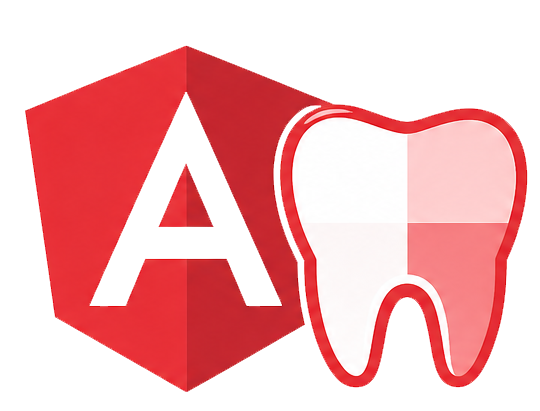

<p align="center">
  
</p>

# 🦷 Angular Advanced Odontogram

[](https://www.npmjs.com/package/angular-advanced-odontogram)
[](https://github.com/ZoliQua/Angular-Advanced-Odontogram/releases)
[](https://github.com/ZoliQua/Angular-Advanced-Odontogram/blob/main/LICENSE)

[](https://angular.dev/)
[](https://www.typescriptlang.org/)

---

> 🌐 **Languages:** 🇬🇧 [English](README-en.md) | 🇭🇺 [Magyar](README-hu.md) | 🇩🇪 [Deutsch](README-de.md) | 🇪🇸 [Español](README-es.md) | 🇫🇷 [Français](README-fr.md) | 🇮🇹 [Italiano](README-it.md) | 🇵🇱 [Polski](README-pl.md) | 🇧🇷 [Português (BR)](README-pt-br.md) | 🇸🇰 [Slovenčina](README-sk.md) | 🇷🇺 [Русский](README-ru.md) | 🇸🇦 [العربية](README-ar.md) | 🇨🇳 [简体中文](README-zh.md) | 🇯🇵 [日本語](README-ja.md) | 🇰🇷 한국어(이 파일)

---

## 📑 목차

- [📋 개요](#-개요)
- [📦 npm 패키지로 사용하기](#-npm-패키지로-사용하기)
- [✨ 주요 기능](#-주요-기능)
- [📦 모듈](#-모듈)
- [🛠️ UI 컨트롤](#-ui-컨트롤)
- [🦷 치아 종류와 상태](#-치아-종류와-상태)
- [⚙️ 설정](#-설정)
- [🖼️ SVG 템플릿 시스템](#-svg-템플릿-시스템)
- [🔢 치식 표기](#-치식-표기)
- [🚀 사용법](#-사용법)
- [🔗 통합](#-통합)
- [🧪 테스트](#-테스트)
- [📖 API 문서](#-api-문서)
- [📡 공개 API](#-공개-api)
- [💾 상태 유지(localStorage)](#-상태-유지localstorage)
- [💾 상태 내보내기/가져오기 형식](#-상태-내보내기가져오기-형식)
- [🖨️ 내보내기](#-내보내기)
- [📁 폴더 구조](#-폴더-구조)
- [⚙️ 기술 스택](#-기술-스택)
- [📝 참고](#-참고)
- [🔒 보안 관련 참고](#-보안-관련-참고)
- [📖 인용 방법](#-인용-방법)

## 🇰🇷 한국어

### 📋 개요

이 프로젝트는 **Angular + TypeScript**를 위한 대화형 브라우저 기반 치식도(odontogram) 편집기로, 깔끔한 UI로 빠른 치식 기록을 지원합니다. 수복물, 치아우식, 근관 상태, 동요도, 그 밖의 임상 세부사항을 표현하기 위해 레이어로 구성된 SVG 치아 템플릿을 그리며, 동시에 다중 선택, 선택 필터, 미리 정의된 상태 프리셋을 제공합니다.

**이 프로젝트는 [React Advanced Odontogram](https://github.com/ZoliQua/React-Advanced-Odontogram)**(npm: [`react-advanced-odontogram`](https://www.npmjs.com/package/react-advanced-odontogram))**의 공식 Angular 포팅입니다.** react-advanced-odontogram **v2.9.0**(엔진 커밋 `3321e63`)과 기능이 대등하며, 페이로드 버전은 **2.22**입니다 — JSON과 FHIR R4 내보내기는 두 라이브러리 사이를 무손실로 왕복합니다. 임상 엔진(`projects/angular-advanced-odontogram/src/lib/core/`)은 그대로 공유합니다 — 치아 상태 로직, 치주 기록, 진단 코딩, FHIR 내보내기/가져오기, i18n 문자열, 안내 투어, SVG 템플릿은 React 원본과 바이트 단위로 동일하며, 재동기화마다 고정된 상위 커밋에서 다시 복사합니다. Angular 네이티브인 것은 컴포넌트 셸(`projects/angular-advanced-odontogram/src/lib/components/`)뿐입니다. 명시적으로 문서화된 작은 차이 집합이 존재합니다(브랜딩/식별 문자열에 한정 — 이 저장소의 포팅 설계 문서를 참고하세요). 버전은 React 모듈과 보조를 맞춥니다.

---

*원본 React 프로젝트의 스크린샷 — Angular 포팅은 동일한 UI를 그립니다.*

🔗 **라이브 데모:** https://angular-advanced-odontogram.vercel.app/

---

### 📦 npm 패키지로 사용하기

이 치식도는 자체 완결형 Angular 컴포넌트 라이브러리로 npm에 배포되어 있습니다:
[`angular-advanced-odontogram`](https://www.npmjs.com/package/angular-advanced-odontogram).

#### 요구 사항
- **Angular 21.2 이상**(peer dependency로 선언 — 애플리케이션이 제공합니다).
- `exports` 필드와 ESM을 이해하는 **번들러** — Angular CLI(`@angular/build`)는 기본 설정으로 충족합니다. 이 패키지는 **ESM 전용**입니다.
- 도구 실행을 위한 Node **≥ 20.19.0** — 라이브러리가 `engines.node >= 20.19.0`을 선언하므로, 더 오래된 Node에서는 설치 시 엔진 경고가 발생합니다(`engine-strict`에서는 오류). 이는 빌드 도구에만 해당하며, 컴포넌트 자체는 브라우저에서 동작합니다.

#### 설치

```bash
npm install angular-advanced-odontogram
```

#### 기본 사용법

애플리케이션의 전역 스타일을 설정하는 곳(예: `angular.json`)에서 스타일시트를 **한 번만** 등록합니다:

```json
"styles": [
  "node_modules/angular-advanced-odontogram/styles.css",
  "src/styles.css"
]
```

그다음 `OdontogramShellComponent`를 렌더링합니다:

```ts
import { Component } from "@angular/core";
import { OdontogramShellComponent } from "angular-advanced-odontogram";

@Component({
  selector: "app-chart",
  imports: [OdontogramShellComponent],
  template: `
    <aao-odontogram-shell
      language="en"           
      numberingSystem="FDI"   
      [darkMode]="false"
    />
  `,
})
export class ChartComponent {}
```

`language`는 `hu | en | de | es | it | sk | pl | ru | pt-br | zh | ar | fr | ja | ko`를, `numberingSystem`은 `FDI | UNIVERSAL | PALMER`를 받습니다.

#### 컴포넌트 입력

`OdontogramShellComponent`는 제어 컴포넌트입니다 — 모든 입력은 Angular `input()` 시그널이며 전부 선택 사항이고, 생략하면 각각 엔진 자신의 기본값으로 돌아갑니다. 자주 쓰는 입력:

| 입력 | 타입 | 기본값 | 설명 |
|------|------|---------|-------------|
| `language` | `Language` | `"hu"` | UI 언어(`hu`/`en`/`de`/`es`/`it`/`sk`/`pl`/`ru`/`pt-br`/`zh`/`ar`/`fr`/`ja`/`ko`). |
| `numberingSystem` | `"FDI" \| "UNIVERSAL" \| "PALMER"` | `"FDI"` | 치식 표기 방식. |
| `darkMode` | `boolean` | `false` | 다크 테마 전환. |
| `readOnly` | `boolean` | `false` | 모든 편집 비활성화(보기 전용). |
| `themeConfig` | `OdontogramThemeConfig` | — | 테마 CSS 변수(`--odon-*`), 치아 아트워크 팔레트(`tooth`, `tokens`), 선택 강조(`selection`) 재정의 — [통합](#-통합)을 참고하세요. |
| `plugins` | `OdontogramPlugin[]` | — | 사용자 정의 상태 플러그인/추가 레이어 등록. |
| `toothTemplates` | `ToothTemplateOverrides` | — | 호스트가 제공하는 치아 도형(SVG 텍스트)을 해부 프로필별로 해석해 출하 기본 도형 대신 사용 — 템플릿에서 `setToothTemplateOverrides()`를 쓰는 관용적인 방법입니다. 모든 템플릿은 검사를 받으며, 거부된 템플릿은 출하 기본 도형을 유지하고 `getToothTemplateRejections()`가 그 목록을 알려줍니다. |
| `enableNotes` | `boolean` | `false` | 치아별 메모 활성화. |
| `enableIcdas` | `boolean` | `false` | ICDAS II 우식 평가 활성화. |
| `fillingComplexity` | `"complex" \| "simple"` | `"complex"` | 충전 카드의 상세 수준: `"simple"`(치아당 재료 하나) 또는 `"complex"`(면별 재료). |
| `fillingDefectEnabled` | `boolean` | `true` | 충전 카드에서 충전물 결함 소견 활성화. |
| `fillingMaterialAvailability` | `Record<string, boolean>` | 전부 사용 가능 | `amalgam`/`composite`/`gic`/`temporary`에 대한 불리언 맵으로 사용 가능한 충전 재료를 지정(알 수 없는 키는 무시). |
| `fissureSealingEnabled` | `boolean` | `true` | 충전 카드에서 치면열구전색 활성화. |
| `screenToothSpacing` | `"wide" \| "normal" \| "close"` | `"normal"` | 화면상 치아 간 간격. |
| `screenToothNumberSize` | `"small" \| "normal" \| "xlarge"` | `"normal"` | 화면 격자에서 치아 번호 크기. |
| `selectionColor` | `string` | `"#3b7bff"` | 선택 링 색상(`#rrggbb`); `themeConfig.selection.color`보다 우선합니다. |
| `selectionBorderStyle` | `"solid" \| "dashed" \| "dotted"` | `"dashed"` | 선택 링 선 종류; `themeConfig.selection.borderStyle`보다 우선합니다. |
| `toothInfo` | `boolean` | `true` | 치아 정보 패널 표시. |
| `languageChange` / `numberingChange` / `darkModeChange`(출력) | `output<T>` | — | 사용자가 UI에서 해당 설정을 바꿀 때 발생. |
| `fillingComplexityChange` / `fillingDefectEnabledChange` / `fillingMaterialAvailabilityChange` / `fissureSealingEnabledChange`(출력) | `output<T>` | — | 사용자가 설정 → 충전에서 해당 설정을 바꿀 때 발생. |

더 세분화된 상세 수준 입력(`pulpDetailLevel`, `secondaryCariesMode`, `rootCariesMode`, `radiographicDepthMode`, `cariesDepthEnabled`, `wearDetailLevel`, `discolorationDetailLevel`, `surfaceNotation`, `showStatusCard`, `showOrthoCard`)도 받습니다 — 완전하고 타입이 붙은 목록은 `odontogram-shell.component.ts`를 참고하세요.

위의 충전 관련 입력 네 개는 **복원 전용**입니다: 생략한 입력은 엔진에 쓰지 않습니다(마운트 전에 명령형으로 호출한 `setFillingComplexity()`는 유지됩니다). 반면 전달한 입력은 엔진과 설정 모달의 상태를 함께 바꾸므로, 모달이 오래된 값을 보여주는 일이 없습니다. `fillingMaterialAvailability`는 정규화된 직렬화 키를 기준으로 차이만 적용하므로, 내용이 동일한 새 객체 리터럴로 다시 렌더링해도 엔진에 다시 쓰지 않습니다. 대응하는 `*Change` 출력은 설정 → 충전에서 발생합니다 — 설정을 저장하는 호스트를 위한 되쓰기 경로입니다.

#### 공개 API(명명된 익스포트)

`OdontogramShellComponent`은 명명된 익스포트입니다. 명령형 상태 API, 단독으로 쓸 수 있는 `PerioChartComponent`, 안내 투어, 그리고 모든 공개 타입은 같은 엔트리 포인트의 명명된 익스포트입니다:

```ts
import {
  OdontogramShellComponent,
  PerioChartComponent,          // standalone periodontal chart
  // read state
  getOdontogramSummary,
  getToothStateSummary,
  onStateChange,                // subscribe to state changes
  // export / import
  exportFhir,                   // HL7 FHIR R4 bundle
  exportSvg, exportImage,       // vector / raster chart export
  setImportFormat,
  // control
  setReadOnly, getReadOnly,
  clearSelection, getSelectedTeeth,
  registerPlugins, setPluginState, getPluginState,
  startIntroTour,               // launch the onboarding tour
  // …and many more setX/getX settings functions
} from "angular-advanced-odontogram";
```

전체 표면(100개를 훌쩍 넘는 함수와 타입 — `OdontogramSummary`, `OdontogramThemeConfig`, `OdontogramPlugin`, `FhirExportOptions`, `PdfSettings`, `PerioViewMode` 등)은 함께 배포되는 `.d.ts` 선언 파일에 완전히 타입이 붙어 있습니다. 정리된 참조 표는 아래 [공개 API](#-공개-api)를 보세요.

#### 조합 가능한 서피스(고급)

`OdontogramShellComponent`은 지원되는 올인원 컴포넌트이며 추가 설정이 필요하지 않습니다. 치식도의 각 영역을 직접 만든 레이아웃의 다른 위치에 배치해야 한다면, 셸의 UI 서피스 네 개도 익스포트되어 있어 하나의 `OdontogramUiService` 아래에서 조합할 수 있습니다. 모두 인스턴스가 소유한 단일 세션을 공유합니다:

```ts
import { AfterViewInit, Component, OnDestroy, inject } from "@angular/core";
import {
  OdontogramUiService,
  OdontogramTopbarComponent,
  OdontogramChartSurfaceComponent,
  ToothInfoSurfaceComponent,
  ToothControlsSurfaceComponent,
} from "angular-advanced-odontogram";

@Component({
  selector: "app-workspace",
  imports: [
    OdontogramTopbarComponent,
    OdontogramChartSurfaceComponent,
    ToothInfoSurfaceComponent,
    ToothControlsSurfaceComponent,
  ],
  providers: [OdontogramUiService],   // one instance = one session, scoped to this host
  template: `
    <my-header-area><aao-odontogram-topbar /></my-header-area>
    <my-main-area>
      <aao-odontogram-chart-surface />
      <aao-tooth-info-surface />
    </my-main-area>
    <my-side-panel><aao-tooth-controls-surface /></my-side-panel>
  `,
})
export class WorkspaceComponent implements AfterViewInit, OnDestroy {
  protected readonly ui = inject(OdontogramUiService);

  constructor() {
    // Every `OdontogramUiConfig` field is optional — a zero-config
    // `configure()` call gives a standalone session with the same defaults
    // `OdontogramShellComponent` itself falls back to (language "en"/"hu"
    // depending on host document, "FDI" numbering, light mode, ...). Pass
    // only the Signals/callbacks you want to override, e.g.
    // `{ darkMode: this.darkMode, onDarkModeChange: (v) => ... }`.
    this.ui.configure();
  }

  ngAfterViewInit(): void { this.ui.init(); }
  ngOnDestroy(): void { this.ui.destroy(); }
}
```

`OdontogramUiService`는 `OdontogramShellComponent`의 입력과 같은 설정 형태를 받습니다(그 `configure()` 메서드는 `Signal`과 콜백으로 이루어진 `OdontogramUiConfig` 객체를 받으며, 모든 필드가 선택 사항이고 기본값은 상위와 같습니다). 현재 제약: 한 페이지에 `OdontogramUiService` 인스턴스는 하나만 사용하세요(엔진은 모듈 수준 싱글턴입니다). 서피스는 필요에 따라 마운트/언마운트할 수 있습니다. `OdontogramShellComponent` 자체는 달라지지 않았습니다 — 바로 이 조합을 기본 배치로 구성한 것이며, 여전히 자신의 입력에서 모든 필드를 명시적으로 연결합니다.

더 세밀하게 조합하려면 개별 컨트롤 카드도 익스포트되어 있습니다:

| 컴포넌트 | 셀렉터 | 담당 범위 |
|---|---|---|
| `StatusesCardComponent` | `aao-statuses-card` | 전악 상태/프리셋 컨트롤(초기화, 유치열/혼합치열, 무치악, 상태 부가 항목) |
| `ToothDetailsCardComponent` | `aao-tooth-details-card` | 기본 행(치아 선택/치질), 치관 파절 체크박스, 치관 필요/재제작 전환 |
| `CariesCardComponent` | `aao-caries-card` | 우식 깊이 모드, 치관 하부 우식, 치근면 우식 중증도, 면별 우식 선택기 |
| `FillingsCardComponent` | `aao-fillings-card` | 충전 재료, 면별 충전 선택기 + 결함, 이차우식/결함 힌트 메모 |
| `RootPeriodontiumCardComponent` | `aao-root-periodontium-card` | 치수/근관 상태, 치근단 진단, 흡수, 동요도, 임플란트 주위 상태 |
| `OrthodonticsCardComponent` | `aao-orthodontics-card` | 장치, 이동, 수직 이동, 회전 |
| `SurfaceCrossComponent` | `aao-surface-cross` | 우식/충전 카드가 내부에서 쓰는 공용 B/M/O/D/L 십자형 면 선택 위젯 |
| `DiagnosesCardComponent` | `aao-diagnoses-card` | 치아별 ICD-10/BNO-10/ICD-10-CM/SNOMED 진단 코딩 — 그 치아에서 도출된 진단을 확인하고 조정(도출된 것을 억제하거나, 차트가 표현하지 못하는 것을 추가) |

각 카드는 자체 완결형 선언적 컴포넌트로, `inject(OdontogramUiService)`와 익스포트된 `engineState()` 헬퍼(엔진 getter를 읽어 시그널로 돌려주며, 코어 자체의 변경 알림 버스로 최신 상태를 유지합니다)를 통해 공유 세션을 읽고 씁니다. 특정 레이아웃에 필요한 카드만, 원하는 배치로, 하나의 `OdontogramUiService` 아래에 마운트하세요. `CreditsModalComponent`(`aao-credits-modal`, 상단 바의 「정보와 크레딧」 팝업)와 `CaseDiagnosesModalComponent`(`aao-case-diagnoses-modal`, 전악 증례/영역 진단 팝업)도 익스포트되므로, 호스트가 직접 열고 닫는 상태로 둘 다 구동할 수 있습니다.

```ts
import { engineState, OdontogramUiService, getOdontogramSummary } from "angular-advanced-odontogram";

// Anywhere inside an injection context under an `OdontogramUiService`:
readonly summary = engineState(getOdontogramSummary); // Signal<OdontogramSummary>, kept fresh automatically
```

#### 호스트 테스트를 위한 DI 접합부

`InjectionToken` 두 개를 통해 호스트 애플리케이션이 부수 효과를 가진 엔진 호출을 자신의 테스트에서 대체할 수 있습니다(둘 다 프로덕션에서는 실제 엔진 호출이 기본값이며, 둘 다 `providedIn: "root"`입니다):

| 토큰 | 대체 대상 | 형태 |
|---|---|---|
| `ODONTOGRAM_ENGINE_LIFECYCLE` | `OdontogramShellComponent`의 `ngAfterViewInit()`/`ngOnDestroy()`에서 호출되는 `initOdontogram()` / `destroyOdontogram()` | `{ init: () => Promise<void>; destroy: () => void }` |
| `EXPORT_PDF_FN` | `ExportOptionsModalComponent`의 「내보내기」에서 호출되는 `exportPdf(opts)` | `(opts: PdfExportOptions) => Promise<void>` |

둘이 존재하는 이유는 실제 함수가 헤드리스 테스트 환경이 온전히 제공할 수 없는 DOM/canvas/`jsPDF` 내부를 건드리기 때문입니다 — 호스트 애플리케이션의 컴포넌트 테스트에서는 Angular `TestBed`의 provider 배열로 대체하세요.

#### 중요한 참고 사항과 현재 제약
- **ESM 전용** — 이 패키지는 단일 ES 모듈(`ng-packagr`로 빌드)과 타입 선언 엔트리를 공개합니다. 번들러의 모듈 해석을 대상으로 하며, CommonJS 빌드는 없습니다.
- **스타일시트는 별도** — `angular-advanced-odontogram/styles.css`를 **반드시** 한 번 등록해야 합니다. 자동으로 주입되지 않습니다. 스타일은 `.odontogram-root` 아래로 범위가 지정된 전역 CSS이며 `--odon-*` CSS 변수로 제어합니다.
- **SSR / 클라이언트 전용** — 이 컴포넌트는 마운트 시 DOM을 읽으므로 브라우저에서 실행되어야 합니다. 클라이언트 측에서만 렌더링하세요.
- **애셋은 자체 완결형** — 치아와 아이콘 SVG는 빌드 시 번들에 인라인됩니다(생성된 TypeScript 모듈, `npm run gen:assets`). **런타임 애셋 요청이 없으므로** 설정할 것도, 애플리케이션의 public 폴더로 따로 복사할 것도 없습니다.
- **필요할 때 불러오기** — 초기 번들에는 영어와 `classic` 치아 해부 아트워크만 들어 있습니다. 다른 13개 UI 언어 테이블과 `measured` 해부 프로필의 아트워크는 별도의 지연 청크로, 호스트가 처음 그쪽으로 전환할 때 받아옵니다(각각 `[language]` / `I18nService.setLanguage()`/언어 메뉴, 그리고 `setToothAnatomy("measured")`/설정 → 치식도 → 치아 해부). 2.6.0의 분할로 데모의 메인 청크는 3.12 MB에서 1.25 MB로, 초기 총량은 3.21 MB에서 1.33 MB로 줄었습니다. 2.7.0에서는 토큰으로 착색한 아트워크 때문에 각각 1.29 MB와 1.38 MB로 조금 늘고, 해부가 완성되면서 지연 `measured` 청크가 1.2 MB에서 4.0 MB로 늘었습니다 — 호스트 측에서 설정할 것은 없습니다. 2.8.0에서는 1.30 MB와 1.39 MB, 지연 `measured` 청크는 3.9 MB입니다. 2.9.0에서는 초기 수치가 1.30 MB와 1.39 MB로 그대로입니다. 일본어, 한국어와 그 두 PDF 폰트는 모두 지연 청크이며(한국어 폰트 3.24 MB, 일본어 폰트 289 kB, 로케일 테이블 87 kB와 79 kB), 어느 것도 초기 번들에 들어가지 않습니다. 지연 `measured` 청크는 3.89 MB입니다.
- 이 릴리스에서는 **페이지당 인스턴스 하나** — 엔진 상태는 모듈 수준 싱글턴이므로(React 원본과 동일), 같은 페이지에 `<aao-odontogram-shell>`을 두 개 렌더링하면 하나의 차트 상태를 공유하게 됩니다.
- **치아 템플릿 재정의와 열려 있는 치주 차트** — `toothTemplates` 입력은 엔진 초기화 전에 적용되며, 이후 값이 바뀌면 메인 격자를 다시 만듭니다. 이미 그려진 차트에서 `setToothTemplateOverrides()`를 명령형으로 호출해도 **다시 그려지지 않으므로**, 차트가 마운트되기 전에 호출하거나 입력을 쓰세요. **이미 열려 있는** 치주 차트는 `toothTemplates`가 바뀌어도 다시 만들지 않습니다: 다시 열거나 해부 프로필이 바뀔 때까지 이전 치아 아트워크를 유지합니다(React 원본과 같은 동작입니다).

---

### ✨ 주요 기능
- 🖱️ 빠른 선택과 다중 선택(CMD/CTRL + 클릭)
- 🦷 치아 종류: 영구치, 유치, 임플란트, 치은 아래, 상실
- 🦷 치질(수복물과 직교하는 축): 건전, 잔존치근, 파절, 치관 형성 완료
- 👑 수복물은 종류 × 재료로 지정: 크라운/인레이/온레이/라미네이트 베니어/브리지를 e.max, 금, 그라디아, 지르코니아, 메탈, 메탈세라믹, 텔레스코프, 임시 중 하나로(온레이는 교합면 보기 전용) — 클릭 수를 줄인 「고정: 크라운 – …」 통합 선택기에서 고릅니다. 기존 `metal` 크라운은 `metal-ceramic`(메탈세라믹)으로 이행합니다. 임플란트도 같은 종류 × 재료 모델을 쓰며 임플란트 커넥터 레이어와 합성됩니다. 선택기는 치아 종류로 범위가 정해집니다: 임플란트는 크라운/브리지만(그리고 아래의 다섯 가지 어태치먼트), 상실치·결손부는 브리지 폰틱만(그리고 국소의치/총의치), `radix`(잔존치근) 치질에서는 수복물 컨트롤 자체를 숨깁니다(잔존치근에는 수복물을 기록할 수 없습니다)
- 🦿 가철성·어태치먼트 보철은 전용 `prosthesis` 축에(통합 선택기의 「가철성:」 항목): 임플란트 힐링 어버트먼트, 로케이터, 로케이터 병용 피개의치, 바, 바 병용 피개의치, 그리고 치아 지지 국소의치 또는 총의치
- 🌉 브리지 치아는 크라운 캡과 새들 커넥터를 모두 그립니다. 여러 치아에 걸친 브리지 스팬 오버레이는 연속된 브리지 치아(폰틱 + 지대치)와 그 사이의 치간부를 가로질러, 치열궁을 고려한 하나의 연속 커넥터를 그리며 PNG/JPG/SVG 내보내기에도 포함됩니다
- 🔍 6개 면의 우식 기록: 근심, 원심, 협면, 설면, 교합면, 치관 하부
- 🪥 면별 충전 재료: 아말감, 콤포지트 레진, 글라스아이오노머, 임시
- 🏥 「치수/근관 상태」를 하나로 통합한 선택기(생활 치수와 치료 완료/근관으로 묶음): 근관 상태(약제 근관충전, 근관충전, 불완전 근관충전, 글라스파이버 포스트, 메탈 포스트)와 AAE 치수 진단(`pulpDx`: 정상/가역성/비가역성 치수염/괴사)은 상호 배타적입니다 — 근관치료를 받은 치아(`endo` 설정됨)는 생활 치수 진단을 함께 가질 수 없습니다. 치료를 설정하면 `pulpDx`는 `normal`로 정규화됩니다. 3단계 치수 상세 수준 설정(`pulpDetailLevel`: 간단/AAE/실용 라틴어)을 켜면 `pulpLatin`을 통해 9가지 실용 라틴어 치수 하위 유형을 선택할 수 있습니다
- 🦴 치근단 진단(`apicalDx`: 증상이 있는/없는 치근단 치주염, 급성/만성 치근단 농양, 경화성 골염)이 치근단 글리프를 직접 구동합니다. 육아종/치근낭이라는 병소 하위 유형 수식자는 증상이 있는/없는 치근단 치주염 아래에서만 표시됩니다
- 🩹 「치근과 치주 조직」 카드 통합(치근/치근단과 치주 소견을 하나의 접을 수 있는 섹션으로)
- ⚕️ 수식: 치근단 염증(상실치와 발치창 치아에만 표시. 현존치에서는 숨기고, 임플란트에서는 `periImplant`가 담당하므로 숨깁니다), 치주 질환, 동요도(M1/M2/M3, 임플란트에서는 숨김)
- 🦷🔩 임플란트 주위 상태(`periImplant`: 없음/점막염/임플란트 주위염 경도·중등도·중증) — 2018년 World Workshop 병기 분류에 따라 임플란트에서 전용 선택기로 표시됩니다
- 🏷️ 특수 지표: 치관 필요, 치관 재제작 필요, 폐쇄된 결손, 발치 예정, 치면열구전색, 접촉점 상실
- 👁️ 교합면 보기, 제3대구치, 골, 치수 표시 전환
- 🔢 12가지 선택 필터(전체, 현존치, 영구치, 유치, 임플란트, 상실, 상악/하악, 전치/대구치)
- 📊 미리 정의된 상태 프리셋(초기화, 유치열, 혼합치열, 무치악)
- 📦 22가지 미리 정의된 수복 템플릿(브리지, 가철성 의치, 임플란트 병용 바 피개의치)
- 💾 상태의 JSON 내보내기/가져오기(버전 2.22. 기존 1.4 및 2.0~2.21도 읽을 수 있고 자동으로 이행합니다. 플러그인의 사용자 정의 상태와 치아별 메모를 포함합니다)
- 💽 선택적 localStorage 유지(`enablePersistence`/`disablePersistence`/`clearPersistedState`/`isPersistenceEnabled`) — 기본은 비활성. 상태 차트(그리고 선택적으로 계획 차트)를 자동 저장하며, 4 MB 크기 가드가 있고 저장소나 파싱 오류는 예외를 던지지 않고 `onError` 콜백(또는 `console.warn`)으로 전달됩니다
- 🔗 HL7 FHIR R4 내보내기(치아별 Observation을 담은 collection Bundle, 영구치 **및** 유치(51-85, 가져올 때 무손실 왕복)의 ISO 3950 치아 코드, 로컬 코드 체계, 그리고 선택적 SNOMED CT 오버레이(설정 → 일반 → SNOMED CT)). 중증도가 기록된 우식 컴포넌트는 점수 체계 코딩도 함께 갖습니다 — 충전되지 않은(일차) 면에서는 ICDAS, 충전된(이차) 면에서는 CARS. 치료 계획도 함께 나갑니다: 계획 차트가 상태 차트와 다를 때 `exportFhir()`는 계획된 각 처치마다 해당 치아의 의도된 임상 상태로 코딩된 `ServiceRequest`(`intent: "plan"`)를 하나씩 내보냅니다. FHIR 가져오기는 계획 레이어를 무시하며, 계획 레이어는 JSON 페이로드로 왕복합니다
- ✚ 우식과 충전을 위한 십자형 면 선택 UI(B/M/O/D/L) — `SurfaceCrossComponent`로 익스포트되어 조합형 레이아웃에서도 쓸 수 있습니다
- 🧱 면별 수복 재료(혼합 충전, 예: 협면 아말감 + 원심 콤포지트)
- 🖼️ 차트의 PNG/JPG/SVG 이미지 내보내기(다운로드 가능. PNG/JPG는 벡터 SVG에서 래스터화)
- 🦷 우식/이차우식은 면별 상태 기계입니다: 충전이 없는 우식 면은 일차 우식으로 그려지고(ICDAS에 따른 불투명도), 그 면에 충전이 있으면 이차 우식으로 그려집니다(CARS로 점수화) — 같은 면에서 둘이 동시에 활성화되는 일은 없습니다
- 🎯 면별 통합 중증도(`cariesSeverity`, 0–6): 일차 면에서는 ICDAS 깊이로, 이차 면에서는 이름이 붙은 CARS 점수(건전 … 광범위한 우식공)로 읽히며, 그 면의 현재 상태에 해당하는 척도만 보여주는 맥락형 팝업으로 입력합니다
- 🌱 치근면 우식(`rootCaries`: 없음/활성/정지성/우식공을 동반한 활성). 전용 치근면 우식 아트워크 레이어를 중증도에 따른 불투명도로 활성화합니다
- 📡 방사선학적 우식 깊이(`radiographicDepth`: 면별로 없음/E1/E2/D1/D2/D3). 시각적 ICDAS/CARS 중증도 척도와 독립적이며, 배지로 표시되고 전용 FHIR Observation으로 왕복합니다
- 🎚️ 세 가지 우식 세분화 설정(`secondaryCariesMode`, `rootCariesMode`, `radiographicDepthMode`)과 `cariesDepthEnabled` 토글. 저장된 값을 잃지 않고 각 척도를 더 단순한 선택기 보기로 접을 수 있습니다
- 🩹 충전 패널의 이차우식 요약 줄: 이차우식이 있는 선택된 치아와 그 면을 나열합니다
- 🪛 면별 충전물 결함(`fillingDefect`: 없음/변연 결함/파절/마모)을 직접 수복물에. 이차우식과 독립적입니다
- 🦷💥 임상적 원인과 위치로 유형화된 치아 마모(`wearEdge`: 없음/교모/부식, 절단·교합면. `wearCervical`: 없음/마모/굴곡파절/부식, 치경부)
- 🎨 원인별 치아 변색(`discoloration`: 없음/테트라사이클린/불소증/실활/외인성/기타)을 영구치와 유치에
- ✏️ 전치(절치·견치)는 UI 전체에서 교합면을 「절단」으로 표시합니다. 저장되는 면 키는 `occlusal` 그대로입니다
- 🔤 위치를 고려한 치면 표기(설정 → 치아 상세 → 「치면 표기」, 간단/전체, 기본은 전체): 전체 모드에서는 우식·충전 면의 기호와 라벨이 치아 해부를 따릅니다 — 교합면 → 전치에서는 I/절단, 협면 → 전치에서는 L/순면, 설면 → 상악에서는 P/구개면, 하악에서는 L/설면
- 🦷↕️ 치아별 교정 기록(`orthoAppliance`: 없음/브라켓/밴드. `orthoDrift`: 없음/근심/원심. `orthoVertical`: 없음/정출/압하. `orthoRotation`: 불리언)을 현존하는 자연 치아(영구치 또는 유치)에
- 🪨 치석, 그리고 내부성/외부(치경부)성으로 유형화된 치근 흡수(`resorptionType`)
- 📏 면별 우식 깊이(표층/상아질/심층), 또는 `enableIcdas`로 선택적인 ICDAS II 점수화(0–6)
- 🩹 치관 변연 누출 토글. 크라운 또는 브리지 수복이 있을 때만 표시됩니다
- 🧬 표준 기반 진단 코딩(WHO ICD-10, 항상 활성): 기록된 각 소견에서 ICD-10 코드가 붙은 진단을 도출합니다 — 우식(K02), 치근면/백악질 및 정지성 우식(K02.2/.3), 치수염과 치수 괴사(K04.0/.1), 치근단 치주염, 치근단 농양과 치근낭(K04.4–.9), 교모/마모/부식/굴곡파절(K03.0–.8), 치석(K03.6), 흡수(K03.3), 변색(K00.3/K00.8/K03.7), 치아 상실(K08.1), 잔존치근(K08.3), 치아 파절(S02.5) — FHIR Condition으로 내보내집니다
- 🩺 치아별 **진단 카드**(`DiagnosesCardComponent`, `aao-diagnoses-card`): 그 치아에서 도출된 ICD-10 진단을 확인하고 조정할 수 있습니다 — 잘못 도출된 것을 억제하고, 차트가 표현하지 못하는 것을 추가할 수 있습니다. 실효 집합(도출 − 억제 + 추가)이 FHIR 내보내기를 구동합니다. 각 행은 자신의 코드를 먼저 보여주고(`K04.0 치수염`) 행은 코드순으로 정렬됩니다. **제외** 토글은 차트를 건드리지 않고 FHIR 내보내기에서만 진단을 빼며, **삭제**(×)는 진단*과* 그 바탕이 되는 소견을 함께 지웁니다
- 🗂️ **증례/영역 진단**(`CaseDiagnosesModalComponent`, `aao-case-diagnoses-modal`): 단일 치아에 묶이지 않는 전악 진단 — 부정교합과 측두하악관절(K07), 구강의 낭(K09), 타액선 질환(K11), 구내염과 구강 점막(K12/K13), 치열궁 수준의 발육 이상(K00) — 각각 선택적으로 좌/우/양측을 지정할 수 있고, 치식도/치주 상태 토글 옆의 **진단** 버튼으로 엽니다
- 🌍 국가별 코드 팩(설정 → 일반 → 진단 코드 체계): WHO ICD-10을 기반으로 국가별 코드 체계를 덧씌웁니다 — BNO-10(헝가리, 공식 NEAK 명칭. WHO 코드는 유지) 또는 미국 ICD-10-CM(코드 재매핑, 예: K07 치아악안면 범위 → M26)
- 🔬 SNOMED CT 오버레이(설정 → 일반 → SNOMED CT, 선택적, 기본 꺼짐): WHO 및 국가별 팩 코딩과 나란히 SNOMED CT 코딩을 추가하고, WHO ICD-10 코드가 없는 임플란트 주위 소견도 코딩합니다. ICD-10-CM과 SNOMED 개념 ID는 참고용·최선 노력입니다 — 임상 사용 전에 공식 ICD-10-CM 목록/SNOMED CT 브라우저로 검증하세요
- 🔁 FHIR Condition 왕복: 진단은 Observation과 나란히 FHIR `Condition` 리소스로 내보내지고(치아에 연결된 것, 그리고 좌우를 bodySite로 갖는 환자 수준의 증례 병태), 가져올 때 이를 재구성합니다 — 증례 병태는 직접, 치아별 추가/억제 재정의는 가져온 Condition과 다시 도출한 차트를 비교해 복원합니다
- ✅ HL7 검증기에서 깔끔한 FHIR 내보내기: Bundle의 각 항목은 결정적인 `id`와 절대 `fullUrl`을 가지며(`urn:uuid` 자리표시자를 쓰지 않습니다), Bundle은 엔진 자신의 **CodeSystem**을 포함하므로 검증 중에 로컬 코드가 해석됩니다. 같은 CodeSystem과 생성된 ValueSet은 이 저장소의 `projects/angular-advanced-odontogram/src/lib/fhir/` 아래에 공개되어 있습니다(FHIR 내보내기 옵션에서 `includeCodeSystem: false`를 전달하면 Bundle에서 생략할 수 있습니다)
- 🔄 치주 데이터는 JSON 페이로드뿐 아니라 FHIR 가져오기로도 왕복합니다: 가져오기는 LOINC 74029-0 치주 패널을 각 치아로 되읽습니다 — 치주낭 깊이, 치은 변연(CAL에서 재구성하므로 가성낭 값도 보존됩니다), BOP, 치근분지부, O'Leary 치태, PI/GI와 임플란트 mPI/mBI 지수, 부착치은 폭 — 그리고 증례 수준의 흡연 상태와 HbA1c 근거 Observation까지. 배농만이 예외로 JSON 전용으로 남습니다
- 🧰 통합된 상단 바 아이콘 줄과 탭이 있는 설정 대화상자(7개 탭 — 일반 / 치식도 / 치주 차트 / 치아 상세 / 우식 / 충전 / 내보내기 설정 — 아래 [설정](#-설정) 참고)
- 🦷🩺 설정 → 「치주 차트」 탭: 사용 여부 토글과, 치주 차트 행에 대한 16개의 지수별 표시/숨김 토글(각각 설명이 붙습니다), 그리고 지수 명칭을 번역할지 표준 표기로 쓸지 선택하는 표시 옵션
- 📋 치아 정보 패널: 차트 전체의 실시간 텍스트 요약(치아 수, 현존/상실 목록, 이차를 포함한 우식, 충전, 근관치료, 보철, 임플란트, 치주 상태) — 기본으로 표시되며 설정에서 전환할 수 있습니다
- 🗂️ 내보내기 드롭다운 통합(상태 JSON / FHIR / PNG / JPG / SVG / PDF 보고서). 설정 → 일반에서 형식별로 따로 숨길 수 있습니다
- 📥 FHIR 가져오기를 갖춘 가져오기 드롭다운(내보낸 Bundle을 왕복할 수 있습니다). 출처별로 따로 숨길 수 있습니다
- ⏳ 이미지 내보내기 중 진행 오버레이
- 🎓 대화형 소개 투어(셸 컨트롤을 안내하며 둘러봅니다)
- 🔢 세 가지 치식 표기(FDI, 유니버설, 팔머)
- 🌐 다국어 지원 — 14개 UI 언어(HU/EN/DE/ES/IT/SK/PL/RU/PT-BR/AR/ZH/FR/JA/KO)와 언어 전환기. 아랍어는 UI를 오른쪽에서 왼쪽으로 그리고 치식/치주 차트는 왼쪽에서 오른쪽으로 고정합니다(기계 번역이며 AR/ZH/FR/JA/KO는 모국어 화자 검토 대기 중입니다). 주 번들에는 영어만 들어갑니다 — 다른 모든 언어는 별도 청크로, 처음 선택될 때 받아옵니다
- 🌗 토글 버튼이 있는 다크 모드 지원(단독 또는 상위 앱이 제어)
- 🎨 테마를 적용할 수 있는 차트와 치아 아트워크: `themeConfig`(`colors`, `tooth`, `tokens`, `selection`)가 `--odon-*` CSS 사용자 정의 속성을 구동합니다 — 치아 도형 자체(`--odon-tooth-body`, `--odon-milktooth-body`, `--odon-tooth-dentin`, …)까지 포함하며, 다크 아트워크 팔레트가 기본으로 들어 있습니다
- 🎨 임플란트와 윤곽선 테마: `--odon-implant-tint`는 CSS 필터 하나로 임플란트 픽스처 전체의 색조를 바꾸고, `--odon-implant-fill`은 단색으로 칠하며, 치아 윤곽선 굵기도 테마로 지정할 수 있습니다(`themeConfig.tooth.outlineWidth` → `--odon-tooth-outline-width`). 교합면 실루엣도 그 굵기를 따릅니다
- 🖌️ 호스트가 제공하는 치아 도형: `setToothTemplateOverrides()`와 `toothTemplates` 입력은 포크 없이 해부 프로필별로 출하 기본 SVG를 대체합니다 — 모든 템플릿은 그려지기 전에 검사를 받고(조용히 정리하지 않고 거부합니다), `getToothTemplateRejections()`가 무엇이 왜 거부되었는지 알려줍니다
- 🩺 치주 차트 수정: 격자를 다시 만들어도 포커스가 있던 셀이 유지되므로 키보드로 기록하는 임상가가 자리를 잃지 않으며, UI 언어가 바뀌면 격자가 스스로 라벨을 다시 붙입니다
- 📐 완성된 실측 해부: `measured` 프로필은 이제 40개 치아 위치 전부에 문헌 실측 템플릿을 하나씩 갖추고, 유치는 유치로 그려지며, 치관과 치근에는 도출된 상아질 코어가 있습니다. 이 아트워크는 별도의 지연 청크로, 전환할 때만 받아옵니다(설정 → 치식도 → 치아 해부)
- ⚖️ `compareExams(before, after)` — 같은 구강의 내보낸 검사 두 건을 비교합니다: 축 수준의 변화, 부위별 치주낭 깊이와 부착 수준의 변동(2 mm 이상 변화는 표시됩니다), 그리고 각 검사의 2017년 분류. 순수 함수이므로 라이브 차트를 건드리지 않습니다
- 🖥️ API로서의 차트 표시 설정: 치아 간 간격, 치아 번호 크기, 선택 색상과 선 종류, 치아 정보 패널(`get…`/`set…` 짝과 대응하는 셸 입력), 그리고 `getNumberingSystem()`
- 📱 모바일 터치 UX: 탭하면 확대되는 팝오버, 길게 눌러 여는 컨텍스트 메뉴, 핀치 줌, WCAG 44px 터치 영역, 치열궁 전환 내비게이션
- 🔌 사용자 정의 SVG 플러그인 시스템: 시각 오버레이 주입, 치아별 사용자 정의 상태, JSON 내보내기/가져오기 지원 — 플러그인의 `renderSvg()` 출력은 라이브 차트에 삽입되기 전에 DOMPurify(SVG 프로필)로 소독됩니다. 그래도 플러그인은 신뢰된 코드로 실행되므로, 신뢰할 수 있는 출처의 플러그인만 불러오세요
- ⚠️ 양립할 수 없는 치아 상태 조합에 대한 상태 검증 경고
- 🏷️ 치아 타일에 자동으로 나타나는 상태 툴팁(활성화된 모든 상태를 표시)
- 🩺 치아별 툴팁과 전악 요약 패널이 임상 소견 전체를 보여줍니다(치수/치근단 진단, 치근 흡수, 임플란트 주위 상태, 등급이 붙은 치근면 우식, 치석, 치관 변연 누출, 파절, 접촉 상실, 유형화된 절단·치경부 마모)
- ♿ 키보드 접근성(WCAG): ARIA listbox/option 역할, Enter/Space 선택, 화살표 키 이동, focus-visible 외곽선
- 🔒 읽기 전용 모드: 인쇄·보고서·열람 용도로 모든 상호작용을 비활성화
- ✨ 선택 애니메이션: 선택된 치아의 맥동하는 파선 테두리와 빛나는 그림자(prefers-reduced-motion 지원)
- 📝 치아별 메모: 두 번 클릭해 메모 추가·수정, 치아 번호 옆 메모 아이콘, 마우스를 올리면 메모 본문 툴팁, 전악 요약 패널의 「개별 메모」 줄, PDF 보고서 포함, JSON 내보내기/가져오기
- 🔀 현재 ↔ 계획 차트 분리: `현재 | 계획` 토글이 현재 **상태** 차트와 **계획**(치료 후 의도하는 상태) 차트를 전환하며, 각각 고유한 치아 상태를 가집니다. 내보내기/가져오기는 항상 상태 차트를 대상으로 하고, 계획 차트는 고유한 API로 따로 읽고 씁니다([공개 API](#-공개-api) 참고). 상태 차트와 다를 때는 JSON 내보내기에 추가 `plan` 섹션으로 포함됩니다
- 📝 「무엇이 바뀌는가」 상자: 계획이 현재 상태와 다를 때마다 치아별·처치 축별로 모든 차이를 나열합니다. `getPlanChanges()`로 프로그램에서도 가져올 수 있습니다
- 🅿️ 제안 스타일링: 계획 모드에서는 계획이 현재 상태에 **추가**하는 소견이 뚜렷한 파선의 색조가 들어간 「제안」 외곽선으로 그려집니다
- 🚦 계획 모드의 제한: 계획 차트는 치과의사가 *할 수 있는* 것만 보여줍니다 — 상태 전용 소견(우식, 마모, 변색, 치주 블록 전체)은 숨겨지고, 수복물, 보철, 교정, 치관 필요·재제작, 발치 예정은 계획 가능한 상태로 남습니다


*원본 React 프로젝트의 스크린샷 — Angular 포팅은 동일한 UI를 그립니다.*

- 🩺 치주 기록: 치아별 표준 6개 부위에서 **치주낭 깊이**, **치은 변연**, **탐침 시 출혈**(+ 배농)을 기록하고, **임상적 부착 수준(CAL = PD + 치은 변연)**, 치은퇴축, 전악 **%BOP**를 도출합니다. **그래픽 전악 치주 차트**는 각 치열궁을 협면과 구개(설)면의 독립된 두 SVG로 그리고, 붉은 **CEJ 선**, 숫자가 붙은 밀리미터 안내 격자, 치은 변연/치주낭 깊이 곡선을 갖추며, **Miller 분류**와 **치태/PI/GI/mPI/mBI**를 치아별 해부학적 다이아몬드 타일로 담은 중앙 치주 지수 띠로 위아래가 나뉩니다. 입력은 키보드 자동 이동으로 할 수 있고, 차트는 사용 가능한 너비를 채우도록 동적으로 크기가 조절됩니다. `치식도 | 치주 상태` 보기 전환으로 제시되며, 익스포트된 `PerioChartComponent`로 여전히 단독으로 호출할 수 있습니다. 부위별 **FHIR** 내보내기는 LOINC 치주 패널(`74029-0`. PD `32910-2`, 치은퇴축 `32911-0`, CAL `32912-8`)을 통합니다
- 🧪 치식 표기, 번역, 프리셋, 다국어, 셸, 테마, 터치, 플러그인, 접근성, 그리고 동결된 React 코퍼스에 대한 임상 축·진단 패리티를 포괄하는 광범위한 자동 테스트 모음([테스트](#-테스트) 참고)
- 📖 모든 공개 익스포트에 JSDoc 주석을 붙인 TypeDoc API 문서(`npm run docs`)

### 📦 모듈
- 🦷 치식도 격자와 치아 타일 UI(`OdontogramChartSurfaceComponent`)
- 🎛️ 컨트롤과 상태 패널(`ToothControlsSurfaceComponent` + 8개의 선언적 카드)
- 🎨 SVG 레이어링 엔진과 템플릿(프레임워크에 의존하지 않는 코어, `core/odontogram.ts`)
- 🔢 치아 번호와 라벨 매핑(FDI/유니버설/팔머, `core/utils/numbering.ts`)
- 🌐 현지화 — 14개 UI 언어(HU/EN/DE/ES/IT/SK/PL/RU/PT-BR/AR/ZH/FR/JA/KO). 아랍어(RTL) 포함(`core/i18n/`, `I18nService`)
- 💾 상태 내보내기/가져오기
- 📋 상태 추가 프리셋: 미리 정의된 수복 템플릿
- 🎨 테마 설정: `--odon-*` CSS 속성으로 조정할 수 있는 색상 팔레트
- 📱 모바일 터치 상호작용(탭하면 확대, 길게 누르기, 핀치 줌, 치열궁 전환)
- 🔌 사용자 정의 SVG 플러그인 시스템
- ⚠️ 상태 검증과 툴팁 체계
- ♿ 키보드 접근성과 ARIA 지원
- 🔒 읽기 전용 모드
- ✨ 선택 애니메이션
- 📝 치아별 메모 기능
- 🧱 **조합 가능한 UI** — `OdontogramUiService`, `engineState()` 헬퍼, 4개의 표시용 서피스, 8개의 선언적 컨트롤 카드를 모두 개별적으로 익스포트합니다(위 [조합 가능한 서피스](#-npm-패키지로-사용하기) 참고)
- 🧪 자동 테스트 모음(Vitest 코퍼스 + `ng test`. [테스트](#-테스트) 참고)

### 🛠️ UI 컨트롤

**🔝 상단 바**(`OdontogramTopbarComponent`):
- 언어 전환기(HU/EN/DE/ES/IT/SK/PL/RU/PT-BR/AR/ZH/FR/JA/KO 드롭다운)
- 다크 모드 전환 버튼(해/달 아이콘. 라이트와 다크 테마를 전환합니다)
- 치식 표기 전환기(FDI/유니버설/팔머 드롭다운)
- 상태 내보내기 / 상태 가져오기 버튼
- 설정(톱니바퀴 아이콘), 크레딧·정보(정보 아이콘), GitHub 링크

**📊 차트 머리글:**
- 교합면 보기 전환
- 제3대구치 표시 전환
- 골 표시 전환
- 치수 표시 전환
- 선택 해제 버튼

**🔍 선택 필터:**
- 전체 선택 / 현존치 전체 / 영구치 / 유치 / 임플란트 / 상실치 전체
- 상악 선택 / 상악 전치 6개 / 상악 대구치
- 하악 선택 / 하악 전치 6개 / 하악 대구치

**📋 상태 프리셋:**
- 전체 초기화(구강 초기화)
- 유치열
- 혼합치열
- 무치악 전환

**📦 상태 추가 프리셋 드롭다운:**
- 상악/하악 지르코니아 브리지(12-22, 13-23, 16-26, 전체 치열궁)
- 상악/하악 메탈 브리지(12-22, 13-23, 16-26, 전체 치열궁)
- 상악/하악 국소의치
- 상악/하악 총의치
- 상악/하악 임플란트 병용 바 피개의치

**🦷 치아 편집 패널**(`ToothControlsSurfaceComponent`. 선택한 치아에 대해, 접을 수 있는 카드로 묶여 있습니다):
- **상태 카드:** 전악 프리셋과 상태 추가 프리셋(`showStatusCard`로 따로 표시/숨김)
- **치아 상세 카드:** 치아 선택(파절 치관 변형을 포함한 기본 종류), 치질, 통합된 「고정: …」/「가철성: …」 수복 드롭다운, 치관 변연 누출 체크박스, 파절 치관 위치 체크박스, 치관 필요 / 치관 재제작 필요 토글
- **교정 카드:** 장치, 근심/원심 이동, 수직 이동, 회전 토글 — 현존하는 자연 치아에서 표시됩니다(`showOrthoCard`로 따로 표시/숨김)
- **우식 카드:** 우식 깊이 모드 드롭다운, 치관 하부 우식 체크박스, 치근면 우식 중증도 드롭다운, 그리고 B/M/O/D/L 면별 우식 선택기(`SurfaceCrossComponent`. 맥락형 ICDAS 깊이/CARS 팝업과 방사선학적 깊이 배지 포함)
- **충전 카드:** 충전 재료 드롭다운, 면별 충전 선택기, 면별 충전물 결함 표시기, 이차우식과 충전물 결함 힌트 메모
- **치근과 치주 조직 카드:** 통합된 「치수/근관 상태」 선택기, 치근단 진단 선택기, 치근단 병소 하위 유형 선택기, 치근 흡수 종류 선택기, 동요도 선택기, 임플란트 주위 상태 선택기(임플란트만)
- **특수 지표:** 발치 예정/발치창, 폐쇄된 결손, 치면열구전색, 접촉점 상실, 치석, 치수인접 핀, 치근단절제, 브리지 지대치

### 🦷 치아 종류와 상태

**치아 선택(기본 종류):**
| 값 | 설명 |
|---|---|
| `none` | 상실치 |
| `tooth-base` | 영구치 |
| `milktooth` | 유치 |
| `implant` | 치과 임플란트 |
| `tooth-under-gum` | 치은 아래(미맹출) 치아 |

**파절 치아 변형:**
`tooth-broken-inicisal`, `tooth-broken-distal-inicisal`, `tooth-broken-distal`, `tooth-broken-mesial-distal-inicisal`, `tooth-broken-mesial-distal`, `tooth-broken-mesial-inicisal`, `tooth-broken-mesial`, `no-tooth-after-extraction`

**치질(영구치):**
`natural`(기본), `radix`(잔존치근), `broken`, `crownprep`(치관 형성 완료)

**수복물 종류(영구치):**
`none`, `crown`, `inlay`, `onlay`(교합면 보기 전용), `veneer`, `bridge`

**수복물 재료(영구치):**
`none`, `emax`, `gold`, `gradia`, `zircon`, `metal`, `metal-ceramic`(기존 `metal` 크라운이 이쪽으로 이행), `telescope`, `temporary`

**수복물 선택지는 치아 종류로 제한됩니다**(`projects/angular-advanced-odontogram/src/lib/core/registry/restorations.ts`의 `restorationOptions()`): 임플란트는 `crown`/`bridge` 수복 종류만(임플란트 커넥터 레이어와 합성) 그리고 아래의 다섯 가지 `prosthesis` 어태치먼트 항목, 상실치·결손부는 `bridge` 폰틱만 그리고 두 가지 가철성 의치 `prosthesis` 항목, `radix` 치질에서는 수복물 컨트롤 자체를 숨깁니다.

**보철장치**(`prosthesis`. 직교하는 가철성·어태치먼트 축. 통합된 수복 드롭다운의 「가철성:」 항목으로 표시됩니다):
`none`, `healing-abutment`, `locator`, `locator-denture`, `bar`, `bar-denture`(임플란트 어태치먼트. 피개의치 유무에 따라), `removable-partial`, `removable-full`(상실치·결손부 위의 치아 지지 의치). 한 치아는 고정 수복물이나 보철장치 중 하나만 가지며 둘 다 갖지는 않습니다 — 한쪽을 설정하면 다른 쪽은 해제됩니다.

**치관 변연 누출**(`crownLeakage`. 불리언): `restorationType`이 `crown` 또는 `bridge`일 때만 표시됩니다.

**근관 선택지(영구치):**
`none`, `endo-medical-filling`, `endo-filling`, `endo-filling-incomplete`, `endo-glass-pin`, `endo-metal-pin`

**근관 선택지(유치):**
`none`, `endo-medical-filling`

`endo`와 `pulpDx`는 하나로 통합된 「치수/근관 상태」 선택기(생활 치수와 치료 완료/근관으로 묶음)로 표시되며 상호 배타적입니다 — 치료 완료(`endo != none`) 선택지를 고르면 `pulpDx`가 `normal`로 돌아가고, 치수 진단을 고르면 `endo`가 `none`으로 돌아갑니다.

**충전 재료(영구치):**
`amalgam`, `composite`, `gic`, `temporary`

**충전 재료(유치):**
`composite`, `gic`, `temporary`

**충전/우식 면:**
`mesial`, `distal`, `buccal`, `lingual`, `occlusal`, `subcrown`(우식만)

**수식:**
`inflammation`(치근단), `parodontal`(치주), `mobility`(M1/M2/M3)

**치근단 병소 종류**(`periapicalType`. 치근단 글리프를 수식하며, 증상이 있는/없는 치근단 치주염 아래에서만 표시됩니다):
`none`, `granuloma`, `cyst` — 기존 `abscess` 값은 여전히 받아들이고 저장하지만 선택기에는 제시되지 않습니다

**치수 진단**(AAE 용어. `pulpDx`):
`normal`, `reversible-pulpitis`, `irreversible-pulpitis`, `necrosis` — `endo`와 상호 배타적입니다

**치수 진단, 실용 라틴어**(`pulpLatin`. `pulpDetailLevel`이 `latin`일 때만 치수 선택기에 표시됩니다):
`none`, `pulpa-sana`, `hyperaemia-pulpae`, `pulpitis-acuta-serosa`, `pulpitis-acuta-purulenta`, `pulpitis-chronica-clausa`, `pulpitis-chronica-ulcerosa`, `pulpitis-chronica-hyperplastica`, `necrosis-pulpae`, `gangraena-pulpae`

**치수 상세 수준**(`pulpDetailLevel`, 전역 설정): `simple`, `aae`(기본), `latin`

**치근단 진단**(`apicalDx`. 치근단 글리프를 구동합니다):
`normal`, `symptomatic-apical-periodontitis`, `asymptomatic-apical-periodontitis`, `acute-apical-abscess`, `chronic-apical-abscess`, `condensing-osteitis`

**치근 흡수 종류**(`resorptionType`):
`none`, `internal`, `external-cervical`

**임플란트 주위 상태**(`periImplant`. 임플란트 전용, 2018년 World Workshop 병기 분류):
`none`, `mucositis`, `peri-implantitis-mild`, `peri-implantitis-moderate`, `peri-implantitis-severe`

**우식 중증도**(`cariesSeverity`. 면별 통합 필드, `0`–`6`): 충전이 없는 면에서는 ICDAS 우식 깊이 척도(`superficial`/`dentin`/`deep`, `enableIcdas`가 설정된 경우 원시 ICDAS II 코드 `0–6`)로 읽히고, 충전이 있는 면에서는 이름이 붙은 CARS 점수(`0` 건전 … `6` 광범위한 우식공)로 읽힙니다

**치근면 우식**(`rootCaries`): `none`, `active`, `arrested`, `active-cavitated`

**방사선학적 우식 깊이**(`radiographicDepth`. 면별): `none`, `E1`, `E2`, `D1`, `D2`, `D3`

**우식 세분화 설정**(전역): `secondaryCariesMode`(`simple`/`standard`/`full`, 기본 `standard`), `rootCariesMode`(`simple`/`severity`, 기본 `simple`), `radiographicDepthMode`(`off`/`threeLevel`/`detailed`, 기본 `off`), `cariesDepthEnabled`(불리언, 기본 `true`)

**특수 지표:**
`crownNeeded`, `crownReplace`, `missingClosed`, `extractionPlan`, `extractionWound`, `bridgePillar`, `fissureSealing`, `contactMesial`, `contactDistal`, `endoResection`, `calculus`, `parapulpalPin`

**치아 마모**(`wearEdge`, `wearCervical`. 위치별 임상 유형. 치아 종류가 tooth-base + 수복물 없음 + 치질이 건전할 때로 제한됩니다):
`wearEdge`: `none`, `attrition`, `erosion` — `wearCervical`: `none`, `abrasion`, `abfraction`, `erosion`

**변색**(`discoloration`. 치아별 원인. 자연 tooth-base 또는 유치 + 수복물 없음 + 치질이 건전할 때로 제한됩니다):
`none`, `tetracycline`, `fluorosis`, `nonvital`, `extrinsic`, `other`

**충전물 결함**(`fillingDefect`. 면별, 이차우식과 독립적인 직접 수복물 소견):
`none`, `marginal`, `fracture`, `wear`

**교정**(`orthoAppliance`, `orthoDrift`, `orthoVertical`, `orthoRotation`. 치아별, 현존하는 자연 치아로 제한됩니다):
`orthoAppliance`: `none`, `bracket`, `band` — `orthoDrift`: `none`, `mesial`, `distal` — `orthoVertical`: `none`, `extrusion`, `intrusion` — `orthoRotation`: 불리언

**치아 상세/표기 설정**(전역 세션 설정, 설정 → 치아 상세): `wearDetailLevel`과 `discolorationDetailLevel`(`ToothDetailLevel`: `simple`/`complex`, 기본 `complex`), 그리고 `surfaceNotation`(`simple`/`full`, 기본 `full`)

### ⚙️ 설정

상단 바의 톱니바퀴 아이콘으로 엽니다(`SettingsModalComponent`). 포커스가 갇히는 ARIA `dialog`이며 7개 탭 레이아웃입니다(Esc 또는 배경 클릭으로 닫고, 화살표 키로 탭을 전환합니다). 이 대화상자는 호스트가 제공하는 `SettingsState`를 보여주는 순수한 뷰일 뿐이며, 설정 상태를 스스로 소유하지 않습니다. 별도 언급이 없으면 모든 설정은 세션 수준의 UI 상태일 뿐입니다 — 어느 것도 치아별 데이터나 내보내기 페이로드를 바꾸지 않습니다.

- **일반:** 치식 표기(FDI/유니버설/팔머), 언어, 다크/라이트 테마, 형식별 내보내기 사용 여부(PNG/JPG/SVG/PDF — 끄면 해당 내보내기 메뉴 항목이 숨겨지고, PDF를 끄면 내보내기 설정 탭이 비활성화됩니다), 출처별 가져오기 사용 여부(상태 JSON/FHIR), 진단 코드 체계(없음 / BNO-10 / ICD-10-CM), 그리고 선택적 SNOMED CT 오버레이 토글
- **치식도:** 화면 레이아웃 — 치아 간 간격, 치아 번호 크기, 선택 색상과 선 종류. 치아 정보 패널 표시. 계획 모드 사용 여부. 치아 해부 프로필(기본 `classic` / `measured` — 두 치열궁·치아별 너비 레이아웃으로 그리는 40가지 문헌 실측 치아 템플릿. 런타임에 전환할 수 있고, 그 아트워크는 별도의 지연 청크로 전환할 때만 받아오므로 클래식 기본에는 비용이 들지 않습니다). 상태 카드와 교정 카드 표시
- **치주 차트:** 탭의 나머지와 셸의 치주 진입점을 제어하는 사용 여부 토글. 치주 보기 모드(`toggle`/`popup`). 5개 묶음에 걸친 16개의 지수별 표시/숨김 토글(치주낭: PD/GM/CAL/BOP · 구강 위생: 치태/PI/GI · 치은점막: CEJ 식별성/치근 함몰/KG/GT · 지지 조직: 치근분지부/동요도/Miller 분류 · 임플란트 주위: mPI/mBI). 그리고 지수 명칭을 번역할지 표준 표기로 쓸지의 표시 모드(표준 표기 = 어떤 UI 언어에서도 고정된 영어/라틴어 학술명. 툴팁은 항상 현지화된 상태로 남습니다)
- **치아 상세:** 치수 상세 수준(간단/AAE/실용 라틴어, 기본 AAE), 마모 상세 수준과 변색 상세 수준(간단/상세, 둘 다 기본은 상세), 치면 표기(간단/전체, 기본은 전체), 치아별 메모 토글
- **우식:** ICDAS II 점수화 토글, 우식 깊이 토글, 치근면 우식 세분화(간단/중증도), 이차/CARS 세분화(간단/표준/전체), 방사선학적 깊이 세분화(꺼짐/3단계/상세)
- **충전:** 충전 상세 수준(상세/간단), 충전물 결함 소견 토글, 재료별 사용 가능 여부(아말감/콤포지트/글라스아이오노머/임시), 치면열구전색 토글
- **내보내기 설정:** PDF 보고서 전체 설정(`PdfSettings` — 아래 [내보내기](#-내보내기) 참고) — 일반 탭에서 PDF 내보내기를 끄면 비활성화됩니다(일반 탭의 내용으로 돌아갑니다)

### 🖼️ SVG 템플릿 시스템

**치아 템플릿**(`projects/angular-advanced-odontogram/src/lib/core/assets/teeth-svgs/` 안):
| 템플릿 | 사용하는 치아 |
|---|---|
| `11.svg` | 11, 12, 21, 22, 31, 32, 41, 42(절치) |
| `13.svg` | 13, 23, 33, 43(견치) |
| `14.svg` / `14_occl.svg` | 14, 15, 24, 25, 34, 35, 44, 45(소구치) |
| `16.svg` / `16_occl.svg` | 16, 17, 18, 26, 27, 28, 36, 37, 38, 46, 47, 48(대구치) |

템플릿은 하악에서 180도 회전하고, 좌측에서는 수평으로 반전됩니다. 나란히 있는 `measured/` 하위 폴더에는 `measured` 해부 프로필이 두 치열궁·치아별 너비 레이아웃으로 그리는 40가지 문헌 실측 치아 템플릿이 들어 있습니다(설정 → 치식도 → 치아 해부).

**아이콘 SVG**(`projects/angular-advanced-odontogram/src/lib/core/assets/icon-svgs/` 안):
`icon_8.svg`(제3대구치), `icon_gum.svg`(골), `icon_no_selection.svg`(선택 해제), `icon_occl.svg`(교합면 보기), `icon_pulp.svg`(치수)

두 폴더는 `npm run gen:assets`로 생성된 TypeScript 모듈(`core/generated/teeth-svgs.ts`, `core/generated/icon-svgs.ts`)로 컴파일됩니다 — 원본 SVG를 고친 뒤에는 이 명령을 실행해 번들에 인라인된 문자열을 맞춰 두세요.

**호스트가 제공하는 도안**. 호스트 앱은 라이브러리를 포크하지 않고도 `OdontogramShellComponent`의 `toothTemplates` 입력(관용적인 방법) 또는 명령형 `setToothTemplateOverrides()`를 통해 이 템플릿들을 자체 SVG로 바꿀 수 있습니다. 재정의는 **해부 프로필별**로 키가 매겨집니다. 템플릿 번호 N은 `classic`과 `measured`에서 서로 다른 도안이기 때문입니다:

```ts
import { Component } from "@angular/core";
import {
  OdontogramShellComponent,
  setToothTemplateOverrides,
  getToothTemplateRejections,
} from "angular-advanced-odontogram";
import type { ToothTemplateOverrides } from "angular-advanced-odontogram";

@Component({
  selector: "app-custom-teeth",
  imports: [OdontogramShellComponent],
  // The idiomatic way: bind the input. It is applied before the engine
  // initialises, so the first grid is already drawn with your templates.
  template: `<aao-odontogram-shell [toothTemplates]="teeth" />`,
})
export class CustomTeethComponent {
  readonly teeth: ToothTemplateOverrides = {
    classic:  { templates: { 11: myIncisorSvg }, templatesOccl: { 16: myMolarOcclusalSvg } },
    measured: { templates: { 11: myMeasuredIncisorSvg } },
  };
}

// Imperative alternative — call it before the chart mounts:
setToothTemplateOverrides({ classic: { templates: { 11: myIncisorSvg } } });
getToothTemplateRejections(); // [] — everything was accepted
setToothTemplateOverrides(null); // back to the factory artwork
```

각 프로필은 네 개의 맵을 받습니다 — `templates`, `templatesOccl`, 그리고 유치를 고유한 아트워크로 그리는 프로필(`measured`)에서는 `primaryTemplates`와 `primaryTemplatesOccl`. 재정의는 해부 프로필을 바꿔도 유지되고(각 프로필이 자신의 것을 해석합니다), `null`은 출하 기본 아트워크를 복원합니다. 아무것도 제공하지 않으면 엔진은 늘 그래왔던 도안을 그대로 제공합니다.

템플릿은 라이브 DOM에 들어가는 신뢰할 수 없는 마크업이므로 **그려질 수 있게 되기 전에 검사됩니다** — 아래 보안 관련 참고를 보세요. 거부된 템플릿은 `getToothTemplateRejections()`가 `{ profile, set, key, reason }[]`로 알려주고 출하 기본 도안이 그대로 남습니다: 차트가 치아 없이 남겨지는 일은 없습니다.

### 🔢 치식 표기

**FDI(ISO 3950):** 영구치 11-18, 21-28, 31-38, 41-48. 유치 51-55, 61-65, 71-75, 81-85. 값: `"FDI"`.

**유니버설(미국):** 영구치는 1-32로 번호를 붙입니다. 유치는 A-T 문자를 씁니다. 값: `"UNIVERSAL"`.

**팔머(지그몬디-팔머):** 사분악 + 위치 형식(예: UR-1, LL-5). 유치는 사분악마다 A-E 문자를 씁니다. 값: `"PALMER"`.

`NumberingSystem`(`core/utils/numbering.ts`)은 정확히 `"FDI" | "UNIVERSAL" | "PALMER"` 유니온이며, 익스포트된 `toLabel(fdiTooth, system)`은 FDI 치아 번호를 요청한 표기의 라벨로 바꿉니다(예: `toLabel(14, "PALMER")` → `"UR-4"`).

### 🚀 사용법
개발(데모 앱 실행):
```bash
npm install
npm start           # ng serve
```
라이브러리 빌드:
```bash
npm run build:styles && npx ng build angular-advanced-odontogram
```
데모 앱 빌드:
```bash
npm run build:demo
```

### 🔗 통합
이 컴포넌트는 어떤 Angular 앱에도 임베드할 수 있습니다:
```ts
import { Component } from "@angular/core";
import { OdontogramShellComponent } from "angular-advanced-odontogram";
import type { Language } from "angular-advanced-odontogram";
import type { NumberingSystem } from "angular-advanced-odontogram";

@Component({
  selector: "app-host",
  imports: [OdontogramShellComponent],
  template: `
    <aao-odontogram-shell
      [language]="language"
      (languageChange)="onLanguageChange($event)"
      [numberingSystem]="numbering"
      (numberingChange)="onNumberingChange($event)"
      [darkMode]="darkMode"
      (darkModeChange)="onDarkModeChange($event)"
    />
  `,
})
export class HostComponent {
  language: Language = "en";
  numbering: NumberingSystem = "FDI";
  darkMode = false;

  onLanguageChange(lang: Language) { this.language = lang; console.log(lang); }
  onNumberingChange(system: NumberingSystem) { this.numbering = system; console.log(system); }
  onDarkModeChange(dark: boolean) { this.darkMode = dark; console.log(dark); }
}
```

**다크 모드 통합:**
- **단독 모드:** `darkMode`를 생략하세요 — 컴포넌트가 상단 바의 전환 버튼으로 자신의 테마 상태를 관리하며, 호스트의 루트 요소에 `.dark` 클래스를 붙이거나 떼어냅니다.
- **제어 모드:** `[darkMode]`와 `(darkModeChange)`를 연결하세요 — 상위 앱이 테마를 제어합니다. 전환 버튼은 여전히 나타나지만 내부 상태를 관리하는 대신 `darkModeChange`를 발생시킵니다. `<html>`에 `.dark` 클래스를 붙이거나 떼는 책임은 상위 앱에 있습니다.

**사용자 정의 테마:**
```ts
import type { OdontogramThemeConfig } from "angular-advanced-odontogram";

@Component({
  template: `<aao-odontogram-shell [themeConfig]="theme" />`,
})
export class ThemedHostComponent {
  readonly theme: OdontogramThemeConfig = {
    colors: {
      accent: "#e74c3c",
      background: "#fafafa",
      text: "#222222",
    },
    // The tooth drawings are themable too. Omitted keys keep the colour the
    // artwork is drawn in, so this is additive: set nothing and nothing moves.
    tooth: {
      // `body` is the tooth's own silhouette, crown AND root. In `classic`
      // that is the whole tooth; in `measured` it is the outer shell around
      // `dentin`, which takes its colour unless you set it.
      body: "#f2f2f2",
      dentin: "#e6d7bf",
      outline: "#b9bdc2",
      // Not a colour: the width of that outline, in SVG user units.
      outlineWidth: "1.4",
      gum: "#e8a5a0",
      bone: "#f6e6c8",
    },
    // Any palette token by name, for the surfaces `tooth` does not cover
    // (per-material restoration colours, gradient stops).
    tokens: {
      "--odon-rest-gold": "#d4af37",
      // Not a colour: a CSS filter over the implant fixture as a whole.
      "--odon-implant-tint": "hue-rotate(205deg) saturate(.85)",
      // …or one flat colour over the whole fixture, instead of the tint.
      "--odon-implant-fill": "#8fa6b8",
    },
    // The selection highlight. Applied through the session setters,
    // not as a CSS custom property.
    selection: { color: "#3b7bff", borderStyle: "dashed" },
  };
}
```

도안은 색을 CSS 사용자 정의 속성으로 들고 다니며 출하 색을 대체값으로 둡니다(`--odon-tooth-body`, `--odon-milktooth-body`, `--odon-tooth-dentin`, …). 그래서 생략한 키는 아트워크를 그려진 그대로 남기고, 두 해부 프로필이 하나의 설정을 따릅니다. 내보낼 때는 파일이 페이지를 떠나기 전에 토큰이 해석됩니다. `tooth.body`는 윤곽 전체(치관과 치근)로 — `classic`에서는 치아 전체, `measured`에서는 상아질 코어를 감싸는 외피 — 이고, `tooth.dentin`은 그 코어를 칠합니다(`measured` 전용. 설정하지 않으면 body를 따르므로 요청할 때만 경계가 나타납니다). 선택은 CSS 변수가 아닙니다: `themeConfig.selection`은 `selectionColor` / `selectionBorderStyle` 입력과 같은 세터(`setSelectionColor()` / `setSelectionBorderStyle()`)로 적용되며, 둘 다 주어지면 전용 입력이 이깁니다. 다크 모드는 자체 아트워크 팔레트를 갖추고 있어 차트가 인터페이스의 나머지와 함께 어두워집니다 — 상아질은 의도적으로 그 팔레트에서 빠져 있어 계속 body 색을 따릅니다. 다크 모드에서는 교합면 타일이 측면 보기와 함께 어두워지고, 우식 병변은 어두운 채움을 유지하면서 윤곽선만 밝게 뒤집힙니다. 전체 토큰 표는 원본 프로젝트의 [`tools/toothgen/palette.py`](https://github.com/ZoliQua/React-Advanced-Odontogram/blob/main/tools/toothgen/palette.py)에 있습니다.

**임플란트 픽스처는 색을 바꾸는 것이 아니라 색조를 입힙니다.** 그 도안은 광원을 담아내는 거의 같은 금속 회색 약 65가지를 들고 있어, 하나씩 테마를 지정할 수 있게 하지 않았습니다. 따로 설정하면 음영을 다시 테마화하는 대신 평평하게 만들어 버립니다. `--odon-implant-tint`(`themeConfig.tokens` 아래에 설정)는 픽스처 전체에 걸린 CSS 필터이므로 모든 회색이 함께 움직이고 그 사이의 관계가 살아남습니다 — `hue-rotate(205deg) saturate(.85)`처럼, 또는 직접 만든 `url(#…)` 필터로. 설정하지 않으면 `none`이며, 임플란트 주위 골 소실 오버레이는 건드리지 않습니다: 그 레이어는 필터가 걸린 그룹 밖에 있으므로, 미관을 위한 설정이 임상 신호를 바꾸는 일은 결코 없습니다.

**…또는 당신의 팔레트가 그런 것이라면 단색으로.** `--odon-implant-fill`은 픽스처 안 모든 도형의 채움을 한 번에 대체하므로, 단색의 임상 팔레트에는 별도의 필터가 필요하지 않습니다. 각 도형은 그려진 회색으로 되돌아가므로, 이 토큰을 설정하지 않으면 픽스처는 늘 그래왔던 도안 그대로입니다. 둘은 합성됩니다: 채움이 평평하게 만들고, 그다음 색조가 옮깁니다. `fill`만 영향을 받으므로 교합면 나사 구멍의 테두리는 윤곽을 유지하고, 임플란트 주위 골 소실 오버레이는 색조와 마찬가지로 그대로 남습니다.

**윤곽선 굵기도 테마로 지정할 수 있습니다.** 도안은 `stroke-width`를 아예 선언하지 않으므로 SVG 초기값 `1`로 선이 그려집니다. `themeConfig.tooth.outlineWidth` — 또는 `--odon-tooth-outline-width` — 가 그것을 바꿉니다. 이 값은 치아 자신의 윤곽인 모든 레이어에 함께 적용됩니다: 자연 치관과 유치 치관, 잔존치근, 형성된 치관, 치은 아래 치아, 일곱 가지 파절 상태 전부, 그리고 교합면 투영. 따라서 치아를 무엇으로 기록하든 윤곽은 하나의 굵기를 유지하고, 교합면 타일은 옆에 놓인 측면 보기와 함께 굵어집니다. 교합면 구만이 고정된 굵기로 남습니다.

**플러그인 통합:**
```ts
import type { OdontogramPlugin } from "angular-advanced-odontogram";
import { setPluginState } from "angular-advanced-odontogram";

const myPlugin: OdontogramPlugin = {
  id: "implant-brand",
  label: { en: "Implant Brand", hu: "Implantátum márka" },
  layer: "overlay",
  renderSvg: (toothNo, _quadrant, state) => {
    if (!state) return null;
    return `<text x="16" y="60" font-size="6" fill="#3b7bff">${state}</text>`;
  },
};

// <aao-odontogram-shell [plugins]="[myPlugin]" />

// Set plugin state for a tooth:
setPluginState(11, "implant-brand", "Straumann");
```

플러그인의 `renderSvg()` 출력은 라이브 차트에 삽입되기 전에 DOMPurify(SVG 프로필)로 소독됩니다 — [보안 관련 참고](#-보안-관련-참고)를 보세요.

### 🧪 테스트

테스트 모음은 **두 개의 러너**로 나뉘며 둘 다 통과해야 합니다(`npm test`가 순서대로 둘 다 실행합니다):

```bash
npm run test:corpus   # plain Vitest — the shared clinical-engine core
npm run test:ng       # Angular's Vitest builder — the Angular shell (ng test)
npm test              # both, in order
npm run test:watch    # watch mode (corpus runner)
```

- **`test:corpus`**(`vitest run`)는 공유 임상 엔진 코어인 `projects/angular-advanced-odontogram/src/lib/core/`를 이식된 테스트 코퍼스(`core/__tests__/` 아래 100개가 넘는 스펙 파일)로 검증합니다. SVG 렌더링, FHIR 내보내기, JSON 왕복의 **골든 픽스처**가 여기에 있고 바이트 단위로 검사됩니다: `parity/svg-fingerprints.json`, `parity/fhir-golden.json`, `parity/roundtrip-golden.json`, `parity/shell-dom-golden.html`.
- **`test:ng`**(`ng test angular-advanced-odontogram --watch=false`. Angular의 `@angular/build:unit-test` Vitest 연동)는 Angular 셸 자체의 `*.spec.ts` 스펙 — 컴포넌트, 서비스, 디렉티브 — 을 실행해 DOM 패리티를 확인합니다: 셸이 원본 React 컴포넌트와 같은 id, 클래스, 마크업을 그리는지 검사합니다.

이 빌더의 Vitest 연동은 상대 경로 모듈 모킹을 위한 `vi.mock()`/`vi.spyOn()`을 지원하지 않으므로, DOM을 건드리는 부수 효과(`initOdontogram`/`destroyOdontogram`, `exportPdf`)는 대신 `ODONTOGRAM_ENGINE_LIFECYCLE`/`EXPORT_PDF_FN` 주입 토큰과 Angular `TestBed`의 provider 배열로 대체합니다 — 위 [호스트 테스트를 위한 DI 접합부](#-npm-패키지로-사용하기)를 보세요.

### 📖 API 문서
```bash
npm run docs           # Generate TypeDoc docs in docs/api/
```
공유 임상 엔진 API는 원본 프로젝트에도 문서화되어 있습니다:

📚 **https://zoliqua.github.io/React-Advanced-Odontogram/**

### 📡 공개 API

**컴포넌트 입력/출력:** 전체 표는 위 [컴포넌트 입력](#-npm-패키지로-사용하기)을 보세요.

**외부 제어를 위한 익스포트 함수**(정리된 일부 — 완전하고 타입이 붙은 표면은 함께 배포되는 `.d.ts`에 있습니다):

| 함수 | 설명 |
|---|---|
| `initOdontogram()` / `destroyOdontogram()` | 엔진 초기화/정리(`ODONTOGRAM_ENGINE_LIFECYCLE` 토큰을 통해 `OdontogramShellComponent`/`OdontogramUiService`가 내부적으로 호출합니다) |
| `setNumberingSystem(system)` | FDI, UNIVERSAL, PALMER 사이를 전환 |
| `clearSelection()` | 모든 치아 선택 해제 |
| `getSelectedTeeth()` | 현재 선택된 치아(FDI 번호)를 선택한 순서로 |
| `registerPlugins(plugins)` | 사용자 정의 SVG 플러그인 등록 |
| `setPluginState(toothNo, pluginId, value)` / `getPluginState(toothNo, pluginId)` | 치아에 대한 플러그인의 사용자 정의 상태를 설정/조회 |
| `getToothStateSummary(toothNo)` | 활성화된 모든 상태의 현지화된 요약을 가져오기 |
| `getOdontogramSummary()` | 차트 전체의 구조화된 현지화 텍스트 요약(개수, 섹션, 계획된 변경)을 가져오기 |
| `onStateChange(callback)` | 상태 변화를 구독하고, 구독 해제 함수를 돌려줍니다 |
| `setReadOnly(value)` / `getReadOnly()` | 읽기 전용 모드 활성화/비활성화/조회 |
| `setNotesEnabled(value)` / `getNotesEnabled()` | 치아별 메모 활성화/비활성화/조회 |
| `setPulpDetailLevel(level)` / `getPulpDetailLevel()` | 치수 선택기의 용어 체계를 설정/조회 — `"simple"`, `"aae"`, `"latin"` |
| `getToothAnatomy()` / `setToothAnatomy(v)` | 치아 해부 프로필 조회/설정 — `"classic"` 또는 `"measured"` |
| `setToothTemplateOverrides(overrides)` | 출하 기본 치아 도안을 호스트가 제공한 SVG로 해부 프로필별로 대체합니다. `null`은 출하 기본 아트워크를 복원합니다. 마크업은 검사를 받고, 거부된 템플릿은 출하 기본 도안을 유지합니다. 이미 만들어진 격자는 다시 그리지 않으므로 `toothTemplates` 입력을 쓰거나 마운트 전에 호출하세요 |
| `getToothTemplateRejections()` | 지금까지 거부된 호스트 템플릿과 그 이유 — `{ profile, set, key, reason }[]` |
| `getNumberingSystem()` | 현재 활성인 치식 표기 |
| `getScreenToothSpacing()` / `setScreenToothSpacing(v)` | 화면상 치아 간 간격 조회/설정 — `"wide"`, `"normal"`, `"close"` |
| `getScreenToothNumberSize()` / `setScreenToothNumberSize(v)` | 치아 번호 크기 조회/설정 — `"small"`, `"normal"`, `"xlarge"` |
| `getSelectionColor()` / `setSelectionColor(hex)` | 선택 링 색상 조회/설정(`#rrggbb`) |
| `getSelectionBorderStyle()` / `setSelectionBorderStyle(v)` | 선택 링 선 종류 조회/설정 — `"solid"`, `"dashed"`, `"dotted"` |
| `getToothInfoVisible()` / `setToothInfoVisible(on)` | 치아 정보 패널 표시 여부 조회/설정 |
| `getChartMode()` / `setChartMode(mode)` | 활성 차트 조회/전환 — `"status"` 또는 `"plan"`(계획 차트는 처음 들어갈 때 상태 차트에서 깊은 복사로 만들어집니다) |
| `getStatusChart()` / `getPlanChart()` / `setPlanChart(payload)` | 활성 차트와 무관하게 상태/계획 차트 페이로드를 읽거나, 계획 차트의 치아를 교체 |
| `getPlanChanges()` | 구조화된 상태→계획 차이를 가져오기(`{ toothNo, axis, from, to }[]`) |
| `compareExams(before, after)` | 같은 구강의 내보낸 검사 두 건을 비교 — 축 수준의 변화(`getPlanChanges()`와 같은 형태), 부위별 치주 수치(치주낭 깊이와 부착 수준, 2 mm 이상 움직인 것 표시), 그리고 각 검사의 2017년 분류. 순수 함수이므로 라이브 차트를 건드리지 않습니다 |
| `setPerioSite(toothNo, site, patch)` / `getToothPerio(toothNo)` | 6개 부위 중 한 곳의 치주 데이터를 설정/조회(`patch` = `{ pd?, gm?, bop?, sup? }`) |
| `getToothCal(toothNo)` | 치아의 부위별 도출 CAL을 가져오기 |
| `getPerioSummary()` | 전악 치주 집계: 기록된 부위 수, 출혈 수, %BOP, 최악 CAL, 최대 PD |
| `getPerioChart()` | 활성 차트의 치아별 치주 기록을 가져오기 |
| `openPerioOverlay()` / `closePerioOverlay()` / `isPerioOverlayOpen()` | 치주 차트 오버레이를 프로그램에서 열기/닫기/조회 |
| `getPerioViewMode()` / `setPerioViewMode(mode)` | 치주 차트를 어떻게 제시할지 조회/설정 — `"toggle"` 또는 `"popup"` |
| `getPerioClassification()` | 2017년 World Workshop 치주 분류를 가져오기(`{diagnosis, stage, grade, extent, derived, overridden}`) |
| `setDiagnosisOverride(v)` / `setStageOverride(v)` / `setGradeOverride(v)` / `setExtentOverride(v)` | 도출된 치주 분류 축을 재정의하거나, `null`로 도출값으로 되돌리기 |
| `getCaseMeta()` / `resetCaseMeta()` | 증례 수준 메타데이터 객체(나이, 흡연/당뇨 상태, 환자 식별, 검사일 …)를 조회/초기화 |
| `setPatientName(v)` / `setPatientDob(v)` / `setExamDate(v)` | 증례 식별 항목 설정(PDF 보고서 머리글 전용 — FHIR 내보내기에는 결코 포함되지 않습니다) |
| `getToothDiagnoses(toothNo)` | 임상 축 규칙으로 도출된, 치아의 ICD-10 코드가 붙은 진단을 가져오기 |
| `getActiveDiagnoses()` | 현재 선택된 치아의 실효 진단 행(도출 − 억제 + 추가)과 추가 가능한 진단 카탈로그를 가져오기 — `DiagnosesCardComponent`의 뷰 모델 |
| `addDiagnosisToSelection(key)` / `removeDiagnosisFromSelection(key)` | 바탕이 되는 차트 소견을 기록하여 현재 선택에 진단을 추가/제거 |
| `setDxOverrideForSelection(key, mode)` | 현재 선택에 진단 재정의를 강제 — `"add"`, `"suppress"`, 또는 `null`로 해제 |
| `getDiagnosisCodingPack()` / `setDiagnosisCodingPack(id)` | WHO ICD-10 위에 덧씌우는 국가별 코드 팩을 조회/설정 — `"none"`, `"bno10"`(헝가리 NEAK 명칭), `"icd10cm"`(미국) |
| `getSnomedEnabled()` / `setSnomedEnabled(v)` | 선택적 SNOMED CT 코딩 오버레이를 조회/설정 |
| `getCaseConditions()` / `setCaseCondition(key, laterality)` | 전악 증례/영역 진단(부정교합과 측두하악관절, 구강의 낭, 타액선 질환, 구내염과 구강 점막, 치열궁 수준의 발육 이상)을 좌우 지정과 함께 조회/설정 — `null`은 해제, 또는 `"left"`/`"right"`/`"bilateral"` |
| `exportFhir(options?)` | 차트를 HL7 FHIR R4 collection Bundle로 내보내기(JSON 다운로드). 선택적 `{ subject }` 참조를 받고, 계획 차트가 상태 차트와 다를 때는 계획된 처치마다 `ServiceRequest`(`intent: "plan"`)도 하나씩 내보냅니다 |
| `importFhirBundle(input)` | 이 모듈이 만든 FHIR R4 Bundle(객체 또는 JSON 문자열)을 가져오기 |
| `exportImage(format)` | 차트를 이미지로 다운로드 — `"png"` 또는 `"jpg"` |
| `exportSvg()` | 차트를 확대·축소 가능한 SVG(벡터)로 다운로드 |
| `hasAnyPerioData()` | 구강 어딘가에 치주 축이 하나라도 기록되어 있을 때만 `true` |
| `exportPerioSvg()` / `exportPerioImage(format)` | 전체 치주 차트를 단독 벡터 SVG 또는 래스터 이미지로 다운로드 |
| `exportPdf(opts)` | jsPDF 네이티브 PDF 보고서를 다운로드(아래 [내보내기](#-내보내기) 참고) |
| `getPdfSettings()` / `setPdfSettings(patch)` | PDF 보고서 설정(`PdfSettings`)을 조회/부분 변경 |
| `exportStatus()` | 상태 차트를 JSON으로 다운로드 |
| `importStatus(data)` | 이전에 내보낸 JSON 페이로드로 엔진을 복원([상태 내보내기/가져오기 형식](#-상태-내보내기가져오기-형식) 참고) |
| `setImportFormat(format)` | 다음 파일 가져오기의 파서를 설정 — `"status"` 또는 `"fhir"` |
| `startIntroTour()` | 대화형 소개 투어 시작 |

### 💾 상태 유지(localStorage)

치식도의 증례 상태를 위한 선택적 `localStorage` 유지 기능입니다(`core/persistence.ts`. 패키지 엔트리 포인트에서 다시 익스포트됩니다). 기본은 비활성이므로 호스트 앱이 명시적으로 켜지 않으면 기존 통합에는 영향이 없습니다. 그리고 치식도가 마운트된 **뒤에** 호출해야 합니다(예: `OdontogramShellComponent`/`OdontogramUiService`가 `init()`을 호출한 뒤 컴포넌트의 `ngAfterViewInit()`에서 — 복원은 `importStatus()`를 통해 라이브 DOM을 다시 그립니다):

```ts
import {
  enablePersistence, disablePersistence,
  clearPersistedState, isPersistenceEnabled,
} from "angular-advanced-odontogram";

enablePersistence({
  key: "my-app-odontogram",   // default: "react-advanced-odontogram" (the shared core's own default key)
  includePlan: true,          // also persist the plan chart; default: false
  onError: (err) => console.error("odontogram persistence:", err),
});
```

| 함수 | 설명 |
|---|---|
| `enablePersistence(options?)` | 이전에 저장된 증례가 있으면 `importStatus()`로 복원하고, 그 뒤 상태가 안정될 때마다 상태 차트를 `localStorage`에 저장합니다(편집은 약 400 ms 디바운스되므로 상태 프리셋처럼 변경이 몰려도 한 번만 씁니다). 멱등이므로 다시 호출하면 이전 구독/옵션을 대체합니다. **치식도가 마운트된 뒤에 호출해야 합니다.** |
| `disablePersistence()` | 유지를 중단합니다(대기 중인 디바운스 저장을 먼저 내보냅니다). 저장된 항목은 그대로 남습니다. |
| `clearPersistedState()` | 활성(또는 기본) 키의 저장된 항목을 제거합니다. |
| `isPersistenceEnabled()` | 상태 변경 구독이 활성인 동안 `true`입니다. |

**`PersistenceOptions`:**

| 항목 | 타입 | 기본값 | 설명 |
|---|---|---|---|
| `key` | `string` | `"react-advanced-odontogram"` | `localStorage` 키 — 공유 코어 모듈 자체의 리터럴 기본값입니다(Angular 포팅에서도 바뀌지 않았습니다). 같은 origin의 React 쪽 통합과 충돌하지 않도록, 또는 여러 호스트의 이름 공간을 나누려면 직접 `key`를 전달하세요. |
| `includePlan` | `boolean` | `false` | 계획 차트(페이로드의 `plan` 항목)도 함께 유지합니다. |
| `onError` | `(err: Error) => void` | — | 저장소/파싱 오류가 생기면 `console.warn` 대신 이 콜백이 호출됩니다. |

참고: `enablePersistence()`를 호출하지 않으면 `localStorage`에서 아무것도 읽지 않고 아무것도 쓰지 않습니다. 4 MB 크기 가드는 지나치게 큰 저장을 예외 없이 건너뛰고(`onError`/`console.warn`으로 알립니다), 모든 저장소/JSON 실패 — 용량 초과, 제한된 iframe, 손상되거나 알 수 없는 저장 데이터 등 — 은 잡아내어 보고합니다. 이 모듈은 결코 예외를 던지지 않습니다.

참고: 유지를 켜면 저장된 증례를 `importStatus()`로 복원하며, 이는 현재 증례를 대체합니다 — 저장된 페이로드에 계획 차트가 없으면 작업 중인 계획 차트까지 포함해서입니다. 유지는 세션 중간이 아니라 시작 시점(마운트 직후)에 켜세요.

참고: 유지되는 페이로드에는 환자를 식별할 수 있는 증례 데이터(환자 이름, 검사일)가 평문 `localStorage`에 담길 수 있습니다. 그런 데이터를 기록한다면 기기 수준의 보호를 보장하거나, 적절한 시점에 `clearPersistedState()`로 지우세요.

### 💾 상태 내보내기/가져오기 형식
내보내기는 다음을 담은 JSON 파일을 만듭니다(버전 `2.22`. 가져오기는 기존 `1.4` 및 `2.0`~`2.21`도 받아들여 자동으로 이행합니다):

**전역 항목:**
- `wisdomVisible` - 제3대구치 표시
- `showBase` - 골 레이어 표시
- `occlusalVisible` - 교합면 보기 활성
- `showHealthyPulp` - 건전 치수 표시
- `edentulous` - 무치악 모드 활성

**치아별 항목(32개 치아):**
- `toothSelection` - 기본 치아 종류
- `toothSubstrate` - 치질(natural/radix/broken/crownprep). 수복물과 직교합니다
- `restorationType` - 수복물 종류(none/crown/inlay/onlay/veneer/bridge)
- `restorationMaterial` - 수복물 재료(emax/gold/gradia/zircon/metal/metal-ceramic/telescope/temporary). `restorationType`과 짝을 이룹니다
- `prosthesis` - 가철성·어태치먼트 축(none/healing-abutment/locator/locator-denture/bar/bar-denture/removable-partial/removable-full). crown/bridge의 고정 `restorationType`과 상호 배타적입니다
- `crownLeakage` - 치관 변연 누출 플래그. `restorationType`이 crown 또는 bridge일 때만 의미가 있습니다
- `endo` - 근관 상태. `pulpDx`와 상호 배타적입니다
- `mods` - 수식 배열(inflammation, parodontal). `inflammation`은 상실치·발치창 치아에만 적용됩니다
- `caries` - 활성 우식 면
- `cariesActiveDepth` - 새 면을 적용할 때 우식 깊이 선택기가 준비해 둔 ICDAS 깊이 값
- `rootCaries` - 치근면 우식 중증도(none/active/arrested/active-cavitated)
- `cariesSeverity` - 면별 통합 중증도(0-6): 일차(충전 없음) 면에서는 ICDAS 깊이, 이차(충전됨) 면에서는 CARS 점수
- `radiographicDepth` - 면별 방사선학적 우식 깊이(none/E1/E2/D1/D2/D3). 시각적 ICDAS/CARS 척도와 독립적입니다
- `fillingMaterial` - 충전 재료
- `fillingSurfaces` - 충전된 면
- `fillingSurfaceMaterials` - 면별 충전 재료(혼합 충전, 예: 협면 아말감 + 원심 콤포지트)
- `fillingDefect` - 면별 충전물 결함(none/marginal/fracture/wear). 충전된 면으로 제한되며 이차우식과 독립적입니다
- `pulpDx` - AAE 치수 진단(normal/reversible-pulpitis/irreversible-pulpitis/necrosis)
- `pulpLatin` - 실용 라틴어 치수 하위 유형(`pulpDetailLevel`이 `latin`일 때만 치수 선택기에 표시됩니다)
- `apicalDx` - 치근단 글리프를 구동하는 치근단 진단
- `periapicalType` - 치근단 병소 하위 유형(none/granuloma/cyst). 기존 `abscess`는 가져올 때 여전히 받아들입니다
- `resorptionType` - 치근 흡수 종류(none/internal/external-cervical)
- `periImplant` - 임플란트 전용 임플란트 주위 상태(none/mucositis/peri-implantitis-mild/-moderate/-severe). 2018년 World Workshop 병기 분류
- `dxOverrides` - 치아별 진단 코딩 재정의(버전 2.21): ICD-10 진단 키 → `add` | `suppress`로 이루어진 객체. 대응하는 차트 소견이 없어도 코딩된 진단을 켜거나, 있어도 끕니다. FHIR `Condition`으로 내보내지는 실효 코딩 집합을 결정합니다
- `endoResection` - 치근단절제 플래그
- `fissureSealing` - 치면열구전색 플래그
- `calculus` - 치석 플래그
- `contactMesial` / `contactDistal` - 근심/원심 접촉점 상실
- `wearEdge` - 절단·교합면 마모 종류(none/attrition/erosion)
- `wearCervical` - 치경부 마모 종류(none/abrasion/abfraction/erosion)
- `discoloration` - 치아별 변색 원인(none/tetracycline/fluorosis/nonvital/extrinsic/other)
- `orthoAppliance` - 교정 장치(none/bracket/band)
- `orthoDrift` - 교정적 이동(none/mesial/distal)
- `orthoVertical` - 교정적 수직 이동(none/extrusion/intrusion)
- `orthoRotation` - 교정적 회전 플래그
- `brokenMesial`, `brokenIncisal`, `brokenDistal` - 파절 위치
- `extractionWound` - 발치 후 창
- `extractionPlan` - 계획된 발치
- `parapulpalPin` - 치수인접 핀 플래그
- `bridgePillar` - 브리지 지대치
- `mobility` - 동요도 등급(none/m1/m2/m3)
- `crownNeeded` - 치관 필요 지표
- `crownReplace` - 치관 재제작 필요 지표
- `missingClosed` - 발치 후 폐쇄된 결손
- `customStates` - 플러그인 사용자 정의 상태(플러그인 ID로 키가 매겨진 객체)
- `note` - 치아별 텍스트 메모(문자열, 선택적 — 비어 있지 않을 때만 존재합니다)

**최상위 `plan` 항목(버전 2.11 이상):**
- `plan` - 선택적 객체로, `teeth`와 같은 형태(위의 치아별 항목)이며 **계획**(치료 후 의도하는 상태) 차트를 담습니다. 계획 차트가 초기화되었고 그 내용이 상태 차트와 다를 때만 존재합니다. 가져올 때 `plan`이 없으면 계획 차트를 지우고 초기화되지 않은 상태로 되돌리며, `plan`이 있으면 상태 차트와 함께 계획 차트를 복원합니다. `getPlanChart()`/`setPlanChart()`로 따로 읽고 쓸 수도 있습니다.

**최상위 `case` 항목(버전 2.17 이상. 2.18, 2.19, 2.20, 2.22에서 확장):**
- `case` - 상태 차트와 계획 차트가 공유하는 증례 수준(치아별이 아닌) 메타데이터를 담은 선택적 객체입니다. 비어 있으면 생략합니다. 항목(각각 기본값일 때는 생략): `age`. `smokingStatus`(+ `cigarettesPerDay`). `diabetesStatus`(+ `hba1c`). `toothLossPerio`. `maxRblPercent`. 2017년 분류의 축별 임상가 재정의 네 가지 `diagnosisOverride` / `stageOverride` / `gradeOverride` / `extentOverride`. `patientName` / `examDate`. `patientDob`. 그리고 (버전 2.22) `caseConditions` — 증례/영역 진단(부정교합과 측두하악관절 K07, 구강의 낭 K09, 타액선 질환 K11, 구내염과 구강 점막 K12/K13, 치열궁 수준의 발육 이상 K00)으로, 각각 좌우 지정(unspecified/left/right/bilateral)에 대응됩니다. `getCaseMeta()`/`getCaseConditions()`와 위의 `set*`/`setCaseCondition()` 세터로 읽고 씁니다. 환자 이름, 생년월일, 검사일은 차트 식별 메타데이터일 뿐이며 FHIR 내보내기의 일부가 **아닙니다**.

### 🖨️ 내보내기
`exportFhir()`는 HL7 검증기에서 깔끔합니다: Bundle의 각 항목은 결정적인 `id`와 절대 `fullUrl`을 가지며(`urn:uuid` 자리표시자를 쓰지 않습니다), Bundle은 엔진 자신의 CodeSystem을 포함하므로 검증 중에 로컬 코드가 해석됩니다(`projects/angular-advanced-odontogram/src/lib/fhir/` 아래에도 공개되어 있습니다. `includeCodeSystem: false`를 전달하면 생략합니다).

치주 데이터는 이제 JSON 페이로드뿐 아니라 FHIR 가져오기로도 왕복합니다: `importFhirBundle()`은 LOINC `74029-0` 치주 패널을 각 치아의 치주 기록으로 되읽습니다 — 치주낭 깊이, 치은 변연(CAL에서 재구성하므로 가성낭 값도 보존됩니다), BOP, 치근분지부, O'Leary 치태, PI/GI와 임플란트 mPI/mBI 지수, 부착치은 폭 — 그리고 증례 수준의 흡연 상태와 HbA1c 근거 Observation까지. 배농만이 예외입니다: FHIR 내보내기의 일부가 아니므로 JSON 전용으로 남습니다.

치식도 자신의 상태 JSON / FHIR / PNG / JPG / SVG 내보내기 외에, **치주 차트**에는 고유한 내보내기 경로가 있습니다:
- **치주 SVG/PNG/JPG:** `exportPerioSvg()` / `exportPerioImage("png"|"jpg")`는 마운트된 `PerioChartComponent`의 DOM과 무관하게 전체 치주 차트를 하나의 단독 벡터 SVG로 그립니다. `hasAnyPerioData()`가 false이면 비활성화됩니다.
- **PDF 보고서:** 내보내기 메뉴의 「PDF 보고서…」 항목은 `ExportOptionsModalComponent`를 엽니다 — 환자 이름 + 생년월일 + 검사일 입력(증례 메타데이터에 직접 연결되며 검사일은 오늘로 기본 설정됩니다)과 섹션 체크박스(환자 데이터, 치식도 차트, 치식도 설명, 개별 메모 — 메모가 있는 치아가 없으면 비활성화 — 치주 상태, 치주 설명)를 갖춘 설정 대화상자로, 그다음 `EXPORT_PDF_FN` 주입 토큰을 통해 `exportPdf(opts)`를 호출합니다. 식별 항목이 비어 있으면 자리표시자(`"John Doe"` / `"1980-01-01"`. `PdfSettings.defaultName`/`defaultDob`로 바꿀 수 있습니다)로 돌아가므로 내보내기는 항상 성공합니다. PDF는 jsPDF 네이티브로 조립됩니다 — 벡터 텍스트는 `.text()`로, 래스터 치아/치주 차트 이미지는 `.addImage()`로 — `svg2pdf.js` 의존성은 없습니다. 개별 메모 섹션은 메모가 있는 치아가 없으면, 두 치주 섹션은 `hasAnyPerioData()`가 false이면 대화상자의 체크박스와 무관하게 자동으로 건너뜁니다.
- **보고서 설정(`PdfSettings`, 설정 → 내보내기 설정 탭. `getPdfSettings()`/`setPdfSettings(patch)`로 조회/설정):** 기본 환자 이름·생년월일, 나이 표시 여부, 날짜 형식(ISO/DMY/MDY), 색상 테마(blue/teal/amber/slate), 치식도의 골·치수 표시, 차트 이미지의 치아 간 간격·테두리·치아 번호 크기, 산문 설명과 소견 표의 포함 여부, 그에 대응하는 치주 차트의 간격·라벨 배치·글자 크기 옵션과 치주 지표 표·약어 용어집의 포함 여부, 의료 면책 문구(기본 문구 또는 사용자 지정), 생성기/버전 표기, 그리고 치열 요약의 묶음 단위(전악 / 악 / 사분악 / 육분악 — 화면의 치아 정보 패널 표도 이 설정을 따릅니다).
- **mPI/mBI의 임플란트 제한:** 임플란트 주위 Mombelli 지수(mPI/mBI)는 임플란트 치아가 하나 이상 있는 치열궁에서만 행으로 그려집니다 — 라이브 치주 차트와 SVG/PDF 내보내기 모두에서입니다.
- 환자 이름, 생년월일, 검사일은 차트 식별 메타데이터일 뿐이며(페이로드 `2.20`, 추가분) FHIR 내보내기의 일부가 **아닙니다**.

### 📁 폴더 구조
- `projects/angular-advanced-odontogram/src/public-api.ts` - 패키지의 공개 엔트리 포인트(모든 익스포트가 여기서 다시 익스포트됩니다)
- `projects/angular-advanced-odontogram/src/lib/core/odontogram.ts` - 프레임워크에 의존하지 않는 임상 엔진: SVG 레이어링, 치아 상태 관리, 터치 상호작용, 플러그인 오버레이, 설정, 내보내기/가져오기
- `projects/angular-advanced-odontogram/src/lib/core/persistence.ts` - 선택적 localStorage 유지
- `projects/angular-advanced-odontogram/src/lib/core/theme.ts` - `OdontogramThemeConfig` 타입과 `applyThemeConfig()` 유틸리티
- `projects/angular-advanced-odontogram/src/lib/core/plugin.ts` - `OdontogramPlugin` 타입, `PluginLayer`, `getQuadrant()`, `LAYER_Z` z-index 우선순위
- `projects/angular-advanced-odontogram/src/lib/core/pluginSanitize.ts` - `sanitizePluginSvg()`. 플러그인의 `renderSvg()` 출력이 라이브 차트에 삽입되기 전에 통과하는 DOMPurify 기반 소독기
- `projects/angular-advanced-odontogram/src/lib/core/tour.ts` - 안내 소개 투어
- `projects/angular-advanced-odontogram/src/lib/core/perioClassification.ts` - 2017년 World Workshop 치주 분류 도출
- `projects/angular-advanced-odontogram/src/lib/core/perioExport.ts` / `perioGraphic.ts` / `perioIndexNames.ts` - 전악 치주 차트의 SVG 렌더링
- `projects/angular-advanced-odontogram/src/lib/core/perioPdf.ts` - PDF 보고서의 순수 jsPDF 조립기(`assemblePdf`)
- `projects/angular-advanced-odontogram/src/lib/core/status_extras.ts` - 22가지 미리 정의된 수복 템플릿
- `projects/angular-advanced-odontogram/src/lib/core/i18n/` - 번역. `i18n/locales/` 아래 언어마다 하나씩 지연 로드되는 모듈(영어는 정적, 나머지 13개는 처음 사용할 때 `i18n/loader.ts`로 받아옵니다)과 프레임워크에 의존하지 않는 i18n 버스
- `projects/angular-advanced-odontogram/src/lib/core/dx/` - 표준 기반 진단 코딩: 도출 규칙(`derive.ts`), ICD-10 진단 카탈로그(`codes.ts`/`caseCodes.ts`), 국가별 코드 팩 — BNO-10/ICD-10-CM(`packs.ts`) — 그리고 ICD-10-CM/SNOMED CT 정밀화 레이어(`refine.ts`)
- `projects/angular-advanced-odontogram/src/lib/core/anatomy/` - 치아 해부 프로필(`classic`/`measured`). `measured`의 문헌 실측 템플릿(`measured.ts`)은 별도의 지연 청크로 불러옵니다
- `projects/angular-advanced-odontogram/src/lib/core/utils/numbering.ts` - FDI, 유니버설, 팔머 표기 변환
- `projects/angular-advanced-odontogram/src/lib/core/registry/` - 선언적 임상 축 레지스트리: FHIR 필드 매핑, SVG 해제 집합·불리언 플래그 활성화, 수복물 종류×재료 행렬, UI 선택지 목록
- `projects/angular-advanced-odontogram/src/lib/core/fhir/` - HL7 FHIR R4 내보내기/가져오기: `toFhir.ts`/`fromFhir.ts`, `toFhirDx.ts`/`importConditions.ts`(진단 Condition), `importPerio.ts`(치주 Observation), 코드 체계, 필드 매핑, 원시 타입
- `projects/angular-advanced-odontogram/src/lib/fhir/` - 공개된 `CodeSystem-odontogram.json`과 생성된 `ValueSet-odontogram-*.json` 집합(임상 축 값 묶음마다 하나, 소견 유형용 하나, 전체 코드 집합 하나)
- `projects/angular-advanced-odontogram/src/lib/core/bridgeOverlay.ts` - 여러 치아에 걸친 브리지 스팬 커넥터 오버레이
- `projects/angular-advanced-odontogram/src/lib/core/fonts/` - 번들에 포함된 PDF 유니코드 폰트(아랍어 성형, CJK) + 폰트 로더
- `projects/angular-advanced-odontogram/src/lib/core/assets/` - SVG 치아·아이콘 원본 파일(`teeth-svgs/`, `teeth-svgs/measured/`, `icon-svgs/`)
- `projects/angular-advanced-odontogram/src/lib/core/generated/` - 인라인 TypeScript 모듈로 컴파일된 SVG(`npm run gen:assets`)
- `projects/angular-advanced-odontogram/src/lib/core/__tests__/` + `registry/__tests__/` - 이식된 테스트 코퍼스. `parity/` 골든 픽스처를 포함합니다
- `projects/angular-advanced-odontogram/src/lib/components/odontogram-shell/` - 올인원 셸인 `OdontogramShellComponent`
- `projects/angular-advanced-odontogram/src/lib/components/odontogram-ui.service.ts` - 조합형 UI의 상태·이펙트 레이어인 `OdontogramUiService`
- `projects/angular-advanced-odontogram/src/lib/components/engine-state.ts` - `engineState()` 시그널 헬퍼
- `projects/angular-advanced-odontogram/src/lib/components/odontogram-engine-lifecycle.ts` - `ODONTOGRAM_ENGINE_LIFECYCLE` DI 토큰
- `projects/angular-advanced-odontogram/src/lib/components/surfaces/` - 네 개의 표시용 서피스(상단 바, 차트, 치아 정보, 치아 컨트롤)와 `surfaces/cards/` 아래의 여덟 개 선언적 컨트롤 카드(`DiagnosesCardComponent` 포함)
- `projects/angular-advanced-odontogram/src/lib/components/settings-modal/` - `SettingsModalComponent`(7개 탭 설정 대화상자)
- `projects/angular-advanced-odontogram/src/lib/components/export-options-modal/` - `ExportOptionsModalComponent`과 `EXPORT_PDF_FN` DI 토큰
- `projects/angular-advanced-odontogram/src/lib/components/credits-modal/` - `CreditsModalComponent`
- `projects/angular-advanced-odontogram/src/lib/components/case-diagnoses-modal/` - 전악 증례/영역 진단 팝업인 `CaseDiagnosesModalComponent`
- `projects/angular-advanced-odontogram/src/lib/components/perio-chart/` / `perio-sidebar/` - 단독·인라인 치주 차트와 그 컨텍스트 사이드바
- `projects/angular-advanced-odontogram/src/lib/components/dual-state-confirm/` - 공용 확인 대화상자(상태↔계획에 영향을 주는 편집)
- `projects/angular-advanced-odontogram/src/lib/components/shared/dialog-focus.ts` - 공용 모달 포커스 트랩·복원 헬퍼
- `projects/angular-advanced-odontogram/src/lib/i18n/i18n.service.ts` - 코어 i18n 버스 위의 반응형 Angular 파사드인 `I18nService`
- `projects/demo/` - 데모 Angular 애플리케이션(`ng serve` / `npm run build:demo`)
- `scripts/generate-svg-assets.mjs` - `npm run gen:assets` 생성기

### ⚙️ 기술 스택
- Angular 21(standalone 컴포넌트, 시그널) + Angular CLI(`@angular/build`) + TypeScript
- 라이브러리 빌드는 `ng-packagr`(`ng build angular-advanced-odontogram`)
- UI 스타일링은 Tailwind CSS. 한 번 컴파일해 정적 스타일시트로 만듭니다(`npm run build:styles` → `projects/angular-advanced-odontogram/styles.css`) — 사용하는 쪽은 그 스타일시트를 등록하기만 하면 되고 Tailwind를 직접 실행하지 않습니다
- 프레임워크에 의존하지 않는 코어에서 DOM 조작으로 SVG 레이어링(성능을 위해 Angular 반응성에 의존하지 않는 상태 — React 원본이 쓰는 바로 그 엔진입니다)
- 가볍고 프레임워크에 의존하지 않는 자체 i18n 체계(`core/i18n/`). 반응형 Angular 템플릿 바인딩을 위해 `I18nService`로 감쌉니다
- 두 개의 테스트 러너: 코어 코퍼스는 순수 Vitest(`vitest run`), 컴포넌트 스펙은 Angular의 `@angular/build:unit-test` Vitest 연동(`ng test`). DOM 매처는 `@testing-library/jest-dom`
- API 문서는 TypeDoc(`npm run docs`, 출력 `docs/api/`)
- PDF 보고서는 jsPDF. 플러그인 출력 소독은 DOMPurify

### 📝 참고
- SVG 템플릿과 아이콘은 빌드 시 생성된 TypeScript 모듈로 컴파일됩니다(`npm run gen:assets`) — 런타임 애셋 요청이 없고, public 폴더에서 제공할 것도 없습니다.
- 치식도 엔진은 SVG 격자를 위해 자체 내부 상태를 사용합니다(Angular 시그널이 아닙니다). 성능을 위해서, 그리고 React 원본과 동일하게 유지하기 위해서입니다. Angular 컴포넌트는 그 상태를 직접 소유하지 않고 `engineState()`/`I18nService`/`onStateChange()`를 통해 반응적으로 읽습니다.
- 유치는 사용할 수 있는 재료가 더 적습니다(아말감 충전 없음, 핀을 쓰는 근관 처치 없음).
- 임플란트 치아는 자연 치아와 다른 크라운·어버트먼트 선택지를 가집니다.

### 🔒 보안 관련 참고

- **플러그인은 신뢰된 코드로 실행됩니다.** 플러그인의 `renderSvg()` 반환값은 라이브 차트의 SVG에 주입됩니다. 그 출력은 삽입되기 전에 [DOMPurify](https://github.com/cure53/DOMPurify)(SVG 프로필과 `svgFilters`)로 소독됩니다 — `<script>`, `<iframe>`, `<object>`, `<embed>`, `<foreignObject>`는 전면 금지되고, 전부 악성인 출력은 일부만 그려지는 대신 버려집니다. 이는 손상되거나 결함이 있는 플러그인의 피해 범위를 줄여 주지만, 그래도 플러그인은 신뢰할 수 있는 출처에서만 불러와야 합니다 — 소독은 안전망일 뿐이며 검토를 대신하지 않습니다.
- **호스트가 제공한 치아 템플릿은 정리되는 것이 아니라 거부됩니다.** `setToothTemplateOverrides()`(또는 `toothTemplates` 입력)에 전달된 도안은 그려질 수 있게 되기 전에 검사됩니다: `<svg>` 루트가 하나여야 하고, DOMPurify(SVG 프로필. `<script>`, `<iframe>`, `<object>`, `<embed>`, `<foreignObject>`, `<image>`, `<a>`와 애니메이션 요소는 금지)를 통과해야 하며 — DOMPurify가 *무엇이든* 제거해야 한다면 조용히 소독하는 대신 템플릿 전체를 **거부**하므로, 호스트가 제공한 것과 다른 마크업이 그려지는 일은 결코 없습니다. `href`는 `#id` 프래그먼트만 허용하고, `<style>` 요소나 `style` 속성 안에 `url(`이나 `@import`가 없어야 하므로 템플릿이 담은 어떤 것도 네트워크에 닿을 수 없습니다. 또한 대체하려는 출하 기본 도안의 모든 레이어 id를 갖추어야 합니다. 엔진이 id로 레이어를 전환하기 때문입니다. 거부된 템플릿은 `getToothTemplateRejections()`가 알려주고 출하 기본 도안이 유지됩니다.
- **Content-Security-Policy.** 이 패키지는 라이브러리로 임베드될 때 자체 CSP를 주입하지 않습니다. `OdontogramShellComponent`를 렌더링하는 호스트 애플리케이션은 자신의 배포 환경에 맞는 CSP를 설정해야 합니다. 합리적인 기준선은 원본 React 프로젝트의 데모 정책과 같습니다:

  ```
  default-src 'self'; script-src 'self'; style-src 'self' 'unsafe-inline'; img-src 'self' data: blob:; font-src 'self'; connect-src 'self'; object-src 'none'; base-uri 'self'
  ```

- **패치된 의존성.** 라이브러리의 `package.json`에서 DOMPurify는 `^3.4.16`(패치된 릴리스)으로 선언되어 있으므로, 새로 설치해도 그보다 오래된 버전으로 해석되지 않습니다.

### 📖 인용 방법

이 패키지는 고유한 인용 기록을 갖지 않습니다 — 임상 엔진을 원본 프로젝트와 그대로 공유하는 포팅이기 때문입니다. 이 소프트웨어를 연구에 사용하신다면 원본을 인용해 주세요:

> Dul, Z. (2026). *React Advanced Odontogram* (v2.9.0). Zenodo. https://doi.org/10.5281/zenodo.21156787

**모든 버전(개념 DOI):** https://doi.org/10.5281/zenodo.21156787

기계가 읽을 수 있는 인용 메타데이터는 원본 프로젝트의 [`CITATION.cff`](https://github.com/ZoliQua/React-Advanced-Odontogram/blob/main/CITATION.cff)에 있습니다.

## 🙌 크레딧

Angular Advanced Odontogram은 이 포팅과 그 바탕이 되는 임상 엔진의 제작자이자 리드 개발자인 Zoltan Dul([@ZoliQua](https://github.com/ZoliQua))이 만들고 유지합니다. 앱 안의 같은 팝업(상단 바 → 「정보와 크레딧」)에도 이 이름이 적혀 있습니다.

**원본 프로젝트**

- [React Advanced Odontogram](https://github.com/ZoliQua/React-Advanced-Odontogram)(npm: [`react-advanced-odontogram`](https://www.npmjs.com/package/react-advanced-odontogram)): 이 패키지가 포팅한 원본 React 구현 — 임상 엔진(치아 상태 로직, 치주 기록, 진단 코딩, FHIR 내보내기/가져오기, i18n 문자열, 투어, SVG 템플릿)은 그대로 공유합니다.

**사용 기술** [jsPDF](https://github.com/parallax/jsPDF), [DOMPurify](https://github.com/cure53/DOMPurify), [Angular](https://angular.dev), [Angular CLI](https://angular.dev/tools/cli), [TypeScript](https://www.typescriptlang.org), [Tailwind CSS](https://tailwindcss.com).

**라이선스.** 이 프로젝트는 MIT 라이선스이며 상업적 이용도 포함합니다 — 그리고 그것은 독자적인 창작물인 치아 도안에도 적용됩니다. 런타임 의존성(jsPDF, DOMPurify, tslib), 포함된 PDF 폰트, Angular peer dependency는 각자의 (역시 허용적인) 조건을 따릅니다: [THIRD-PARTY-NOTICES.md](../THIRD-PARTY-NOTICES.md)를 보세요. 이 파일은 npm 패키지 안에도 함께 배포됩니다.

기여를 환영합니다 — [`CONTRIBUTING.md`](https://github.com/ZoliQua/Angular-Advanced-Odontogram/blob/main/CONTRIBUTING.md)를 보세요. 이 프로젝트가 도움이 되었다면 [GitHub에서 스타를 눌러](https://github.com/ZoliQua/Angular-Advanced-Odontogram) 주세요.
